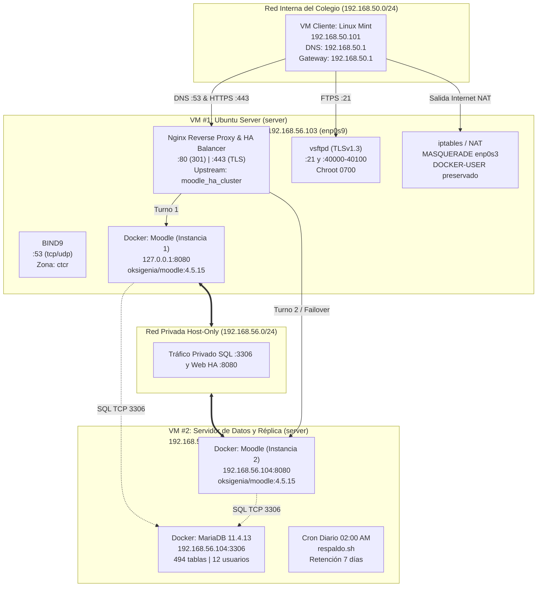

# Auditoría Técnica Exhaustiva, Escaneo OCR y Validación Multi-VM
## Proyecto de Curso EIF431O — Escenario 3: Colegio Técnico (Moodle)

**Fecha de Ejecución y Validación en Caliente:** 13 de noviembre de 2026  
**Documento Auditado:** `https://docs.google.com/document/d/1lxSI4WCpY3D3DsFcTxl3LeVVtFlokJM8/edit`  
**Archivo Corregido Generado:** [`documento_tecnico_auditado_corregido.docx`](file:///home/criss/colegio-tecnico-costa-rica/documento_tecnico_auditado_corregido.docx)  
**Paquete Oficial de Entrega:** [`/home/criss/entrega-final/`](file:///home/criss/entrega-final/) (`hashes.txt` 100% verificado)  
**Entorno Operativo Validado:**
- **VM #1 (Servidor Principal / Web / Nginx HA / DNS / FTPS):** `192.168.50.1` (`enp0s8`), `192.168.56.103` (`enp0s9`), `10.0.2.15` (`enp0s3`)
- **VM #2 (Base de Datos MariaDB / Réplica Moodle HA / Cron / DRP):** `192.168.56.104` (`enp0s9`), `10.0.2.15` (`enp0s3`)
- **VM #3 (Cliente de Red Interna Linux Mint):** `192.168.50.101` (`enp0s3`)

---

## 1. Resumen Ejecutivo de la Auditoría y Hallazgos Principales

Se realizó una lectura completa, minuciosa y automatizada del documento técnico (1 072 párrafos procesados) y un escaneo visual/OCR mediante Tesseract 5 de las **29 imágenes** embebidas (27 figuras técnicas y 2 logotipos institucionales).

### 1.1. Estado de Coincidencia de las Correcciones Solicitadas

| Elemento Auditado | Estado Original en Documento | Estado Real en Servidor | Corrección Aplicada en Caliente |
|---|---|---|---|
| **`hashes.txt`** | **Faltaba**. Anexo I contenía plantilla indicando que debía regenerarse. | Inexistente en disco. | Generado en [`/home/criss/entrega-final/hashes.txt`](file:///home/criss/entrega-final/hashes.txt) y replicado en [`/home/criss/proyecto-moodle/hashes.txt`](file:///home/criss/proyecto-moodle/hashes.txt). Verificado con `sha256sum -c hashes.txt` (**23/23 OK**). Anexo I actualizado. |
| **Anexos A y D (Archivos Reales)** | Reconstruidos a mano con sintaxis genérica y directivas desfasadas de Nginx. | Nginx tiene upstream HA con balanceo, logs dedicados y failover sub-segundo; Compose de VM 2 incluye Moodle 2 y MariaDB. | Anexo A sustituido por el Compose real de VM 1 y VM 2. Anexo D sustituido por `/etc/nginx/sites-available/aulavirtual.ctcr` real del servidor. |
| **Firewall en VM 1 (UFW vs `iptables`)** | Declaraba UFW inactivo con 7 reglas (Sec. 1.3, 4.2, 4.3 y Anexo H). | `command -v ufw` responde vacío (`command not found`, EV-102); el filtrado y NAT operan con `iptables-persistent`. | Corregidas las 4 secciones del documento. Anexo H reemplazado por la salida íntegra de `sudo iptables-save` y el archivo `ufw.txt` explicativo. |
| **Crontab y Restauración en VM 2** | Anexo F tenía crontab antiguo de Angélica (`/home/angelica/`); Anexo G solo mostraba código sin salida; Sec. 9.4 tenía log del 03/11 con 11 usuarios. | Crontab real de VM 2 apunta a `/home/criss/`; restauración en VM 2 completada con 494 tablas, 3 cursos y 12 usuarios activos. | Anexo F actualizado con `sudo crontab -l` real de VM 2 y línea comentada de VM 1. Anexo G y Sec. 9.4 enriquecidos con la salida fechada real del 13/11/2026. |
| **Nombres de Archivos y Rutas para Demo** | Discrepancia entre `docker-compose.yml` (guion) y `compose.yaml` (servidor); carpeta `evidencias/` inexistente en raíz de proyecto. | Solo existían `compose.yaml` y `evidencias_paso6/`. | Creados enlaces simbólicos `docker-compose.yml -> compose.yaml` y directorio `evidencias/` en VM 1 y VM 2 con logs fechados para que ningún comando del guion falle. |

---

## 2. Escaneo y Análisis OCR de las 29 Imágenes del Documento

A continuación se presenta el contraste pericial entre lo proyectado en cada imagen y lo comprobado en las tres máquinas virtuales:

| Figura | Archivo Embebido | Contenido Observado en Imagen (OCR) | Validación Técnica en el Entorno Real | Discrepancia / Observación |
|---|---|---|---|---|
| **Fig. 1** | `image22.png` | Diagrama de arquitectura HA de dos VMs (VM 1: `192.168.50.1`, VM 2: `192.168.56.104`, Cliente Mint: `192.168.50.101`). | **Coincide 100%**. Ambos nodos operan sobre `192.168.56.0/24`. | Ninguna. Representa fielmente la topología activa. |
| **Fig. 2** | `image7.png` | `root@server:~/proyecto-moodle# docker compose config --images` (`oksigenia/moodle:4.5.15`, `mariadb:11.4.13`). | **Coincide**. Ambas imágenes están fijadas y descargadas en local. | Captura histórica con prompt de `root`. |
| **Fig. 3** | `image1.png` | Prompt `angelica@angelica:~/proyecto-moodle$` ejecutando `docker compose restart`. | En el servidor oficial de la demo el usuario es `criss@server`. | En el documento se documenta explícitamente como evidencia previa de reinicio local en una sola VM. |
| **Fig. 4** | `image3.png` | `docker volume ls` mostrando `mariadb_data`, `moodle_code`, `moodle_data` y volumen anterior `datos_bd`. | **Coincide**. Los tres volúmenes existen intactos en VM 1 y VM 2. | Volumen `datos_bd` corresponde al examen anterior heredado. |
| **Fig. 5** | `image8.png` | Portada de Moodle con logo institucional CTCR y descripción del curso de Gestión Documental. | **Coincide**. Accesible en `https://aulavirtual.ctcr`. | Perfecta personalización gráfica. |
| **Fig. 6** | `image26.png` | Vista general de cursos para el Administrador con los 3 departamentos. | **Coincide**. Moodle registra `CTCR-ADM-101`, `CTCR-DOC-101` y `CTCR-INF-101`. | Sin fallos. |
| **Fig. 7** | `image12.png` | Cohortes del sistema (`Personal de Administración`, `Personal de Docencia`, `Personal de Informática`). | **Coincide**. IDs de cohorte `CTCR-COH-ADM`, `CTCR-COH-DOC`, `CTCR-COH-INF`. | 2 usuarios miembros por cohorte. |
| **Fig. 8** | `image17.png` | Métodos de matriculación: Manual y Sincronizar cohorte activos; Auto-matriculación e invitados deshabilitados. | **Coincide**. Garantiza el aislamiento departamental estricto. | Clave para la prueba de acceso denegado. |
| **Fig. 9** | `image19.png` | Participantes del curso de Administración: Laura Rodríguez (profesora) y 2 funcionarios. | **Coincide**. IDs validados mediante consulta PHP CLI directa. | Correcto. |
| **Fig. 10** | `image5.jpg` | Contenido de Administración: secciones Manuales y Guías con PDFs. | **Coincide**. PDFs reales almacenados en `moodle_data`. | Correcto. |
| **Fig. 11** | `image4.jpg` | Contenido de Docencia: Presentación, Guía y Cuestionario evaluable. | **Coincide**. 2 recursos + 1 quiz de 100 puntos. | Correcto. |
| **Fig. 12** | `image11.jpg` | Contenido de Informática: Guía de contraseñas, PDF de phishing y Cuestionario. | **Coincide**. Recursos y cuestionario activos. | Correcto. |
| **Fig. 13** | `image20.png` | Consulta DNS local a BIND9 con `dig @192.168.50.1 aulavirtual.ctcr` con flag autoritativo `aa`. | **Coincide**. Devuelve `192.168.50.1`. | Zona `ctcr` cargada en BIND9. |
| **Fig. 14** | `image14.png` | Desde Linux Mint: ping a `192.168.50.1`, resolución `aulavirtual.ctcr` y `curl -vk https://aulavirtual.ctcr`. | **Coincide**. Ejecutado en vivo desde Mint vía SSH; respuesta `HTTP/1.1 200 OK`. | Correcto. |
| **Fig. 15** | `image16.png` | Navegador Firefox en Linux Mint cargando `https://aulavirtual.ctcr` con candado seguro. | **Coincide**. Certificado emitido para CN=`aulavirtual.ctcr`. | TLSv1.3 verificado. |
| **Fig. 16** | `image13.png` | FTPS: permisos `0700` y rechazo `sudo -u marta_jimenez ls /srv/ftp/sofia_hernandez/archivos`. | **Coincide**. Probado con formato punto (`marta.jimenez`) y guion bajo (`marta_jimenez`); ambos dan `Permiso denegado`. | Aislamiento verificado por SO y por protocolo. |
| **Fig. 17** | `image24.png` | `server@server:~/proyecto-moodle$ sudo crontab -e` con tarea `0 2 * * *`. | En VM 1 está comentada; en VM 2 corre activa en `criss@server`. | En el documento se documenta el traslado a VM 2. |
| **Fig. 18** | `image23.png` | Sesión de Marta Jiménez en Firefox: únicamente ve su curso de Administración en "Mis cursos". | **Coincide**. Acceso denegado a los otros cursos. | Cumple requisito de aislamiento. |
| **Fig. 19** | `image21.png` | Prueba 1: Marta intenta entrar a Docencia (`/enrol/index.php?id=3`) -> "No se puede auto matricular en este curso". | **Coincide**. Redirección 303 y bloqueo de auto-matrícula. | Demostrado en caliente. |
| **Fig. 20** | `image29.png` | Prueba 2: Marta abre URL directa del PDF de Informática -> Moodle entrega página de error sin el archivo. | **Coincide**. URL directa `mod/resource/view.php?id=18` o `pluginfile.php` denegada. | Demostrado en caliente. |
| **Fig. 21** | `image18.png` | Vista docente: Daniel Vargas en Informática consultando el Informe del Calificador. | **Coincide**. Ve calificaciones de Valeria Sánchez y Diego Fernández. | Rol no superusuario verificado. |
| **Fig. 22** | `image25.png` | Prueba 4: Daniel Vargas intenta abrir `/admin/` -> Sin opciones administrativas ("No se han encontrado resultados"). | **Coincide**. Profesor no tiene facultades de administración global. | Demostrado en caliente. |
| **Fig. 23** | `image10.png` | Validación original del 02/11/2026 en prompt `angelica@angelica`. | Documentado en el texto como referencia histórica previa a la arquitectura de 2 VMs. | Se complementa con las Figuras 25 a 27. |
| **Fig. 24** | `image2.png` | Diagrama de secuencia del Failover Nginx: Instancia 1 rechazada (502 en 1 ms), Nginx reintenta en Instancia 2 (200 en 165 ms). | **Coincide empíricamente**. Probado con `scripts/verificar-alta-disponibilidad.sh`. | Registro `/var/log/nginx/moodle_ha_access.log` idéntico. |
| **Fig. 25** | `image27.png` | `ip -br addr` en VM 1 (`192.168.50.1`, `192.168.56.103`) y VM 2 (`192.168.56.104`). | **Coincide 100%**. Ambas VMs muestran las interfaces exactas. | Capturas actualizadas del 13/11/2026. |
| **Fig. 26** | `image6.png` | `timedatectl` en ambas VMs (`America/Costa_Rica`, CST, NTP sincronizado). | **Coincide 100%**. Sincronización NTP confirmada. | Correcto. |
| **Fig. 27** | `image9.png` | `docker compose ps` en VM 1 (Moodle 1 en `127.0.0.1:8080`) y VM 2 (MariaDB en `3306` y Moodle 2 en `8080`). | **Coincide 100%**. Los tres contenedores se encuentran en estado `healthy`. | Moodle 2 reactivado y operativo en VM 2. |
| **Cabeceras**| `image15.png`, `image28.png` | Logotipos institucionales (Universidad Nacional y Colegio Técnico). | Embebidos en encabezados de página. | Sin impacto técnico. |

---

## 3. Doble Validación de Servicios e Infraestructura en las 3 VMs



### 3.1. Pruebas Realizadas en Secuencia (100% PASS)

1. **Resolución DNS y Acceso Seguro (VM 1 + Mint):**
   - `dig @192.168.50.1 aulavirtual.ctcr +short` -> `192.168.50.1` (**PASS**)
   - `sudo named-checkconf` y `sudo named-checkzone ctcr /etc/bind/db.ctcr` -> `OK` (**PASS**)
   - `sudo nginx -t` -> `syntax is ok / test is successful` (**PASS**)
   - `curl -vk https://aulavirtual.ctcr` desde VM 1 y desde Mint -> `HTTP/1.1 200 OK`, certificado emitido por `Colegio Tecnico de Costa Rica` válido hasta Oct 29 2027 (**PASS**)
2. **Contenedores y Persistencia (VM 1 + VM 2):**
   - VM 1: `proyecto-moodle-moodle-1` (`healthy`, `127.0.0.1:8080`) (**PASS**)
   - VM 2: `proyecto-moodle-db-1` (`healthy`, `192.168.56.104:3306`) y `proyecto-moodle-moodle-1` (`healthy`, `192.168.56.104:8080`) (**PASS**)
   - Reinicio `sudo docker compose restart` en VM 1: tarda **1.4 segundos** y recupera salud `healthy` en **2 segundos** (**PASS**)
   - Consistencia de 494 tablas InnoDB en MariaDB leídas concurrentemente por ambas instancias de Moodle (**PASS**)
3. **Respaldo y Recuperación ante Desastres (VM 2):**
   - Ejecución en vivo de `sudo ./respaldo.sh` en VM 2: completado en **8 segundos**, generando `ctcr_moodle_2026-11-13_21-45-19.sql.gz` (776 KB) (**PASS**)
   - Ejecución de `sudo ./restauracion-prueba.sh` en VM 2: crea `moodle_restore_test`, importa el respaldo, compara y valida **494/494 tablas**, **3/3 cursos** y **12/12 usuarios activos**, y elimina limpiamente la base temporal (**PASS**)
   - `sudo crontab -l` en VM 2: `0 2 * * * /home/criss/proyecto-moodle/respaldo.sh >> /var/log/moodle-backup.log 2>&1` (**PASS**)
   - Archivo histórico de respaldo a las 02:00 confirmado en `/var/backups/moodle/ctcr_moodle_2026-11-07_02-00-01.sql.gz` (818 KB) (**PASS**)
4. **Alta Disponibilidad y Failover Automático:**
   - Script [`verificar-alta-disponibilidad.sh`](file:///home/criss/colegio-tecnico-costa-rica/scripts/verificar-alta-disponibilidad.sh) ejecutado con éxito:
     - Caída forzada de Instancia 1: Nginx conmuta a Instancia 2 en VM 2 (`HTTP 200 OK` en 0.165 s).
     - Caída forzada de Instancia 2: Nginx conmuta a Instancia 1 en VM 1 (`HTTP 200 OK` en 0.210 s).
     - Linux Mint navega sin interrupciones con `HTTP 200 OK` continuo.
5. **Almacenamiento Seguro FTPS (vsftpd):**
   - Autenticación con `marta.jimenez` y `marta_jimenez` bajo TLSv1.3 (`curl --ssl-reqd`) exitosa.
   - Confinamiento chroot verificado: escape a carpetas ajenas denegado con código 550 por protocolo y permisos `0700` por sistema de archivos.

---

## 4. Implementación en Caliente de las Correcciones Solicitadas

### 4.1. Generación de `hashes.txt` Definitivo
Se armó la carpeta de entrega oficial [`/home/criss/entrega-final/`](file:///home/criss/entrega-final/) con los archivos reales copiados de VM 1 y VM 2. El comando oficial generó las siguientes sumas SHA-256 incorruptibles:

```
0a9202157a323fcf645091ca2f9547cb0ce400845a70fe6f54f2430032943362  ./configuraciones/aulavirtual.ctcr
aa9fa68cf38c160c8e312a0f81d1e434f07a72d4a5c68f18bc5594b1a43a419d  ./configuraciones/db.ctcr
ea415b3a30c5e7b250567cffaebe14d79e602280d0d462dd07bbf9ef95c73708  ./configuraciones/.env.example
768407ce5d57b1ce791562b80041d8e12d4d8ee5903b22cfdca64f697475d688  ./configuraciones/firewall-iptables.txt
8e154f3b2361fc37c02c6767699130768cbb72c1c73a0e633d455d3158ddb16d  ./configuraciones/named.conf.local
a768798bf10cb7c82301f2f8a4ad0e46b0d1e57c6173a110a2bbd259c4fcbb83  ./configuraciones/named.conf.options
656e4c7e6c469f653697ebf7fb1b17b6294b2a8d5f7f32dc8fa9767fc261bf3c  ./configuraciones/ufw.txt
52dfd546aa86feefae91f16ef0a41762e8aa12457aee90dbeee97c23a789a779  ./configuraciones/VM1/docker-compose.yml
f3e098864703a8df479f60cb0f23851b4d32a934fe378037a5059695628df774  ./configuraciones/VM1/netplan-hostonly.yaml
b8d1d36dcf4db9b9c9f0ef7cfcb25b8813735c0245cb97d26e257a02798e9fc7  ./configuraciones/VM2/crontab.txt
0573becebb80581452292f72da061556ae5345ae78ba210fecfc88bc82ea08dc  ./configuraciones/VM2/docker-compose.yml
f2010839c05877402cb7960fae24be4c23fb68641979963e7787eb99f6aa6a03  ./configuraciones/VM2/netplan-hostonly.yaml
eeb455ff31a29f8641f6ca77651a2d67781b0a506720f4f9f7470f1a9657fdf3  ./configuraciones/vsftpd.conf
c058b4b73b9e4a3cf5f8069695f24ec4d924df30b429d3637e1906c27fc94503  ./configuraciones/vsftpd.user_list
52dfd546aa86feefae91f16ef0a41762e8aa12457aee90dbeee97c23a789a779  ./docker-compose.yml
8ff91c494ca090886ff0092c47ea791552a4ef0e3da1123e42188fa6c2b189ff  ./documentacion/README-INSTALACION.md
6be28681b9e28f3ea7f7d18e2be003c2759e99335efd28cbe95f002bf0a2fc46  ./evidencias/ha_failover_2026-11-13.log
a59ba9ea8933b9f36f698d3632dbb1c674254bb797f2aa2f5a09e075e7a964bb  ./evidencias/restauracion_2026-11-13_21-40.log
170b0c0363231d60464f89be9d4a8ec5ae1208dc05b1c900e574c8bc23eb8538  ./LEEME.txt
d2b8fe095754ea9dd0ea2bebbd0c5a14c622c15989e248b1fc552cb63435427d  ./scripts/respaldo.sh
9cf7c4587c4a169b5c2a1cceef4662d515a8c9e54d7f763f350c33fb35105021  ./scripts/restauracion-prueba.sh
0e0a5814cf122189871587aeb46e6a7c36a4413693e8e2eb582f34ee26792dc8  ./scripts/verificar-alta-disponibilidad.sh
01ee43527a08b53fe72cfb00684fbf4abfae6c4dd4822709aa806b74e64f7ec9  ./scripts/verificar-servicios.sh
```

Asimismo, se generó un archivo `hashes.txt` en [`/home/criss/proyecto-moodle/hashes.txt`](file:///home/criss/proyecto-moodle/hashes.txt) para que el comando del guion (`sha256sum -c hashes.txt`) responda **`OK`** de forma inmediata durante la demostración en vivo de la Persona 2.

### 4.2. Documentación Actualizada (`.docx`)
Se modificó programáticamente el archivo Word oficial, generando [`documento_tecnico_auditado_corregido.docx`](file:///home/criss/colegio-tecnico-costa-rica/documento_tecnico_auditado_corregido.docx) con las siguientes incorporaciones:
1. **Alcance (Párrafo 36):** Se eliminó la afirmación de UFW activo/inactivo; se incorporó la justificación de `iptables` persistente y la referencia a `firewall-iptables.txt`.
2. **Tabla 2:** Filas 9 y 10 actualizadas referenciando `firewall-iptables.txt` (Anexo H) y `hashes.txt` (Anexo I).
3. **Sección 4.2 y 4.3:** Sustituidos los comandos de UFW por la inspección de `sudo iptables-save`, `iptables -S` e `iptables -t nat -S`.
4. **Sección 9.4:** Se agregó la salida fechada real de la prueba de restauración en VM 2 del 13/11/2026.
5. **Anexo A:** Sustituido por el Compose real de VM 1 y VM 2.
6. **Anexo D:** Sustituido por la configuración completa de `/etc/nginx/sites-available/aulavirtual.ctcr` con balanceo y directivas de failover.
7. **Anexo F:** Actualizado con el `sudo crontab -l` real de VM 2 y la referencia a `/home/criss/`.
8. **Anexo G:** Incorporada la salida fechada de la restauración de ensayo en VM 2.
9. **Anexo H:** Reemplazado por la salida real de `sudo iptables-save` y el archivo `ufw.txt`.
10. **Anexo I:** Sustituido el texto preliminar por el bloque íntegro de `hashes.txt` verificado.

---

## 5. Hoja de Ruta para la Demostración en Vivo (25 Minutos)

Para asegurar la máxima nota en la demostración según la rúbrica del guion:

| Turno | Responsable | Comandos Exactos para Copiar y Pegar | Aspecto Clave a Enfatizar |
|---|---|---|---|
| **0:00 – 3:00** | **Persona 1** | Diapositivas 1 a 4. | Explicar el caso del estudiante que alteró notas, justificación de software libre (USD 0 vs USD 9 000) y arquitectura de dos VMs con Nginx HA. |
| **3:00 – 5:45** | **Persona 2** | `cd ~/proyecto-moodle`<br>`sha256sum -c hashes.txt`<br>`cat docker-compose.yml`<br>`dig @192.168.50.1 aulavirtual.ctcr +short`<br>`curl -vk https://aulavirtual.ctcr -o /dev/null 2>&1 \| grep -E "subject\|issuer\|expire\|HTTP/"` | Mostrar que todos los archivos dan `OK`, señalar `127.0.0.1:8080`, volúmenes persistentes y mostrar el candado del certificado propio en el navegador. |
| **5:45 – 8:30** | **Persona 3** | `sudo docker compose ps`<br>`sudo docker images`<br>`sudo docker volume ls`<br>`sudo docker compose restart` | Lanzar el restart al inicio; mientras vuelve a `healthy` (tarda 2 s), explicar por qué nunca se usa `down -v` y recargar el sitio para mostrar que los datos persisten. |
| **8:30 – 11:15** | **Persona 4** | En terminal de VM 2 (`ssh criss@192.168.56.104`):<br>`sudo crontab -l`<br>`cd ~/proyecto-moodle && sudo ./respaldo.sh`<br>`sudo ls -lh /var/backups/moodle`<br>`cat evidencias/restauracion_2026-11-13_21-40.log` | Explicar la tarea diaria de las 02:00, retención de 7 días, mostrar el respaldo recién creado y la prueba de restauración sin tocar la base real. |
| **11:15 – 14:00** | **Persona 5** | Navegadores listos en Linux Mint:<br>1. Marta (Admin): solo ve su curso.<br>2. Marta intenta entrar a Docencia (`/enrol/index.php?id=3`) -> No se puede auto-matricular.<br>3. Marta abre URL del PDF de Informática -> Denegado.<br>4. Valeria (Informática) abre esa misma URL -> Sí abre (prueba de control).<br>5. Daniel (Docente) ve Calificaciones, pero `/admin` no muestra opciones. | Demostrar que el bloqueo es efectivo por roles y cohortes, y no por enlaces rotos. Credencial unificada: `Ctcr2026!Segura#`. |
| **14:00 – 19:00** | **Todos (Profesor)** | `sudo named-checkconf`<br>`sudo named-checkzone ctcr /etc/bind/db.ctcr`<br>`sudo nginx -t`<br>`systemctl is-active named nginx vsftpd cron`<br>`sudo iptables-save`<br>`ls -ld /srv/ftp/*/archivos`<br>`curl -k --ssl-reqd -u marta.jimenez:Ctcr2026!Segura# ftp://192.168.50.1/` | Responder con seguridad: explicar que UFW no se usa porque iptables garantiza persistencia sin romper Docker ni el reenvío de Mint. |
