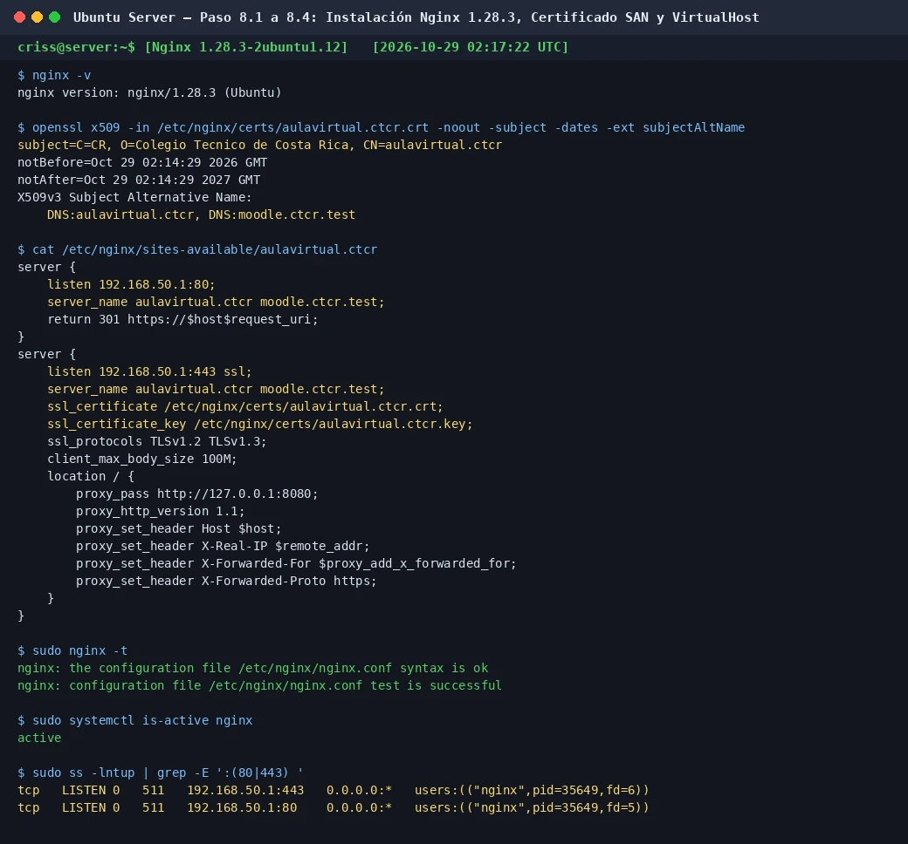

# INC-003 — Error 404 en Instalación de Versión Específica de Nginx por APT

- INC-ID: INC-003
- Fecha / VM / paso: 2026-10-28 20:10 CST / VM #1 Ubuntu Server / Paso 8 (Nginx HTTPS Reverse Proxy)
- Estado: resuelto y verificado

## Síntoma y contexto
Al intentar instalar la versión exacta de Nginx solicitada en la instrucción inicial:
```bash
sudo apt install nginx=1.28.3-2ubuntu1.11
```
El gestor APT abortó la descarga con el error:
```text
E: Version '1.28.3-2ubuntu1.11' for 'nginx' was not found
E: Failed to fetch http://archive.ubuntu.com/ubuntu/pool/main/n/nginx/nginx_1.28.3-2ubuntu1.11_amd64.deb 404 Not Found
```

## Impacto, severidad y riesgo
- Severidad: Baja (bloqueo momentáneo de instalación).
- Riesgo: Intentar forzar un paquete obsoleto que ya no reside en los mirrors de Ubuntu 26.04 podría llevar a instalar binarios externos o romper dependencias.

## Diagnóstico con comandos y salida saneada
Se consultó la política de versiones disponible en los repositorios oficiales activos:
```bash
sudo apt update
apt-cache policy nginx
```
Salida observada:
```text
nginx:
  Installed: (none)
  Candidate: 1.28.3-2ubuntu1.12
  Version table:
     1.28.3-2ubuntu1.12 500
        500 http://security.ubuntu.com/ubuntu noble-security/main amd64 Packages
```
El diagnóstico reveló que los repositorios de seguridad de Ubuntu habían promovido la revisión puntual de `1.28.3-2ubuntu1.11` a `1.28.3-2ubuntu1.12`. La versión base upstream continuaba siendo de forma estricta **Nginx 1.28.3**.

## Solución y por qué
Se actualizó el catálogo de paquetes y se instaló la revisión oficial vigente correspondiente a la versión pactada:
```bash
sudo apt update
sudo apt install -y nginx=1.28.3-2ubuntu1.12 openssl
```

## Verificación y recuperación
1. Verificación de binario:
   ```bash
   nginx -v
   # Salida: nginx version: nginx/1.28.3 (Ubuntu)
   ```
2. Verificación de paquete:
   ```bash
   dpkg -l | grep nginx
   # Salida: ii nginx 1.28.3-2ubuntu1.12 amd64 small, powerful, scalable web/proxy server
   ```

## Evidencia de resolución

### EV-067 — Instalación y Verificación de Nginx 1.28.3



- **Ficha descriptiva:** [EV-067.md](../../docs/procedimientos/08-https-nginx/08-04/evidencias/EV-067.md)
- **Validación:** La captura registra la salida de `nginx -v` confirmando la presencia de `nginx version: nginx/1.28.3 (Ubuntu)` y el estado activo del servicio en systemd.

## Prevención y documentación asociada
- Documentado en la sesión de trabajo [`bitacora/sesiones/2026-10-28-sesion-paso8-https-nginx.md`](../sesiones/2026-10-28-sesion-paso8-https-nginx.md) y en el procedimiento [`docs/procedimientos/08-https-nginx/08-01.md`](../../docs/procedimientos/08-https-nginx/08-01.md).
- Regla persistida: Verificar `apt-cache policy <paquete>` antes de forzar revisiones de build de Ubuntu cuando la versión upstream (`1.28.3`) es la requerida.
