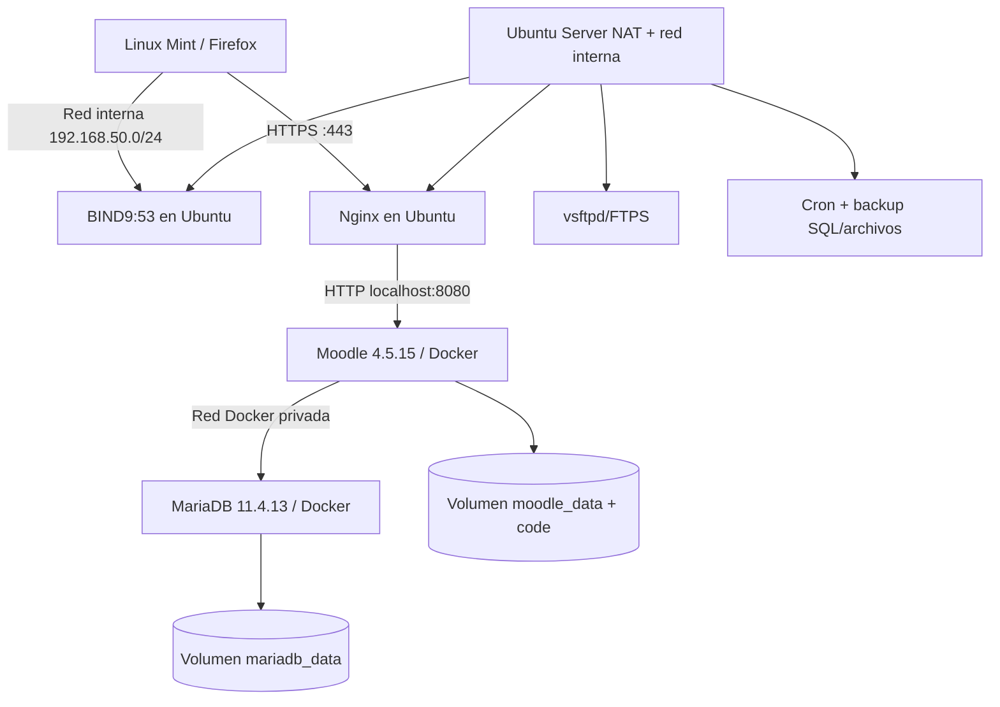

# Escenario, objetivos, alcance y arquitectura

**Equipo académico:** Elevaquitas, cinco integrantes (completar tabla de responsabilidades al validar participación). **Objetivo:** Colegio Técnico con departamentos de Administración, Docencia e Informática, cada uno con contenido Moodle autorizado solo para sus usuarios.

## Requisitos mínimos

- Tres cursos con al menos dos recursos auténticos y una actividad evaluable cada uno.
- Cohortes/matrículas/roles con denegación de acceso directo a recursos ajenos.
- Dos contenedores (Moodle, MariaDB) con imágenes versionadas y volúmenes.
- DNS propio BIND9, HTTPS vía VirtualHost, cuentas FTP aisladas, backup automático y prueba de restauración.
- Informe reproducible y demostración en vivo.

## Topología prevista

> El diagrama es **arquitectura objetivo**. No representa que BIND9/Nginx/FTPS/Cron estén comprobados en la bitácora. El cliente no necesita NAT propio; sí resolución DNS interna para abrir el dominio.

IP observada en la bitácora de una VM: servidor 192.168.50.1 y cliente alrededor de 192.168.50.103. En el chat de otra máquina apareció 192.168.50.102. Registrar la topología de cada integrante antes de imponer IP fija.

## No incluido (salvo decisión posterior)

Alta disponibilidad es bonus opcional, no requisito obligatorio. No añadir Kubernetes, ELK, Prometheus o Portainer mientras comprometan RAM, tiempo o la demo central.
