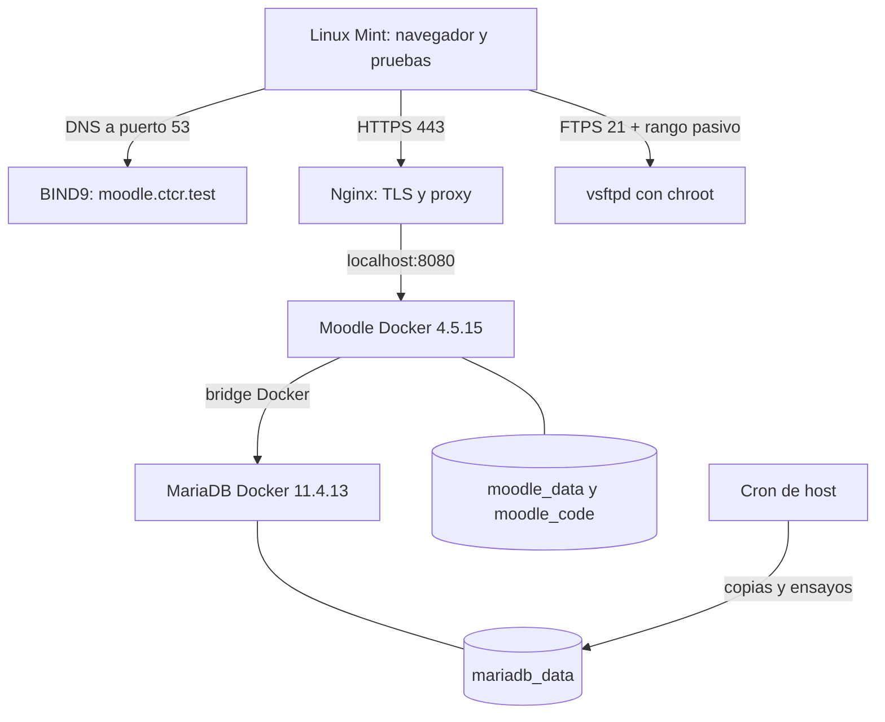

# Contexto del Colegio Técnico — alcance y decisiones oficiales

El grupo Elevaquitas desarrolla el **escenario 3 del proyecto EIF431O** de la Universidad Nacional: una institución educativa con Administración, Docencia e Informática en la misma red, donde la ausencia de controles permitió una alteración de notas. Su solución debe demostrar que Moodle **deniega acceso real a cursos y recursos de otro departamento**, además de montar los servicios de infraestructura solicitados.

## Alcance funcional

Cada departamento dispone de un curso con mínimo **dos recursos auténticos** y **una actividad evaluable**. Las categorías ordenan cursos; las cohortes agrupan usuarios; la sincronización de cohortes matricula en el curso autorizado; los roles delimitan capacidades. Ninguna de estas decisiones sustituye la prueba de una URL de recurso ajeno con usuario de otro departamento.

## Alcance de infraestructura y topología

Linux Mint usa una **red interna VirtualBox** sin NAT propio. Ubuntu Server tiene red interna y NAT para la descarga de paquetes. En Ubuntu corren Docker Compose con Moodle y MariaDB separados; en el host se proyectan BIND9 (DNS), Nginx (VirtualHost HTTPS), vsftpd (FTPS) y Cron (respaldo). El diagrama siguiente es **objetivo**, no constancia de que todos los servicios estén instalados.

## Archivo por archivo: qué informa al equipo

| Documento | Interpretación y dependencia |
|---|---|
| [`ESTADO.md`](ESTADO.md) | Estado respaldado por fuentes al 23/10, separado por subsistema y con evidencia pendiente. Se actualiza solo con pruebas reales. |
| [`matriz-requisitos.md`](matriz-requisitos.md) | Traduce enunciado a identificador RC/RE/RA, prueba y estado. Es el criterio de cierre objetivo, no una lista decorativa. |
| [`versiones.md`](versiones.md) | Separa versiones acordadas de versiones verificadas y de digest real en una VM. Evita que las cinco máquinas diverjan silenciosamente. |
| [`responsabilidades.md`](responsabilidades.md) | Distingue responsable documental, revisor y participación conjunta. No atribuye funciones inventadas a integrantes. |
| [`COBERTURA-Y-TRAZABILIDAD.md`](COBERTURA-Y-TRAZABILIDAD.md) | Muestra cómo los procedimientos y fotografías históricas apoyan —o todavía no prueban— requisitos oficiales. |
| [`INVENTARIO-DE-ARTEFACTOS.md`](INVENTARIO-DE-ARTEFACTOS.md) | Guía de archivos, roles y rutas de trabajo, con explicación de cuándo editar configuraciones vs registros. |

[Auditoría documental y limitaciones de v3](AUDITORIA-CALIDAD-V3.md): qué se corrigió, qué se verificó y qué todavía debe probar el equipo.

## Fuentes y responsabilidad documental

- **Oficial:** `Proyecto_Curso_EIF431O.pdf` (suministrado por el curso; almacenado fuera del repositorio para evitar datos innecesarios).
- **Histórico del equipo:** bitácora de 26 páginas, cuyos extractos saneados se conservan en los pasos del manual.
- **Guía de conversación:** [`GUIA-HISTORICA-INTEGRA.md`](../fuentes/GUIA-HISTORICA-INTEGRA.md), procedencia de comandos originales; no confundir con configuración ya probada.
- **Investigación auxiliar:** [`auditoria-dockerlabs.md`](../fuentes/auditoria-dockerlabs.md), que separa ejercicios antiguos de recetas aplicables.

## Qué NO se afirma

No se ha demostrado todavía una matriz 3×3 de accesos, BIND9, HTTPS, FTPS ni restauración completos por VM. El bonus de alta disponibilidad es opcional; no introducirlo antes de cerrar requisitos. Volver al [manual ejecutable](../procedimientos/README.md) para ejecutar paso a paso.
