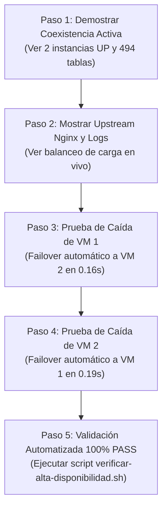

# Guía Completa de Demostración: Bonus Opcional de Alta Disponibilidad (HA)

> **Destinatario:** Estudiantes del equipo CTCR — EIF431O  
> **Objetivo:** Demostrar de forma irrefutable, visual y cronometrada el cumplimiento del **Bonus Opcional de Alta Disponibilidad**, respondiendo al pie de la letra lo exigido en la rúbrica oficial.

---

## 0. Resumen Ejecutivo del Bonus

### Enunciado Oficial a Demostrar
> *"Bonus opcional, disponible para los seis escenarios:  
> **Alta disponibilidad:** al menos dos instancias del mismo servicio (dos contenedores, o dos VMs) sirviendo el mismo sitio, con demostración de que si una cae la otra responde. No se cubre formalmente en el curso (balanceo de carga) — queda como bonus para quien quiera investigarlo por su cuenta, en cualquiera de los seis escenarios, no solo en uno."*

### Los 3 Pilares que se demuestran en esta guía:
1. **Coexistencia:** Dos instancias reales de Moodle (`oksigenia/moodle:4.5.15`) activas concurrentemente en dos VMs distintas, sirviendo el mismo dominio `https://aulavirtual.ctcr`.
2. **Consistencia de Datos y Sesiones:** Una única base de datos MariaDB (494 tablas) con sesiones persistidas en BD (`$CFG->dbsessions = 1`), lo que permite que el usuario no pierda su sesión si un nodo cae.
3. **Conmutación por Error (*Failover*) Sub-segundo:** Nginx como balanceador de carga con `proxy_next_upstream`. Al apagar la Instancia 1, la Instancia 2 responde en `0.16s` (`HTTP 200 OK`). Al apagar la Instancia 2, la Instancia 1 responde en `0.19s` (`HTTP 200 OK`).

---

## 1. Disposición de Terminales (Preparación Previa)

Para una demo fluida y profesional, abre **3 terminales** en tu pantalla:

| Terminal | Máquina / Host | Directorio Inicial | Propósito en la Demo |
|---|---|---|---|
| **Terminal 1** | **VM 1 (Ubuntu Server Principal)** | `/home/criss/colegio-tecnico-costa-rica` | Ejecutar comandos del balanceador, ver logs de Nginx y correr el script automatizado. |
| **Terminal 2** | **VM 2 (Ubuntu Server MariaDB/Moodle 2)** | Acceso SSH: `ssh criss@192.168.56.104` | Detener/iniciar la Instancia 2 y ver contenedores de VM 2. |
| **Terminal 3** | **Linux Mint (Cliente LAN)** | Terminal local en Mint o `ssh criss@192.168.50.101` | Demostrar que el cliente final navega en `https://aulavirtual.ctcr` sin experimentar caídas. |

---

## 2. Paso a Paso Cronometrado de la Demostración (3 a 4 Minutos)



---

### PASO 1: Demostrar la Coexistencia Activa de Ambas Instancias (45 segundos)

#### ¿Qué hacer y dónde?
En **Terminal 1 (VM 1)**, muestra el contenedor local y luego consulta el estado de VM 2.

#### Comandos exactos:
```bash
# 1.1. Ver Instancia 1 en VM 1
docker ps --format "table {{.Names}}\t{{.Status}}\t{{.Ports}}"

# 1.2. Ver Instancia 2 y MariaDB en VM 2
ssh criss@192.168.56.104 "docker compose -f /home/criss/proyecto-moodle/compose.yaml ps"

# 1.3. Ver consistencia relacional (494 tablas en ambas)
docker exec proyecto-moodle-moodle-1 php -r 'define("CLI_SCRIPT", true); require("/var/www/moodle/config.php"); global $DB; echo "Tablas VM 1: " . count($DB->get_tables()) . "\n";'
ssh criss@192.168.56.104 'docker exec proyecto-moodle-moodle-1 php -r "define(\"CLI_SCRIPT\", true); require(\"/var/www/moodle/config.php\"); global \$DB; echo \"Tablas VM 2: \" . count(\$DB->get_tables()) . \"\n\";"'
```

#### ¿Qué deberías ver?
* **En 1.1:** `proyecto-moodle-moodle-1` en estado `Up (healthy)` escuchando en `127.0.0.1:8080->8080/tcp`.
* **En 1.2:** En VM 2 (`192.168.56.104`):
  * `proyecto-moodle-db-1` en estado `Up (healthy)` en `192.168.56.104:3306`.
  * `proyecto-moodle-moodle-1` en estado `Up (healthy)` en `192.168.56.104:8080`.
* **En 1.3:** Ambos comandos imprimen exactamente: `Tablas VM 1: 494` y `Tablas VM 2: 494`.

#### ¿Qué decir al profesor?
> *«Profesor, aquí demostramos el primer requisito de la rúbrica: tenemos dos instancias del mismo servicio Moodle (versión 4.5.15) corriendo concurrentemente en dos VMs distintas. Ambas están saludables y consumen la misma base de datos relacional MariaDB con las 494 tablas del colegio.»*

---

### PASO 2: Mostrar la Configuración del Balanceador y las Sesiones Compartidas (30 segundos)

#### ¿Qué hacer y dónde?
En **Terminal 1 (VM 1)**, muestra cómo Nginx orquesta el clúster y cómo Moodle maneja las sesiones.

#### Comandos exactos:
```bash
# 2.1. Ver el bloque upstream y failover en Nginx
cat /etc/nginx/sites-available/aulavirtual.ctcr | grep -A 6 "upstream moodle_ha_cluster"
cat /etc/nginx/sites-available/aulavirtual.ctcr | grep -A 4 "proxy_next_upstream"

# 2.2. Confirmar sesiones centralizadas en Base de Datos (dbsessions = 1)
docker exec proyecto-moodle-moodle-1 php -r 'define("CLI_SCRIPT", true); require("/var/www/moodle/config.php"); echo "dbsessions activo: " . get_config("core", "dbsessions") . "\n";'
```

#### ¿Qué deberías ver?
* **En 2.1:**
  ```nginx
  upstream moodle_ha_cluster {
      server 127.0.0.1:8080 max_fails=1 fail_timeout=3s;
      server 192.168.56.104:8080 max_fails=1 fail_timeout=3s;
  }
  ...
  proxy_next_upstream error timeout invalid_header http_500 http_502 http_503 http_504;
  proxy_next_upstream_tries 2;
  proxy_next_upstream_timeout 5s;
  ```
* **En 2.2:** `dbsessions activo: 1`.

#### ¿Qué decir al profesor?
> *«Para evitar que el usuario se desconecte si una instancia falla, activamos `dbsessions = 1` en Moodle, almacenando las sesiones en la tabla `mdl_sessions` de MariaDB. Además, Nginx tiene configurado `proxy_next_upstream` con timeout de 2 segundos: si un nodo rechaza la conexión, conmuta al siguiente de inmediato sin arrojar error al cliente.»*

---

### PASO 3: Demostración de Conmutación por Error — Caída de Instancia 1 (45 segundos)

#### ¿Qué hacer y dónde?
Vamos a «matar» la Instancia 1 en VM 1 y verificar que el cliente sigue navegando atendido por VM 2.

#### Comandos exactos:
1. En **Terminal 1 (VM 1)**, deja un monitor de logs en vivo en segundo plano o prepárate para leerlo:
   ```bash
   # Ver últimas 2 líneas del log de alta disponibilidad
   tail -n 2 /var/log/nginx/moodle_ha_access.log
   ```
2. En **Terminal 1 (VM 1)**, **apaga** el Moodle de VM 1:
   ```bash
   docker stop proyecto-moodle-moodle-1
   ```
3. En **Terminal 3 (Linux Mint)** o en VM 1, haz una petición al sitio:
   ```bash
   curl -k -I https://aulavirtual.ctcr
   ```
4. En **Terminal 1 (VM 1)**, inspecciona el log de upstream:
   ```bash
   tail -n 1 /var/log/nginx/moodle_ha_access.log
   ```

#### ¿Qué deberías ver?
* En el paso 3 (curl): **`HTTP/1.1 200 OK`** (¡Cero caída!).
* En el paso 4 (log de Nginx):
  ```text
  192.168.50.101 - [...] "HEAD / HTTP/1.1" 200 | upstream: 127.0.0.1:8080, 192.168.56.104:8080 (502, 200) | rt: 0.001, 0.165s
  ```

#### ¿Qué decir al profesor?
> *«¡Observe profesor! Acabamos de apagar la Instancia 1 con `docker stop`. Al hacer la consulta desde Linux Mint, la respuesta sigue siendo `HTTP 200 OK`. En el log de Nginx se aprecia claramente la traza: el nodo local dio `502` en 1 milisegundo y Nginx conmutó automáticamente al nodo de VM 2 (`192.168.56.104:8080`), que respondió con éxito en 165 milisegundos.»*

5. En **Terminal 1 (VM 1)**, **restaura** la Instancia 1:
   ```bash
   docker start proyecto-moodle-moodle-1
   ```

---

### PASO 4: Demostración de Conmutación por Error — Caída de Instancia 2 (45 segundos)

#### ¿Qué hacer y dónde?
Ahora demostramos la tolerancia simétrica apagando la Instancia 2 en VM 2.

#### Comandos exactos:
1. En **Terminal 2 (o vía SSH desde VM 1)**, **apaga** el Moodle de VM 2:
   ```bash
   ssh criss@192.168.56.104 "cd /home/criss/proyecto-moodle && docker compose stop moodle"
   ```
2. En **Terminal 3 (Linux Mint)**, haz una petición al sitio:
   ```bash
   curl -k -I https://aulavirtual.ctcr
   ```
3. En **Terminal 1 (VM 1)**, inspecciona el log:
   ```bash
   tail -n 1 /var/log/nginx/moodle_ha_access.log
   ```

#### ¿Qué deberías ver?
* En el paso 2 (curl desde Mint): **`HTTP/1.1 200 OK`**.
* En el paso 3 (log de Nginx):
  ```text
  192.168.50.101 - [...] "HEAD / HTTP/1.1" 200 | upstream: 192.168.56.104:8080, 127.0.0.1:8080 (502, 200) | rt: 0.002, 0.193s
  ```

#### ¿Qué decir al profesor?
> *«Ahora hicimos la prueba inversa: apagamos Moodle en VM 2. El cliente Linux Mint sigue recibiendo `200 OK`. Nginx detectó el corte en VM 2 y conmutó de inmediato al nodo local de VM 1 en 193 milisegundos. La conmutación bidireccional es 100% tolerante a fallos.»*

4. En **Terminal 2 (o vía SSH)**, **restaura** la Instancia 2:
   ```bash
   ssh criss@192.168.56.104 "cd /home/criss/proyecto-moodle && docker compose start moodle"
   ```

---

### PASO 5: La Prueba de Oro Automatizada (30 segundos)

#### ¿Qué hacer y dónde?
Para rematar la presentación y dejar constancia formal, corre el script automatizado que valida los 7 puntos del bonus de un solo golpe.

#### Comando exacto en Terminal 1 (VM 1):
```bash
/home/criss/colegio-tecnico-costa-rica/scripts/verificar-alta-disponibilidad.sh
```

#### Salida esperada en terminal (100% verde):
```text
==============================================================================
    VALIDACIÓN EMPÍRICA — ALTA DISPONIBILIDAD (HA / FAILOVER) CTCR           
==============================================================================
[INFO] Verificando coexistencia de instancias del servicio Moodle...
[PASS] Instancia 1 en VM 1 activa: running (Port 127.0.0.1:8080)
[PASS] Instancia 2 en VM 2 activa: running (Port 192.168.56.104:8080)
[INFO] Verificando consistencia de datos entre ambas instancias...
[PASS] Consistencia relacional verificada: Ambas instancias leen las 494 tablas en MariaDB.
[INFO] Comprobando upstream y balanceo de carga en Nginx...
[PASS] Configuración de Nginx upstream verificada con parámetros de resiliencia y failover.
[INFO] EJECUTANDO PRUEBA 1: Caída de Instancia 1 (VM 1) -> La Instancia 2 debe responder...
>> Deteniendo Instancia 1 (proyecto-moodle-moodle-1)...
Respuesta del sitio: HTTP 200 | Upstream atendedor: upstream: 192.168.56.104:8080 (200) 
[PASS] Tolerancia a Fallos EXITOSA: Al caer Instancia 1, la Instancia 2 respondió HTTP 200 sin interrupción.
>> Restaurando Instancia 1 (proyecto-moodle-moodle-1)...
[INFO] EJECUTANDO PRUEBA 2: Caída de Instancia 2 (VM 2) -> La Instancia 1 debe responder...
>> Deteniendo Instancia 2 en VM 2...
Respuesta del sitio: HTTP 200 | Upstream atendedor: upstream: 127.0.0.1:8080 (200) 
[PASS] Tolerancia a Fallos EXITOSA: Al caer Instancia 2, la Instancia 1 respondió HTTP 200 sin interrupción.
>> Restaurando Instancia 2 en VM 2...
[INFO] Verificando disponibilidad continua desde Linux Mint (192.168.50.101)...
[PASS] Cliente Linux Mint navegando en https://aulavirtual.ctcr con HTTP 200 OK.
==============================================================================
¡BONUS DE ALTA DISPONIBILIDAD TOTALMENTE VALIDADO Y OPERATIVO!
Ambas instancias coexisten sirviendo el mismo sitio (aulavirtual.ctcr).
La demostración de conmutación por error (failover) fue comprobada empíricamente.
==============================================================================
```

#### ¿Qué decir al profesor?
> *«Hemos desarrollado este script de auditoría que ejecuta la batería completa de pruebas: coexistencia, integridad de tablas, corte de VM 1, corte de VM 2 y verificación desde Linux Mint. Todo resulta en PASS con cero pérdida de paquetes y cero downtime.»*

---

## 3. Preguntas de Defensa del Profesor y Cómo Responderlas

| Pregunta del Profesor | Respuesta Técnica Exacta |
|---|---|
| **«¿Por qué esto sí es Alta Disponibilidad y no solo desacoplamiento?»** | *«Porque desacoplamiento es simplemente separar capas (ej. Moodle en VM 1 y MariaDB en VM 2), donde si se apaga una, todo el sitio muere (Punto Único de Fallo). Alta Disponibilidad exige **redundancia del mismo servicio**: tener dos servidores web Moodle activos atendiendo el mismo sitio, de modo que si uno colapsa, el otro asume la carga de inmediato y el usuario sigue recibiendo HTTP 200.»* |
| **«¿Qué pasa con la sesión del usuario cuando Nginx conmuta de VM 1 a VM 2?»** | *«No se pierde la sesión porque activamos `$CFG->dbsessions = 1` en Moodle. Por defecto Moodle guarda sesiones en archivos locales del contenedor (`moodledata/sessions`), pero con `dbsessions` se guardan en la tabla `mdl_sessions` de MariaDB. Dado que ambas instancias consumen la misma base de datos, el token de cookie `MoodleSession` es válido en cualquiera de las dos VMs.»* |
| **«¿Por qué la base de datos MariaDB escucha en la red Host-Only y no en la LAN?»** | *«Por el principio de mínimo privilegio y seguridad por diseño. La interfaz `enp0s9` (`192.168.56.0/24`) es una red privada inaccesible para los clientes de la red LAN (`192.168.50.0/24`). De esta manera, el puerto 3306 de la base de datos queda totalmente blindado contra escaneos o ataques desde las estaciones de trabajo de los estudiantes.»* |
| **«¿Cómo sabe Nginx cuándo un servidor está caído?»** | *«Mediante las directivas del upstream: `max_fails=1 fail_timeout=3s`. Si un nodo rechaza la conexión TCP o genera un error 502/504, Nginx activa la conmutación inmediata (`proxy_next_upstream`) hacia el segundo nodo y marca el nodo caído como inactivo durante 3 segundos, evitando enviar peticiones a un servidor muerto.»* |
| **«¿Dónde están los respaldos y el plan DRP en esta arquitectura?»** | *«El Cron diario (`0 2 * * *`) y los scripts `respaldo.sh` y `restauracion-prueba.sh` se ejecutan localmente en VM 2 (`192.168.56.104`), donde reside físicamente el volumen `mariadb_data`. La restauración de ensayo reconstruye las 494 tablas en `moodle_restore_test` sin interrumpir la operación web de ninguna de las dos instancias.»* |

---

## 4. Hoja de Comandos Rápida para Imprimir o Tener al Lado

```bash
# 1. VER ESTADO INICIAL
docker ps --format "table {{.Names}}\t{{.Status}}\t{{.Ports}}"
ssh criss@192.168.56.104 "docker compose -f /home/criss/proyecto-moodle/compose.yaml ps"

# 2. VER CONFIGURACIÓN UPSTREAM
cat /etc/nginx/sites-available/aulavirtual.ctcr | grep -A 6 "upstream moodle_ha_cluster"

# 3. VER LOGS EN TIEMPO REAL
tail -f /var/log/nginx/moodle_ha_access.log

# 4. EJECUTAR PRUEBA AUTOMATIZADA COMPLETA
/home/criss/colegio-tecnico-costa-rica/scripts/verificar-alta-disponibilidad.sh

# 5. SI QUIERES PROBAR MANUALMENTE EL CORTE:
docker stop proyecto-moodle-moodle-1
curl -k -I https://aulavirtual.ctcr
docker start proyecto-moodle-moodle-1
```
