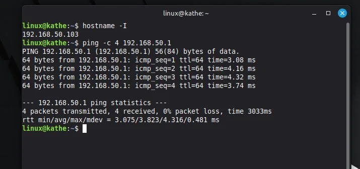

# PASO 01.01 — Topología NAT e interna y verificación entre Ubuntu y Mint

> Procedimiento complementario para reconstruir fases anteriores no explicadas íntegramente en el texto pegado. No sustituye verificación en cada VM.

En Ubuntu Server:

```bash
ip -br address
ip route
ping -c 4 192.168.50.102
```

En Linux Mint:

```bash
ip -br address
ip route
ping -c 4 192.168.50.1
```

Los valores de ejemplo corresponden a una VM documentada. En otra VM adaptar IPs. El ping entre ambas demuestra conectividad IP, no prueba DNS, HTTPS ni autorizaciones.

## Capturas existentes



*EV-001: Mint: ping hacia Ubuntu Server, página 2.*


*EV-002: Ubuntu: ping hacia Mint, página 2.*

## Registro de la sesión

- Ejecutó: __
- VM: __
- Resultado observado: __
- Nueva evidencia: __
- Incidencia: __
