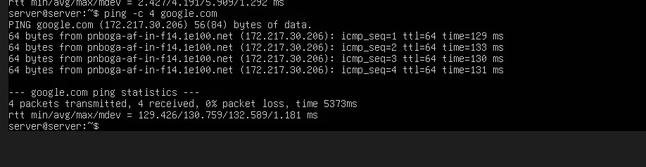

# PASO 01.01 — Topología NAT e interna y verificación entre Ubuntu y Mint

## Archivos relacionados y por qué importan

- **[`docs/00-proyecto/README.md`](../../00-proyecto/README.md)**: arquitectura de VirtualBox, IPs y dependencias entre Mint y Ubuntu.
- **[`bitacora/incidentes/INC-001-almacenamiento-lvm.md`](../../../bitacora/incidentes/INC-001-almacenamiento-lvm.md)**: incidente real del disco lleno: diagnóstico y alcance específico de una VM.

**Lugar de ejecución:** Linux Mint, salvo las comprobaciones indicadas expresamente para Ubuntu. Confirmar direcciones reales y el estado actual de la VM antes de copiar comandos.

## Propósito del paso y contexto operacional

VirtualBox, direccionamiento, ping y diagnóstico LVM: primero confirmar que servidor y cliente están en la red correcta.

Este archivo corresponde **exclusivamente al paso 01-01**, con comandos históricos literales y mejoras razonadas. En una **VM ya configurada** se inspeccionan primero los servicios y datos; no se vuelven a crear credenciales ni volúmenes. Los resultados observados en las capturas pertenecen a la sesión que los originó, no al conjunto de cinco integrantes.

## Comprobación recomendada y salida a documentar

Ejecutar `ip -br a`, `ip route`, `ping -c 4 192.168.50.1` desde Mint y `ping -c 4 <IP_MINT>` desde Ubuntu; anotar pérdida y IP sin atribuirlo a todas las VMs.

Registrar el resultado exacto, fecha, sistema y si la prueba pasó o falló. Para un cambio de configuración conservar el archivo anterior y ejecutar la validación sintáctica antes de reiniciar el servicio. La **ruta versionable recomendada** está explicada en [`infra/`](../../../infra/README.md), sin sustituir los comandos originales que aparecen abajo.

> Procedimiento complementario para reconstruir fases anteriores no explicadas íntegramente en el texto pegado. No sustituye verificación en cada VM.

En Ubuntu Server:

```bash
ip -br address
ip route
ping -c 4 192.168.50.102
```

En Linux Mint:

```bash
ip -br address
ip route
ping -c 4 192.168.50.1
```

Los valores de ejemplo corresponden a una VM documentada. En otra VM adaptar IPs. El ping entre ambas demuestra conectividad IP, no prueba DNS, HTTPS ni autorizaciones.

## Evidencias de este paso — registro local y contextualizado

Estas imágenes proceden de la bitácora del equipo y están **almacenadas físicamente junto al procedimiento**, no en una galería sin contexto. Se muestran con sus límites probatorios y una ficha independiente.

### EV-001 · Mint: ping hacia Ubuntu Server


**Qué se observa:** La terminal de Linux Mint recibe respuestas ICMP de la IP interna de Ubuntu; evidencia una ruta de red en esa VM.

**Qué queda sin probar:** No certifica el resultado en las cinco VMs ni el cumplimiento del resto de requisitos.

**Procedencia:** bitácora actualizada, página 2. **Ficha de evidencia:** [EV-001](01-01/evidencias/EV-001.md). **Privacidad:** revisión pendiente antes de publicar.

### EV-002 · Ubuntu: ping hacia Mint


**Qué se observa:** Ubuntu recibe respuestas ICMP desde Linux Mint; se observa comunicación de retorno en la red de laboratorio.

**Qué queda sin probar:** No certifica el resultado en las cinco VMs ni el cumplimiento del resto de requisitos.

**Procedencia:** bitácora actualizada, página 2. **Ficha de evidencia:** [EV-002](01-01/evidencias/EV-002.md). **Privacidad:** revisión pendiente antes de publicar.

### EV-003 · Ubuntu: conectividad exterior



**Qué se observa:** Ubuntu muestra respuestas de un nombre público; es evidencia puntual de conectividad/resolución saliente.

**Qué queda sin probar:** No certifica el resultado en las cinco VMs ni el cumplimiento del resto de requisitos.

**Procedencia:** bitácora actualizada, página 3. **Ficha de evidencia:** [EV-003](01-01/evidencias/EV-003.md). **Privacidad:** revisión pendiente antes de publicar.

> El estado de una captura no sustituye una comprobación en cada máquina. El criterio de aceptación está en la sección de verificación y en la [matriz de requisitos](../../00-proyecto/matriz-requisitos.md).

## Registro de la sesión

- Ejecutó: __
- VM: __
- Resultado observado: __
- Nueva evidencia: __
- Incidencia: __
