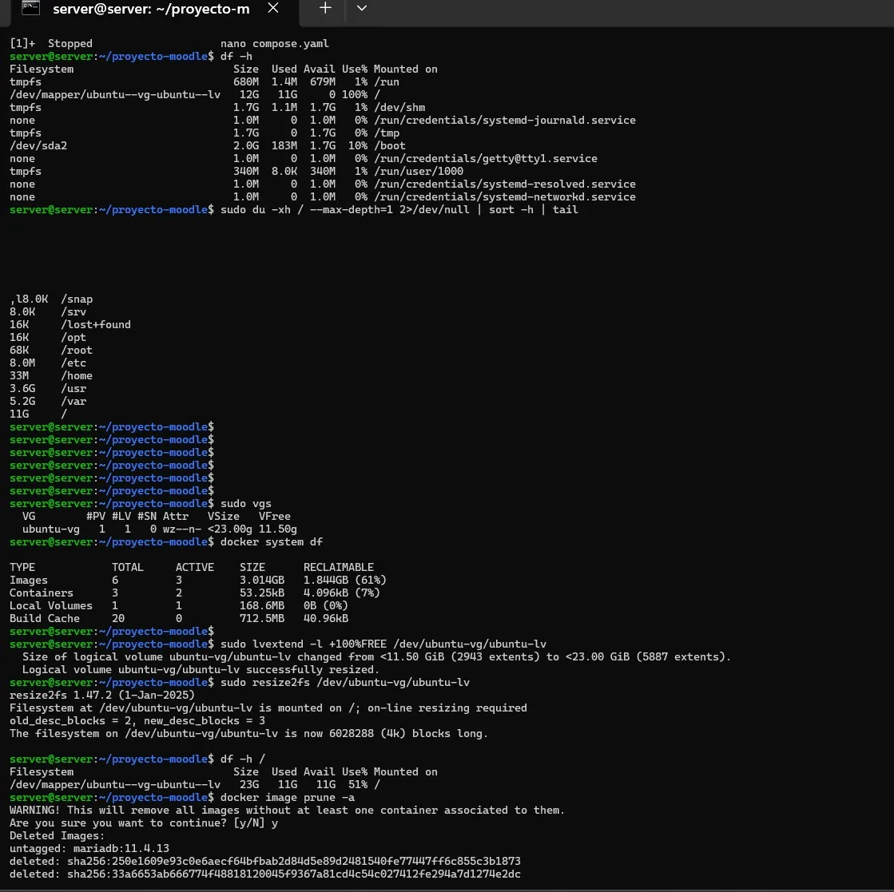

# PASO 01.02 — Estado de discos, LVM y recuperación del incidente histórico

## Archivos relacionados y por qué importan

- **[`docs/00-proyecto/README.md`](../../00-proyecto/README.md)**: arquitectura de VirtualBox, IPs y dependencias entre Mint y Ubuntu.
- **[`bitacora/incidentes/INC-001-almacenamiento-lvm.md`](../../../bitacora/incidentes/INC-001-almacenamiento-lvm.md)**: incidente real del disco lleno: diagnóstico y alcance específico de una VM.

**Lugar de ejecución:** terminal de Ubuntu Server (no la terminal del host Windows ni del contenedor, salvo cuando el comando sea `docker compose exec`). Confirmar direcciones reales y el estado actual de la VM antes de copiar comandos.

## Propósito del paso y contexto operacional

VirtualBox, direccionamiento, ping y diagnóstico LVM: primero confirmar que servidor y cliente están en la red correcta.

Este archivo corresponde **exclusivamente al paso 01-02**, con comandos históricos literales y mejoras razonadas. En una **VM ya configurada** se inspeccionan primero los servicios y datos; no se vuelven a crear credenciales ni volúmenes. Los resultados observados en las capturas pertenecen a la sesión que los originó, no al conjunto de cinco integrantes.

## Comprobación recomendada y salida a documentar

Ejecutar `ip -br a`, `ip route`, `ping -c 4 192.168.50.1` desde Mint y `ping -c 4 <IP_MINT>` desde Ubuntu; anotar pérdida y IP sin atribuirlo a todas las VMs.

Registrar el resultado exacto, fecha, sistema y si la prueba pasó o falló. Para un cambio de configuración conservar el archivo anterior y ejecutar la validación sintáctica antes de reiniciar el servicio. La **ruta versionable recomendada** está explicada en [`infra/`](../../../infra/README.md), sin sustituir los comandos originales que aparecen abajo.

> Procedimiento complementario para reconstruir fases anteriores no explicadas íntegramente en el texto pegado. No sustituye verificación en cada VM.

Inspección de **solo lectura**:

```bash
df -hT
lsblk -f
sudo pvs
sudo vgs
sudo lvs
sudo du -h --max-depth=1 /var/lib/docker 2>/dev/null | sort -h | tail -15
sudo docker system df
```

**INC-001** se resolvió expandiendo un volumen LVM y el sistema de archivos, después de encontrar espacio libre en el VG. No copiar indiscriminadamente `lvextend`, `resize2fs` ni `docker image prune -a`: dependen del diseño de la VM y pueden producir pérdida de datos. Confirmar primero nombre exacto de LV, tipo de filesystem y respaldo/snapshot.

## Evidencias de este paso — registro local y contextualizado

Estas imágenes proceden de la bitácora del equipo y están **almacenadas físicamente junto al procedimiento**, no en una galería sin contexto. Se muestran con sus límites probatorios y una ficha independiente.

### EV-050 · Diagnóstico de disco lleno y ampliación LVM



**Qué se observa:** Se observa el diagnóstico de espacio, el estado LVM y comandos ejecutados para ampliar la raíz; corresponde al incidente INC-001.

**Qué queda sin probar:** No autoriza replicar cambios LVM en otra VM: requiere comprobar volumen, filesystem y copia de seguridad del equipo concreto.

**Procedencia:** bitácora actualizada, página 25. **Ficha de evidencia:** [EV-050](01-02/evidencias/EV-050.md). **Privacidad:** revisión pendiente antes de publicar.

> El estado de una captura no sustituye una comprobación en cada máquina. El criterio de aceptación está en la sección de verificación y en la [matriz de requisitos](../../00-proyecto/matriz-requisitos.md).

## Registro de la sesión

- Ejecutó: __
- VM: __
- Resultado observado: __
- Nueva evidencia: __
- Incidencia: __
