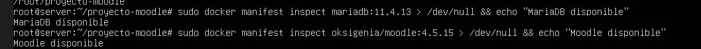

# EV-004 — Etiquetas de las imágenes Docker verificadas

**Procedencia:** bitácora del grupo, versión actualizada de 26 páginas, página **3**. Extracto de una captura histórica: no es una simulación ni una prueba nueva. **Paso relacionado:** [04-02 — PASO 04.02 — Confirmar las versiones de las imágenes](../../04-02.md).

## Qué ocurre en esta captura

La terminal devuelve disponibilidad de las etiquetas solicitadas en el registro de imágenes.

## Interpretación y límite de la evidencia

No certifica que todos los integrantes tengan la misma versión/digest, salud estable o persistencia de datos. Se conserva como **evidencia histórica parcial**, no como prueba de aceptación transversal del laboratorio ni de las cinco instalaciones.

## Reproducir y verificar

Abrir el [procedimiento 04-02](../../04-02.md), identificar la VM y ejecutar la sección de validación sin introducir contraseñas en imágenes públicas. Comparar resultado esperado con resultado real y crear una nueva evidencia si cambia la versión o configuración.

## Identidad, trazabilidad y privacidad

- **Identificador permanente:** `EV-004`.
- **Archivo de imagen:** `EV-004.webp` (WebP).
- **SHA-256 de la imagen incorporada:** `f1ed35d32b090ccf628f796885afab09e50115c5b8c7798459d5683e65f00bb6`.
- **Origen:** `Proyecto_Colegio_Técnico_con_departamentos_separados(1).docx`, página 3.
- **Estado de revisión:** `EXTRAIDA, revisión manual requerida`.
- **Política de privacidad:** Revisar la captura completa, especialmente barras de navegador, terminal y nombres visibles, antes de publicar fuera del grupo.
- **Responsable de captura, fecha exacta, host y revisor:** no determinados inequívocamente por esta imagen; registrar si se cuenta con esa información.

## Para cerrar la evidencia

- [ ] Confirmar que no aparecen contraseñas, tokens ni datos de terceros en zonas legibles.
- [ ] Asociar el registro de sesión y la VM que la generó.
- [ ] Comprobar el resultado esperado en una sesión controlada, si se exige prueba de aceptación.
