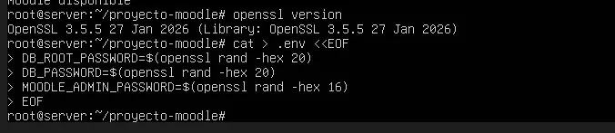
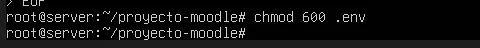

# PASO 04.03 — Generar las contraseñas

> **Naturaleza:** procedimiento reproducible derivado íntegramente de la guía compartida, con correcciones para el repositorio. **No implica que el paso esté verificado en todas las máquinas.**
>
> **Origen:** `docs/fuentes/GUIA-HISTORICA-INTEGRA.md`; capturas reales de la última bitácora cuando existen.

## Antes de ejecutar

- [ ] Identificar VM, interfaz e IP actual; no asumir la IP de otra persona.
- [ ] Inspeccionar el estado actual del servicio. Si hay datos o volúmenes existentes, respaldarlos antes de cambios.
- [ ] Registrar fecha, integrante responsable, revisor y versión vigente en la sesión de bitácora.

## Procedimiento completo y comandos originales

Comprobá que OpenSSL funciona:

```
openssl version
```

Después creá el archivo `.env`:

```
cat > .env <<EOF
DB_ROOT_PASSWORD=$(openssl rand -hex 20)
DB_PASSWORD=$(openssl rand -hex 20)
MOODLE_ADMIN_PASSWORD=$(openssl rand -hex 16)
EOF
```

Protegelo:

```
chmod 600 .env
```

Este archivo contiene las contraseñas iniciales. No debe publicarse en GitHub ni compartirse con otros equipos.

## Correcciones y precauciones aplicables

**No sobrescribir un `.env` existente.** El heredoc de la guía histórica genera nuevas contraseñas y rompería un despliegue ya inicializado. En una máquina nueva usen `scripts/generate-env.sh` tras comprobar que no existe `.env`. Nunca capturen contraseñas en terminal para evidencias. Esta VM ya contiene datos de Moodle: primero inventariar y respaldar.

## Evidencias originales asociadas

**EV-005** — OpenSSL: generación del archivo privado .env (p. 3 de la bitácora):



**EV-006** — Protección de permisos del .env (p. 3 de la bitácora):



## Registro de ejecución del grupo

| Campo | Completar durante la sesión |
|---|---|
| VM / fecha | _Pendiente de registrar_ |
| Quién ejecutó / quién revisó | _Pendiente_ |
| Comandos aplicados / diferencias | _Pendiente_ |
| Resultado observado | _Pendiente de comprobar_ |
| Captura nueva / prueba | _Crear EV nueva sin sobrescribir las históricas_ |
| Incidencia (si ocurre) | _Referenciar `bitacora/incidentes/INC-XXX`_ |

**Aceptación:** adjuntar captura y comando verificable; no cambiar a completado porque el procedimiento figure aquí.
