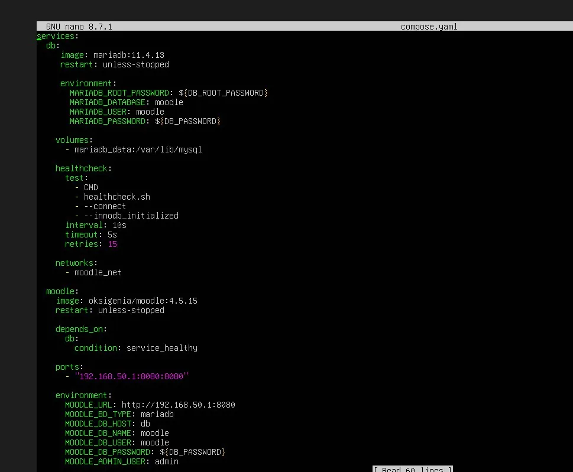
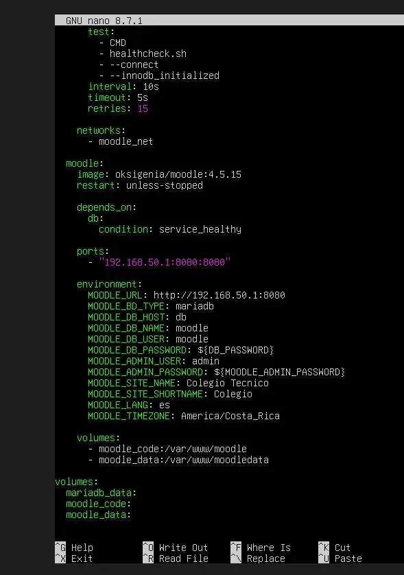

# PASO 04.04 — Crear el archivo Compose

> **Naturaleza:** procedimiento reproducible derivado íntegramente de la guía compartida, con correcciones para el repositorio. **No implica que el paso esté verificado en todas las máquinas.**
>
> **Origen:** `docs/fuentes/GUIA-HISTORICA-INTEGRA.md`; capturas reales de la última bitácora cuando existen.

## Archivos relacionados y por qué importan

- **[`infra/compose/compose.yaml`](../../../infra/compose/compose.yaml)**: definición versionable de Moodle y DB, volúmenes, red interna y puertos; es modelo revisado, no configuración idéntica a la VM.
- **[`infra/compose/.env.example`](../../../infra/compose/.env.example)**: nombres esperados de variables de entorno SIN claves.
- **[`scripts/generate-env.sh`](../../../scripts/generate-env.sh)**: creación inicial de .env privado sin sobrescritura, solo para VM nueva.

**Lugar de ejecución:** terminal de Ubuntu Server (no la terminal del host Windows ni del contenedor, salvo cuando el comando sea `docker compose exec`). Confirmar direcciones reales y el estado actual de la VM antes de copiar comandos.

**Relación con el estado existente:** si el servicio ya está configurado, **no recrearlo por inercia**. Comparar con el archivo realmente activo; modificar solo campos necesarios, con copia, rollback y prueba posterior.

## Propósito del paso y contexto operacional

Moodle y MariaDB mediante Compose: secretos, red privada, volúmenes y salud, conservando los datos entre reinicios.

Este archivo corresponde **exclusivamente al paso 04-04**, con comandos históricos literales y mejoras razonadas. En una **VM ya configurada** se inspeccionan primero los servicios y datos; no se vuelven a crear credenciales ni volúmenes. Los resultados observados en las capturas pertenecen a la sesión que los originó, no al conjunto de cinco integrantes.

## Comprobación recomendada y salida a documentar

En la carpeta de Compose ACTIVA: `sudo docker compose config --quiet`, `sudo docker compose ps`, `sudo docker compose images`, `sudo docker volume ls`; ocultar cualquier secreto en salidas.

Registrar el resultado exacto, fecha, sistema y si la prueba pasó o falló. Para un cambio de configuración conservar el archivo anterior y ejecutar la validación sintáctica antes de reiniciar el servicio. La **ruta versionable recomendada** está explicada en [`infra/`](../../../infra/README.md), sin sustituir los comandos originales que aparecen abajo.

## Antes de ejecutar

- [ ] Identificar VM, interfaz e IP actual; no asumir la IP de otra persona.
- [ ] Inspeccionar el estado actual del servicio. Si hay datos o volúmenes existentes, respaldarlos antes de cambios.
- [ ] Registrar fecha, integrante responsable, revisor y versión vigente en la sesión de bitácora.

## Procedimiento completo y comandos originales

Ejecutá:

```
nano compose.yaml
```

Pegá exactamente:

```
services:
  db:
    image: mariadb:11.4.13
    restart: unless-stopped

    environment:
      MARIADB_ROOT_PASSWORD: ${DB_ROOT_PASSWORD}
      MARIADB_DATABASE: moodle
      MARIADB_USER: moodle
      MARIADB_PASSWORD: ${DB_PASSWORD}

    volumes:
      - mariadb_data:/var/lib/mysql

    healthcheck:
      test:
        - CMD
        - healthcheck.sh
        - --connect
        - --innodb_initialized
      interval: 10s
      timeout: 5s
      retries: 15

    networks:
      - moodle_net

  moodle:
    image: oksigenia/moodle:4.5.15
    restart: unless-stopped

    depends_on:
      db:
        condition: service_healthy

    ports:
      - "192.168.50.1:8080:8080"

    environment:
      MOODLE_URL: http://192.168.50.1:8080
      MOODLE_DB_TYPE: mariadb
      MOODLE_DB_HOST: db
      MOODLE_DB_NAME: moodle
      MOODLE_DB_USER: moodle
      MOODLE_DB_PASSWORD: ${DB_PASSWORD}
      MOODLE_ADMIN_USER: admin
      MOODLE_ADMIN_PASSWORD: ${MOODLE_ADMIN_PASSWORD}
      MOODLE_SITE_NAME: Colegio Tecnico
      MOODLE_SITE_SHORTNAME: Colegio
      MOODLE_LANG: es
      MOODLE_TIMEZONE: America/Costa_Rica

    volumes:
      - moodle_code:/var/www/moodle
      - moodle_data:/var/www/moodledata

    networks:
      - moodle_net

networks:
  moodle_net:
    driver: bridge

volumes:
  mariadb_data:
  moodle_code:
  moodle_data:
```

Guardá con `Ctrl + O`, `Enter`, `Ctrl + X`.

### ¿Qué estamos configurando?

Moodle

Puerto 8080

MariaDB

Puerto 3306 interno

Red Docker moodle_net

Tres volúmenes persistentes

Base de datos, archivos y código de Moodle

El puerto de MariaDB no se publica en la red física; únicamente Moodle se conecta a él mediante Docker.

## Correcciones y precauciones aplicables

La configuración reproducible actual es `infra/compose/compose.yaml` + `.env` privado. Conservar explícitamente el nombre de proyecto `proyecto-moodle` (`-p proyecto-moodle`) si se migra la definición de Compose a otra carpeta; de lo contrario Docker puede crear volúmenes nuevos que parezcan una instalación vacía.

## Evidencias de este paso — registro local y contextualizado

Estas imágenes proceden de la bitácora del equipo y están **almacenadas físicamente junto al procedimiento**, no en una galería sin contexto. Se muestran con sus límites probatorios y una ficha independiente.

### EV-007 · Primer bloque de configuración Compose



**Qué se observa:** Se observa el archivo compose.yaml abierto en un editor; es evidencia de edición, no de sintaxis válida ni de ejecución.

**Qué queda sin probar:** No certifica que todos los integrantes tengan la misma versión/digest, salud estable o persistencia de datos.

**Procedencia:** bitácora actualizada, página 4. **Ficha de evidencia:** [EV-007](04-04/evidencias/EV-007.md). **Privacidad:** revisión pendiente antes de publicar.

### EV-008 · Segundo bloque de configuración Compose



**Qué se observa:** Se observa el archivo compose.yaml abierto en un editor; es evidencia de edición, no de sintaxis válida ni de ejecución.

**Qué queda sin probar:** No certifica que todos los integrantes tengan la misma versión/digest, salud estable o persistencia de datos.

**Procedencia:** bitácora actualizada, página 5. **Ficha de evidencia:** [EV-008](04-04/evidencias/EV-008.md). **Privacidad:** revisión pendiente antes de publicar.

> El estado de una captura no sustituye una comprobación en cada máquina. El criterio de aceptación está en la sección de verificación y en la [matriz de requisitos](../../00-proyecto/matriz-requisitos.md).

## Registro de ejecución del grupo

| Campo | Completar durante la sesión |
|---|---|
| VM / fecha | _Pendiente de registrar_ |
| Quién ejecutó / quién revisó | _Pendiente_ |
| Comandos aplicados / diferencias | _Pendiente_ |
| Resultado observado | _Pendiente de comprobar_ |
| Captura nueva / prueba | _Crear EV nueva sin sobrescribir las históricas_ |
| Incidencia (si ocurre) | _Referenciar `bitacora/incidentes/INC-XXX`_ |

**Aceptación:** adjuntar captura y comando verificable; no cambiar a completado porque el procedimiento figure aquí.
