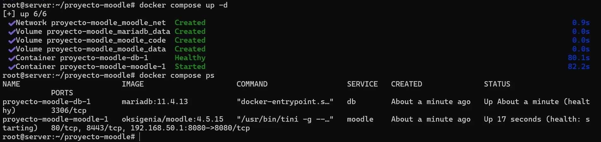
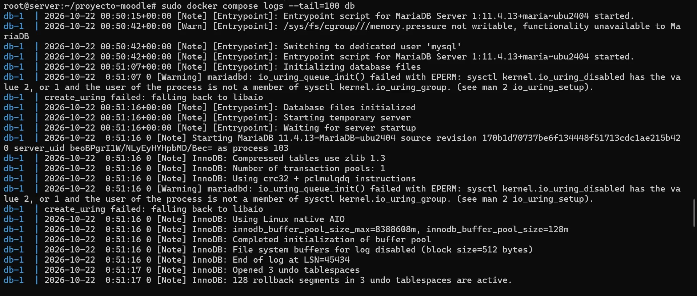
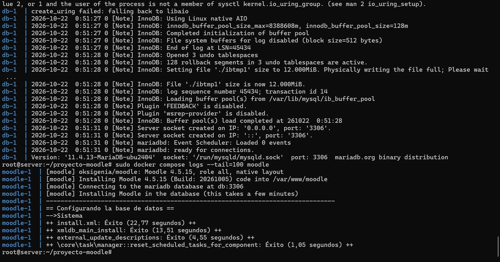

# PASO 04.07 — Levantar los contenedores

> **Naturaleza:** procedimiento reproducible derivado íntegramente de la guía compartida, con correcciones para el repositorio. **No implica que el paso esté verificado en todas las máquinas.**
>
> **Origen:** `docs/fuentes/GUIA-HISTORICA-INTEGRA.md`; capturas reales de la última bitácora cuando existen.

## Antes de ejecutar

- [ ] Identificar VM, interfaz e IP actual; no asumir la IP de otra persona.
- [ ] Inspeccionar el estado actual del servicio. Si hay datos o volúmenes existentes, respaldarlos antes de cambios.
- [ ] Registrar fecha, integrante responsable, revisor y versión vigente en la sesión de bitácora.

## Procedimiento completo y comandos originales

```
sudo docker compose up -d
```

Verificá:

```
sudo docker compose ps
```

Deberían aparecer los servicios `db` y `moodle`.

Si alguno está iniciando o muestra un error, revisá:

```
sudo docker compose logs --tail=100 db
```

```
sudo docker compose logs --tail=100 moodle
```

La primera ejecución de Moodle realiza la instalación inicial y la creación de sus tablas.

## Correcciones y precauciones aplicables

En una instalación con datos, `compose up` no es un paso inocuo si cambió la imagen. Tomar copia y registrar digest antes de recrear. No ejecutar `docker compose down -v`.

## Evidencias originales asociadas

**EV-010** — docker compose up y estado de los servicios (p. 6 de la bitácora):



**EV-011** — Registros iniciales de MariaDB (p. 6 de la bitácora):



**EV-012** — Registros de instalación de Moodle (p. 6 de la bitácora):



## Registro de ejecución del grupo

| Campo | Completar durante la sesión |
|---|---|
| VM / fecha | _Pendiente de registrar_ |
| Quién ejecutó / quién revisó | _Pendiente_ |
| Comandos aplicados / diferencias | _Pendiente_ |
| Resultado observado | _Pendiente de comprobar_ |
| Captura nueva / prueba | _Crear EV nueva sin sobrescribir las históricas_ |
| Incidencia (si ocurre) | _Referenciar `bitacora/incidentes/INC-XXX`_ |

**Aceptación:** adjuntar captura y comando verificable; no cambiar a completado porque el procedimiento figure aquí.
