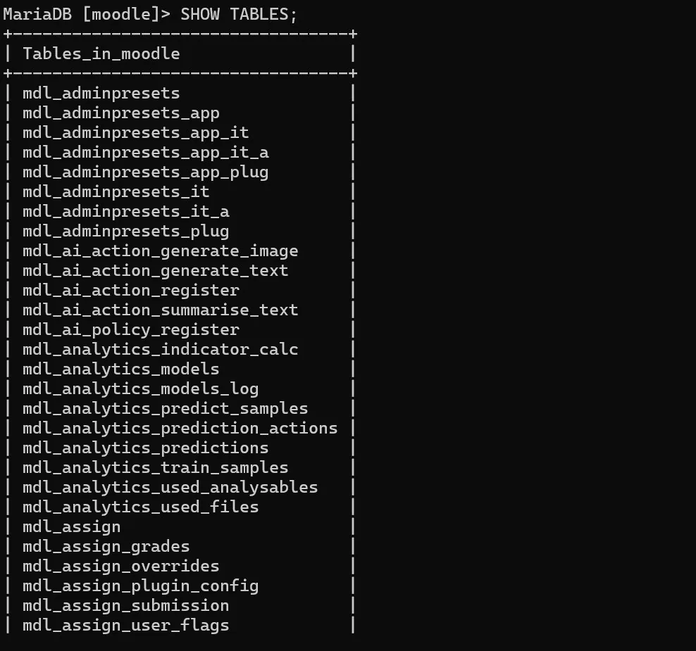

# EV-014 — Consulta SHOW TABLES de Moodle

**Procedencia:** bitácora del grupo, versión actualizada de 26 páginas, página **7**. Extracto de una captura histórica: no es una simulación ni una prueba nueva. **Paso relacionado:** [04-08 — PASO 04.08 — Confirmar la base de datos](../../04-08.md).

## Qué ocurre en esta captura

SHOW TABLES enumera tablas con prefijo mdl_; confirma que existe un esquema Moodle inicializado en esa base.

## Interpretación y límite de la evidencia

No certifica que todos los integrantes tengan la misma versión/digest, salud estable o persistencia de datos. Se conserva como **evidencia histórica parcial**, no como prueba de aceptación transversal del laboratorio ni de las cinco instalaciones.

## Reproducir y verificar

Abrir el [procedimiento 04-08](../../04-08.md), identificar la VM y ejecutar la sección de validación sin introducir contraseñas en imágenes públicas. Comparar resultado esperado con resultado real y crear una nueva evidencia si cambia la versión o configuración.

## Identidad, trazabilidad y privacidad

- **Identificador permanente:** `EV-014`.
- **Archivo de imagen:** `EV-014.webp` (WebP).
- **SHA-256 de la imagen incorporada:** `27ce89d469ca5a30765156e0ad7e41c0d5d518477b6ed5c2811d074f995362cd`.
- **Origen:** `Proyecto_Colegio_Técnico_con_departamentos_separados(1).docx`, página 7.
- **Estado de revisión:** `EXTRAIDA, revisión manual requerida`.
- **Política de privacidad:** Revisar la captura completa, especialmente barras de navegador, terminal y nombres visibles, antes de publicar fuera del grupo.
- **Responsable de captura, fecha exacta, host y revisor:** no determinados inequívocamente por esta imagen; registrar si se cuenta con esa información.

## Para cerrar la evidencia

- [ ] Confirmar que no aparecen contraseñas, tokens ni datos de terceros en zonas legibles.
- [ ] Asociar el registro de sesión y la VM que la generó.
- [ ] Comprobar el resultado esperado en una sesión controlada, si se exige prueba de aceptación.
