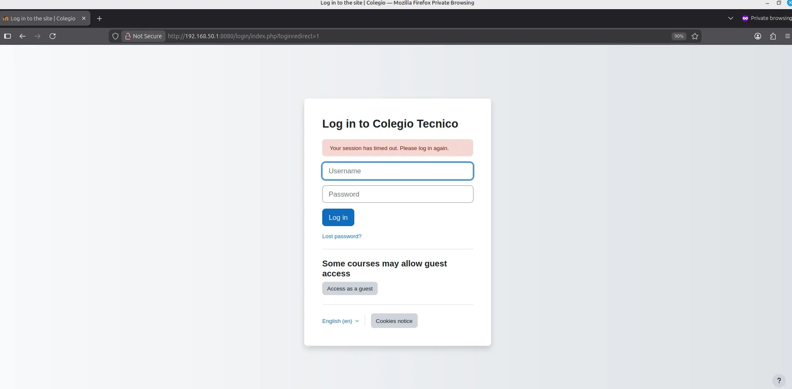

# PASO 05.02 — Abrir Moodle desde Mint

> **Naturaleza:** procedimiento reproducible derivado íntegramente de la guía compartida, con correcciones para el repositorio. **No implica que el paso esté verificado en todas las máquinas.**
>
> **Origen:** `docs/fuentes/GUIA-HISTORICA-INTEGRA.md`; capturas reales de la última bitácora cuando existen.

## Archivos relacionados y por qué importan

- **[`infra/compose/compose.yaml`](../../../infra/compose/compose.yaml)**: puerto de Moodle para la fase HTTP y volúmenes que conservan el estado.
- **[`docs/operacion/REINICIO-Y-RECUPERACION.md`](../../operacion/REINICIO-Y-RECUPERACION.md)**: modo de retomar trabajo tras apagar máquinas sin reinstalar ni eliminar volúmenes.

**Lugar de ejecución:** Linux Mint, salvo las comprobaciones indicadas expresamente para Ubuntu. Confirmar direcciones reales y el estado actual de la VM antes de copiar comandos.

**Relación con el estado existente:** si el servicio ya está configurado, **no recrearlo por inercia**. Comparar con el archivo realmente activo; modificar solo campos necesarios, con copia, rollback y prueba posterior.

## Propósito del paso y contexto operacional

Cliente Linux Mint en red interna: navegación y comprobación de persistencia sin añadir un segundo adaptador NAT.

Este archivo corresponde **exclusivamente al paso 05-02**, con comandos históricos literales y mejoras razonadas. En una **VM ya configurada** se inspeccionan primero los servicios y datos; no se vuelven a crear credenciales ni volúmenes. Los resultados observados en las capturas pertenecen a la sesión que los originó, no al conjunto de cinco integrantes.

## Comprobación recomendada y salida a documentar

Desde Mint abrir la URL de prueba indicada, iniciar sesión y verificar que después de detener/levantar servicios se conservan cursos, archivos y usuarios.

Registrar el resultado exacto, fecha, sistema y si la prueba pasó o falló. Para un cambio de configuración conservar el archivo anterior y ejecutar la validación sintáctica antes de reiniciar el servicio. La **ruta versionable recomendada** está explicada en [`infra/`](../../../infra/README.md), sin sustituir los comandos originales que aparecen abajo.

## Antes de ejecutar

- [ ] Identificar VM, interfaz e IP actual; no asumir la IP de otra persona.
- [ ] Inspeccionar el estado actual del servicio. Si hay datos o volúmenes existentes, respaldarlos antes de cambios.
- [ ] Registrar fecha, integrante responsable, revisor y versión vigente en la sesión de bitácora.

## Procedimiento completo y comandos originales

En la máquina virtual Linux Mint, abrí Firefox y escribí:

```
http://192.168.50.1:8080
```

Debe aparecer Moodle.

[Moodle 4.3 LMS on Ubuntu 22.04 on Azure User Guide | cloudimg](https://images.openai.com/static-rsc-4/tHoAslOw6rXdWTgg7YyKfwL8cTyT4AdWkcq26PbAdxL_I_4RlOVD39DjpVArBsvXiyLlVqG7eGKT8K98p_nVPfc789OQsD-mlHSTYyWaYkMjolgOSuSU8MeLA5UAjZua39rJ12YATd3ItAiUrC0bMH8Xi0aUk9w0Ofe7l17SE50?purpose=inline)

[cloudimg.co.uk](https://www.cloudimg.co.uk/guides/moodle-4-3-12-on-ubuntu-22-04-azure/?utm_source=chatgpt.com)

Iniciá sesión utilizando:

```
Usuario: admin
Contraseña: la generada en MOODLE_ADMIN_PASSWORD
```

Podés consultar la contraseña en Ubuntu:

```
cd ~/proyecto-moodle
grep '^MOODLE_ADMIN_PASSWORD=' .env
```

No incluyás la contraseña en las capturas.

Si Moodle carga desde Mint y podés iniciar sesión, ya están funcionando la red entre las máquinas, el servidor web del contenedor, PHP y la conexión a MariaDB.

## Correcciones y precauciones aplicables

Antes de copiar comandos comprueben si es un servidor nuevo o una VM ya configurada; adaptar rutas, IP, interfaces, nombres y versiones, y guardar evidencia del resultado.

## Evidencias de este paso — registro local y contextualizado

Estas imágenes proceden de la bitácora del equipo y están **almacenadas físicamente junto al procedimiento**, no en una galería sin contexto. Se muestran con sus límites probatorios y una ficha independiente.

### EV-016 · Pantalla inicial de Moodle



**Qué se observa:** Se muestra la pantalla de inicio de sesión Moodle accesible desde el navegador.

**Qué queda sin probar:** No certifica el resultado en las cinco VMs ni el cumplimiento del resto de requisitos.

**Procedencia:** bitácora actualizada, página 8. **Ficha de evidencia:** [EV-016](05-02/evidencias/EV-016.md). **Privacidad:** revisión pendiente antes de publicar.

### EV-017 · Perfil del administrador Moodle


**Qué se observa:** Se observa una pantalla autenticada del perfil administrativo Moodle; los datos privados deben revisarse antes de publicación.

**Qué queda sin probar:** No certifica el resultado en las cinco VMs ni el cumplimiento del resto de requisitos.

**Procedencia:** bitácora actualizada, página 8. **Ficha de evidencia:** [EV-017](05-02/evidencias/EV-017.md). **Privacidad:** revisión pendiente antes de publicar.

> El estado de una captura no sustituye una comprobación en cada máquina. El criterio de aceptación está en la sección de verificación y en la [matriz de requisitos](../../00-proyecto/matriz-requisitos.md).

## Registro de ejecución del grupo

| Campo | Completar durante la sesión |
|---|---|
| VM / fecha | _Pendiente de registrar_ |
| Quién ejecutó / quién revisó | _Pendiente_ |
| Comandos aplicados / diferencias | _Pendiente_ |
| Resultado observado | _Pendiente de comprobar_ |
| Captura nueva / prueba | _Crear EV nueva sin sobrescribir las históricas_ |
| Incidencia (si ocurre) | _Referenciar `bitacora/incidentes/INC-XXX`_ |

**Aceptación:** adjuntar captura y comando verificable; no cambiar a completado porque el procedimiento figure aquí.
