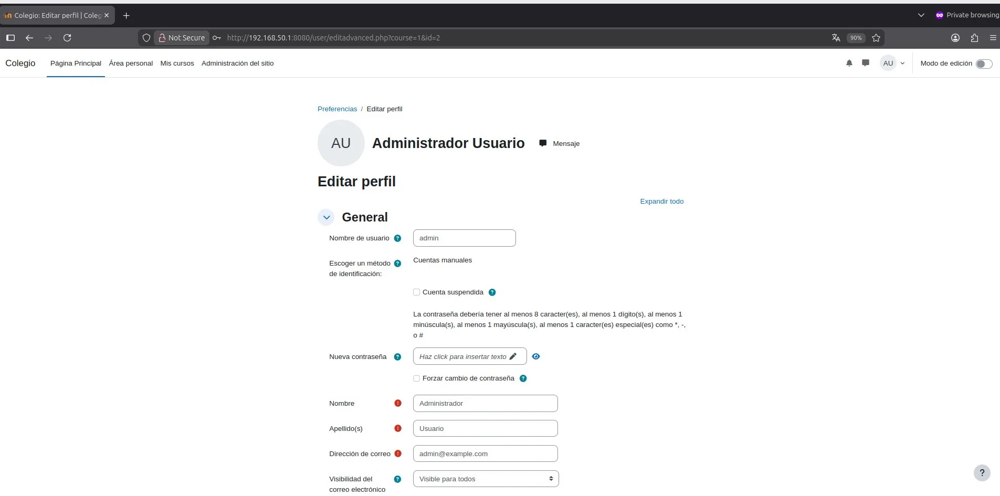

# PASO 05.02 — Abrir Moodle desde Mint

> **Naturaleza:** procedimiento reproducible derivado íntegramente de la guía compartida, con correcciones para el repositorio. **No implica que el paso esté verificado en todas las máquinas.**
>
> **Origen:** `docs/fuentes/GUIA-HISTORICA-INTEGRA.md`; capturas reales de la última bitácora cuando existen.

## Antes de ejecutar

- [ ] Identificar VM, interfaz e IP actual; no asumir la IP de otra persona.
- [ ] Inspeccionar el estado actual del servicio. Si hay datos o volúmenes existentes, respaldarlos antes de cambios.
- [ ] Registrar fecha, integrante responsable, revisor y versión vigente en la sesión de bitácora.

## Procedimiento completo y comandos originales

En la máquina virtual Linux Mint, abrí Firefox y escribí:

```
http://192.168.50.1:8080
```

Debe aparecer Moodle.

[Moodle 4.3 LMS on Ubuntu 22.04 on Azure User Guide | cloudimg](https://images.openai.com/static-rsc-4/tHoAslOw6rXdWTgg7YyKfwL8cTyT4AdWkcq26PbAdxL_I_4RlOVD39DjpVArBsvXiyLlVqG7eGKT8K98p_nVPfc789OQsD-mlHSTYyWaYkMjolgOSuSU8MeLA5UAjZua39rJ12YATd3ItAiUrC0bMH8Xi0aUk9w0Ofe7l17SE50?purpose=inline)

[cloudimg.co.uk](https://www.cloudimg.co.uk/guides/moodle-4-3-12-on-ubuntu-22-04-azure/?utm_source=chatgpt.com)

Iniciá sesión utilizando:

```
Usuario: admin
Contraseña: la generada en MOODLE_ADMIN_PASSWORD
```

Podés consultar la contraseña en Ubuntu:

```
cd ~/proyecto-moodle
grep '^MOODLE_ADMIN_PASSWORD=' .env
```

No incluyás la contraseña en las capturas.

Si Moodle carga desde Mint y podés iniciar sesión, ya están funcionando la red entre las máquinas, el servidor web del contenedor, PHP y la conexión a MariaDB.

## Correcciones y precauciones aplicables

Antes de copiar comandos comprueben si es un servidor nuevo o una VM ya configurada; adaptar rutas, IP, interfaces, nombres y versiones, y guardar evidencia del resultado.

## Evidencias originales asociadas

**EV-016** — Pantalla inicial de Moodle (p. 8 de la bitácora):


**EV-017** — Perfil del administrador Moodle (p. 8 de la bitácora):



## Registro de ejecución del grupo

| Campo | Completar durante la sesión |
|---|---|
| VM / fecha | _Pendiente de registrar_ |
| Quién ejecutó / quién revisó | _Pendiente_ |
| Comandos aplicados / diferencias | _Pendiente_ |
| Resultado observado | _Pendiente de comprobar_ |
| Captura nueva / prueba | _Crear EV nueva sin sobrescribir las históricas_ |
| Incidencia (si ocurre) | _Referenciar `bitacora/incidentes/INC-XXX`_ |

**Aceptación:** adjuntar captura y comando verificable; no cambiar a completado porque el procedimiento figure aquí.
