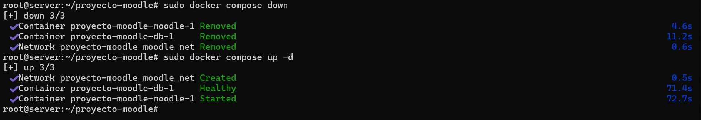

# PASO 05.03 — Probar la persistencia

> **Naturaleza:** procedimiento reproducible derivado íntegramente de la guía compartida, con correcciones para el repositorio. **No implica que el paso esté verificado en todas las máquinas.**
>
> **Origen:** `docs/fuentes/GUIA-HISTORICA-INTEGRA.md`; capturas reales de la última bitácora cuando existen.

## Archivos relacionados y por qué importan

- **[`infra/compose/compose.yaml`](../../../infra/compose/compose.yaml)**: puerto de Moodle para la fase HTTP y volúmenes que conservan el estado.
- **[`docs/operacion/REINICIO-Y-RECUPERACION.md`](../../operacion/REINICIO-Y-RECUPERACION.md)**: modo de retomar trabajo tras apagar máquinas sin reinstalar ni eliminar volúmenes.

**Lugar de ejecución:** terminal de Ubuntu Server (no la terminal del host Windows ni del contenedor, salvo cuando el comando sea `docker compose exec`). Confirmar direcciones reales y el estado actual de la VM antes de copiar comandos.

**Relación con el estado existente:** si el servicio ya está configurado, **no recrearlo por inercia**. Comparar con el archivo realmente activo; modificar solo campos necesarios, con copia, rollback y prueba posterior.

## Propósito del paso y contexto operacional

Cliente Linux Mint en red interna: navegación y comprobación de persistencia sin añadir un segundo adaptador NAT.

Este archivo corresponde **exclusivamente al paso 05-03**, con comandos históricos literales y mejoras razonadas. En una **VM ya configurada** se inspeccionan primero los servicios y datos; no se vuelven a crear credenciales ni volúmenes. Los resultados observados en las capturas pertenecen a la sesión que los originó, no al conjunto de cinco integrantes.

## Comprobación recomendada y salida a documentar

Desde Mint abrir la URL de prueba indicada, iniciar sesión y verificar que después de detener/levantar servicios se conservan cursos, archivos y usuarios.

Registrar el resultado exacto, fecha, sistema y si la prueba pasó o falló. Para un cambio de configuración conservar el archivo anterior y ejecutar la validación sintáctica antes de reiniciar el servicio. La **ruta versionable recomendada** está explicada en [`infra/`](../../../infra/README.md), sin sustituir los comandos originales que aparecen abajo.

## Antes de ejecutar

- [ ] Identificar VM, interfaz e IP actual; no asumir la IP de otra persona.
- [ ] Inspeccionar el estado actual del servicio. Si hay datos o volúmenes existentes, respaldarlos antes de cambios.
- [ ] Registrar fecha, integrante responsable, revisor y versión vigente en la sesión de bitácora.

## Procedimiento completo y comandos originales

En Ubuntu:

```
sudo docker compose down
```

Después:

```
sudo docker compose up -d
```

Volvé a abrir Moodle desde Mint y comprobá que sigue instalada la plataforma con el mismo administrador.

No utilicés `docker compose down -v`, porque eliminaría los volúmenes persistentes.

Evidencia 2: captura de Moodle funcionando desde el navegador de Linux Mint.

# PASO 6. Configurar el Colegio Técnico en Moodle

Esta parte se realiza desde Firefox en Linux Mint, iniciando sesión como administrador de Moodle.

No necesitamos programar una aplicación. Todas estas opciones se administran desde la interfaz de Moodle.

## Correcciones y precauciones aplicables

Antes de recrear contenedores registrar nombre del proyecto, listado de volúmenes y contenido persistente. `down` sin `-v` normalmente conserva volúmenes, pero la prueba completa requiere verificar recursos y archivos tras reiniciar, no solamente el acceso al administrador.

## Evidencias de este paso — registro local y contextualizado

Estas imágenes proceden de la bitácora del equipo y están **almacenadas físicamente junto al procedimiento**, no en una galería sin contexto. Se muestran con sus límites probatorios y una ficha independiente.

### EV-018 · Recreación de contenedores para comprobar persistencia



**Qué se observa:** Se observa la bajada y subida de servicios Docker; acredita ejecución de la maniobra de recreación.

**Qué queda sin probar:** No prueba por sí sola que después de reiniciar siguen los recursos cargados y la base íntegra; requiere una comprobación funcional adicional.

**Procedencia:** bitácora actualizada, página 8. **Ficha de evidencia:** [EV-018](05-03/evidencias/EV-018.md). **Privacidad:** revisión pendiente antes de publicar.

> El estado de una captura no sustituye una comprobación en cada máquina. El criterio de aceptación está en la sección de verificación y en la [matriz de requisitos](../../00-proyecto/matriz-requisitos.md).

## Registro de ejecución del grupo

| Campo | Completar durante la sesión |
|---|---|
| VM / fecha | _Pendiente de registrar_ |
| Quién ejecutó / quién revisó | _Pendiente_ |
| Comandos aplicados / diferencias | _Pendiente_ |
| Resultado observado | _Pendiente de comprobar_ |
| Captura nueva / prueba | _Crear EV nueva sin sobrescribir las históricas_ |
| Incidencia (si ocurre) | _Referenciar `bitacora/incidentes/INC-XXX`_ |

**Aceptación:** adjuntar captura y comando verificable; no cambiar a completado porque el procedimiento figure aquí.
