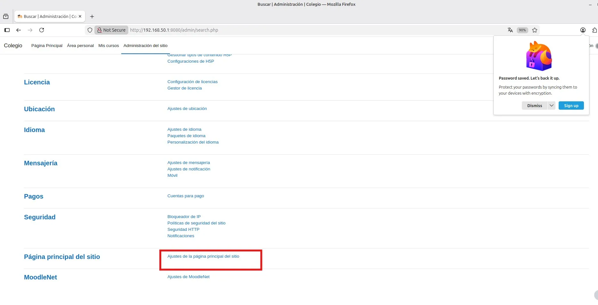
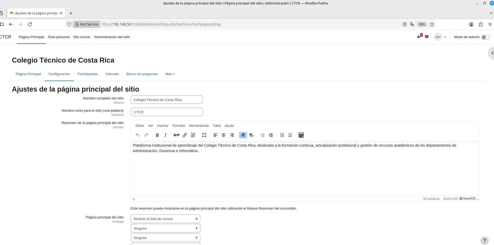
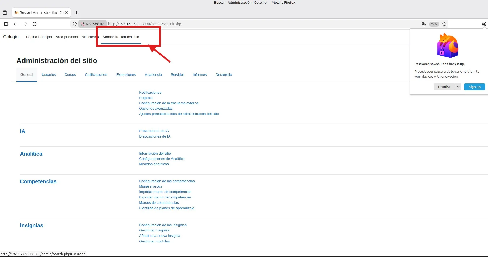
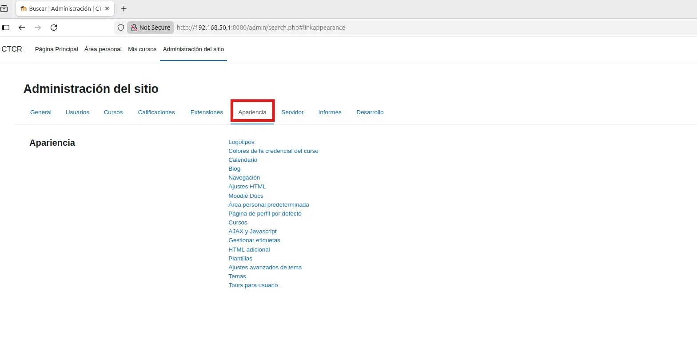

# PASO 06.01 — Personalizar la plataforma

> **Naturaleza:** procedimiento reproducible derivado íntegramente de la guía compartida, con correcciones para el repositorio. **No implica que el paso esté verificado en todas las máquinas.**
>
> **Origen:** `docs/fuentes/GUIA-HISTORICA-INTEGRA.md`; capturas reales de la última bitácora cuando existen.

## Antes de ejecutar

- [ ] Identificar VM, interfaz e IP actual; no asumir la IP de otra persona.
- [ ] Inspeccionar el estado actual del servicio. Si hay datos o volúmenes existentes, respaldarlos antes de cambios.
- [ ] Registrar fecha, integrante responsable, revisor y versión vigente en la sesión de bitácora.

## Procedimiento completo y comandos originales

Ingresá a:

Administración del sitio → Página principal → Ajustes de la página principal.

Configurá:

- Nombre completo: `Colegio Técnico`
- Nombre corto: `Colegio`
- Descripción: `Plataforma institucional de aprendizaje y gestión de recursos departamentales.`

Después, en la configuración de apariencia del sitio, personalizá el tema disponible, los colores y el logotipo.

Podés utilizar un logo propio que identifique al colegio ficticio del escenario.

## Correcciones y precauciones aplicables

La portada puede mostrar diferentes nombres de institución en la bitácora. Usar el nombre final acordado y documentar la personalización real, no asumir que todas las capturas son del mismo instante.

## Evidencias originales asociadas

**EV-019** — Ajustes de la portada de Moodle (p. 9 de la bitácora):

**EV-045** — Navegación a personalización (p. 21 de la bitácora):

**EV-046** — Opción de editar la página principal (p. 22 de la bitácora):

**EV-047** — Información institucional del Colegio (p. 22 de la bitácora):

**EV-048** — Administración del sitio (p. 23 de la bitácora):

**EV-049** — Menú de apariencia de Moodle (p. 23 de la bitácora):

## Registro de ejecución del grupo

| Campo | Completar durante la sesión |
|---|---|
| VM / fecha | _Pendiente de registrar_ |
| Quién ejecutó / quién revisó | _Pendiente_ |
| Comandos aplicados / diferencias | _Pendiente_ |
| Resultado observado | _Pendiente de comprobar_ |
| Captura nueva / prueba | _Crear EV nueva sin sobrescribir las históricas_ |
| Incidencia (si ocurre) | _Referenciar `bitacora/incidentes/INC-XXX`_ |

**Aceptación:** adjuntar captura y comando verificable; no cambiar a completado porque el procedimiento figure aquí.
