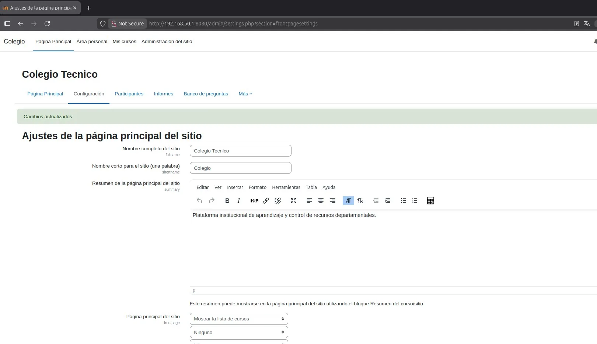

# PASO 06.01 — Personalizar la plataforma

> **Naturaleza:** procedimiento reproducible derivado íntegramente de la guía compartida, con correcciones para el repositorio. **No implica que el paso esté verificado en todas las máquinas.**
>
> **Origen:** `docs/fuentes/GUIA-HISTORICA-INTEGRA.md`; capturas reales de la última bitácora cuando existen.

## Archivos relacionados y por qué importan

- **[`docs/00-proyecto/matriz-requisitos.md`](../../00-proyecto/matriz-requisitos.md)**: criterios de aceptación por curso, recurso y denegación de acceso.
- **[`docs/procedimientos/06-moodle/06-04-cuestionarios.md`](06-04-cuestionarios.md)**: pasos GUI detallados para crear y evaluar preguntas de cuestionarios.

**Lugar de ejecución:** navegador Firefox en Linux Mint con sesión Moodle y permisos de edición. Confirmar direcciones reales y el estado actual de la VM antes de copiar comandos.

## Propósito del paso y contexto operacional

Modelo académico del Colegio Técnico: tres categorías, tres cursos con recursos y cuestionarios, roles y cohortes.

Este archivo corresponde **exclusivamente al paso 06-01**, con comandos históricos literales y mejoras razonadas. En una **VM ya configurada** se inspeccionan primero los servicios y datos; no se vuelven a crear credenciales ni volúmenes. Los resultados observados en las capturas pertenecen a la sesión que los originó, no al conjunto de cinco integrantes.

## Comprobación recomendada y salida a documentar

Realizar una matriz por curso y cuenta: 2 recursos genuinos, 1 actividad evaluable, 1 nota de prueba y bloqueo de URL ajena. Nunca probar aislamiento con el superusuario.

Registrar el resultado exacto, fecha, sistema y si la prueba pasó o falló. Para un cambio de configuración conservar el archivo anterior y ejecutar la validación sintáctica antes de reiniciar el servicio. La **ruta versionable recomendada** está explicada en [`infra/`](../../../infra/README.md), sin sustituir los comandos originales que aparecen abajo.

## Antes de ejecutar

- [ ] Identificar VM, interfaz e IP actual; no asumir la IP de otra persona.
- [ ] Inspeccionar el estado actual del servicio. Si hay datos o volúmenes existentes, respaldarlos antes de cambios.
- [ ] Registrar fecha, integrante responsable, revisor y versión vigente en la sesión de bitácora.

## Procedimiento completo y comandos originales

Ingresá a:

Administración del sitio → Página principal → Ajustes de la página principal.

Configurá:

- Nombre completo: `Colegio Técnico`
- Nombre corto: `Colegio`
- Descripción: `Plataforma institucional de aprendizaje y gestión de recursos departamentales.`

Después, en la configuración de apariencia del sitio, personalizá el tema disponible, los colores y el logotipo.

Podés utilizar un logo propio que identifique al colegio ficticio del escenario.

## Correcciones y precauciones aplicables

La portada puede mostrar diferentes nombres de institución en la bitácora. Usar el nombre final acordado y documentar la personalización real, no asumir que todas las capturas son del mismo instante.

## Evidencias de este paso — registro local y contextualizado

Estas imágenes proceden de la bitácora del equipo y están **almacenadas físicamente junto al procedimiento**, no en una galería sin contexto. Se muestran con sus límites probatorios y una ficha independiente.

### EV-019 · Ajustes de la portada de Moodle

**Qué se observa:** En Administración del sitio se ven campos de título, nombre corto y descripción de la portada. Documenta la decisión de personalizar la identidad del colegio antes de publicar cursos.

**Qué queda sin probar:** No valida por sí sola todos los cursos, rol de profesor, políticas de seguridad ni separación de accesos.

**Procedencia:** bitácora actualizada, página 9. **Ficha de evidencia:** [EV-019](06-01/evidencias/EV-019.md). **Privacidad:** revisión pendiente antes de publicar.

### EV-045 · Navegación a personalización

**Qué se observa:** El menú de administración del sitio está abierto en el área donde se configuran la página principal y la apariencia. Sirve para localizar el punto de personalización.

**Qué queda sin probar:** No valida por sí sola todos los cursos, rol de profesor, políticas de seguridad ni separación de accesos.

**Procedencia:** bitácora actualizada, página 21. **Ficha de evidencia:** [EV-045](06-01/evidencias/EV-045.md). **Privacidad:** revisión pendiente antes de publicar.

### EV-046 · Opción de editar la página principal

**Qué se observa:** En Administración del sitio se ve la opción de configuración de la página principal señalada con un recuadro. Muestra dónde editar la identidad institucional.

**Qué queda sin probar:** No valida por sí sola todos los cursos, rol de profesor, políticas de seguridad ni separación de accesos.

**Procedencia:** bitácora actualizada, página 22. **Ficha de evidencia:** [EV-046](06-01/evidencias/EV-046.md). **Privacidad:** revisión pendiente antes de publicar.

### EV-047 · Información institucional del Colegio

**Qué se observa:** La pantalla de ajustes de portada contiene título y una descripción del Colegio Técnico. Documenta la edición de contenido institucional, a diferencia del tema por defecto.

**Qué queda sin probar:** No valida por sí sola todos los cursos, rol de profesor, políticas de seguridad ni separación de accesos.

**Procedencia:** bitácora actualizada, página 22. **Ficha de evidencia:** [EV-047](06-01/evidencias/EV-047.md). **Privacidad:** revisión pendiente antes de publicar.

### EV-048 · Administración del sitio

**Qué se observa:** Otra vista de navegación de administración del sitio muestra el panel general (similar a EV-045). Se preserva su procedencia aunque aporte poca evidencia independiente.

**Qué queda sin probar:** No valida por sí sola todos los cursos, rol de profesor, políticas de seguridad ni separación de accesos.

**Procedencia:** bitácora actualizada, página 23. **Ficha de evidencia:** [EV-048](06-01/evidencias/EV-048.md). **Privacidad:** revisión pendiente antes de publicar.

### EV-049 · Menú de apariencia de Moodle

**Qué se observa:** La pestaña de Apariencia del panel administrativo muestra opciones de diseño disponibles en Moodle. Documenta la ruta de personalización y no un tema visual final aprobado.

**Qué queda sin probar:** No valida por sí sola todos los cursos, rol de profesor, políticas de seguridad ni separación de accesos.

**Procedencia:** bitácora actualizada, página 23. **Ficha de evidencia:** [EV-049](06-01/evidencias/EV-049.md). **Privacidad:** revisión pendiente antes de publicar.

> El estado de una captura no sustituye una comprobación en cada máquina. El criterio de aceptación está en la sección de verificación y en la [matriz de requisitos](../../00-proyecto/matriz-requisitos.md).

## Registro de ejecución del grupo

| Campo | Completar durante la sesión |
|---|---|
| VM / fecha | _Pendiente de registrar_ |
| Quién ejecutó / quién revisó | _Pendiente_ |
| Comandos aplicados / diferencias | _Pendiente_ |
| Resultado observado | _Pendiente de comprobar_ |
| Captura nueva / prueba | _Crear EV nueva sin sobrescribir las históricas_ |
| Incidencia (si ocurre) | _Referenciar `bitacora/incidentes/INC-XXX`_ |

**Aceptación:** adjuntar captura y comando verificable; no cambiar a completado porque el procedimiento figure aquí.
