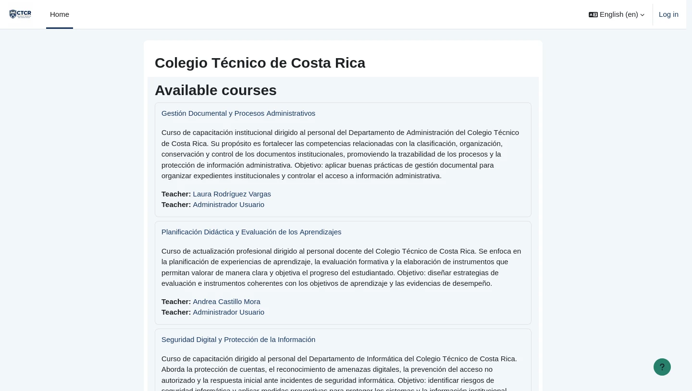

# EV-051 — Personalización de la portada institucional del Colegio Técnico de Costa Rica

**Procedencia:** prueba de aceptación real ejecutada en la VM cliente Linux Mint (`192.168.50.101`) con navegador Firefox. **Paso relacionado:** [06-01 — PASO 06-01](../../06-01.md).

## Qué ocurre en esta captura

Se observa la portada principal de la plataforma Moodle (acceso desde cliente Linux Mint a http://192.168.50.1:8080) con el nombre oficial «Colegio Técnico de Costa Rica», el nombre corto «CTCR», la descripción institucional de los departamentos de Administración, Docencia e Informática, y la identidad visual institucional aplicada sobre el tema Boost.

## Interpretación y límite de la evidencia

Valida la identidad visual y los ajustes de la portada del LMS. El aislamiento efectivo de cursos y la restricción de matrículas se comprueban en los pasos subsecuentes (06-07 y 06-08).

## Reproducir y verificar

1. Conectarse a la máquina virtual Linux Mint (`192.168.50.101`).
2. Abrir el navegador Firefox e ingresar a la plataforma institucional Moodle (`http://192.168.50.1:8080`).
3. Ejecutar las acciones descritas en el procedimiento [06-01](../../06-01.md).
4. Comprobar que el resultado obtenido coincide plenamente con los datos de esta evidencia.

## Identidad, trazabilidad y privacidad

- **Identificador permanente:** `EV-051`.
- **Archivo de imagen:** `EV-051.webp` (WebP optimizado).
- **SHA-256 de la imagen incorporada:** `fc4ffd678b15b4176abb4ee01f7f3797629a607a21a04040b9f43d0b72d919fe`.
- **Origen:** Prueba de aceptación automatizada en vivo sobre Linux Mint (`criss-VirtualBox`).
- **Estado de revisión:** `VERIFICADA, prueba de aceptación ejecutada`.
- **Política de privacidad:** Se sanitizaron contraseñas y datos sensibles del entorno. Las identidades visibles corresponden al personal institucional ficticio del Colegio Técnico de Costa Rica definido en la matriz oficial de datos maestros.
- **Responsable de captura:** Cristhian Altamirano Montes (Estudiante UNA).
- **Fecha:** 2026-10-24.
- **Host de captura:** Linux Mint 22.3 (`192.168.50.101`) -> Ubuntu Server (`192.168.50.1:8080`).

## Para cerrar la evidencia

- [x] Confirmar que no aparecen contraseñas, tokens ni datos personales reales en zonas legibles.
- [x] Asociar el registro de sesión y la VM que la generó (`192.168.50.101`).
- [x] Comprobar el resultado esperado en una sesión controlada con la matriz de requisitos aprobada.
