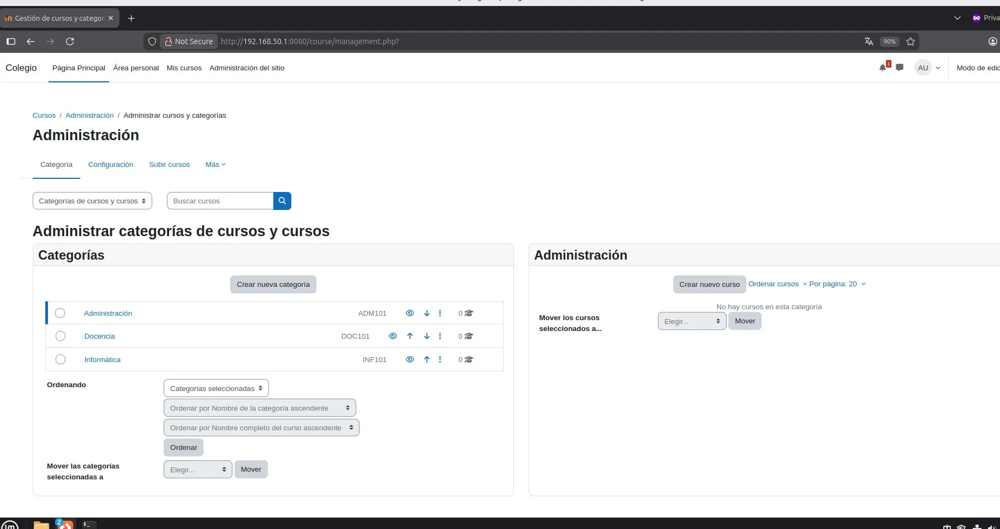

# PASO 06.02 — Crear las categorías de cursos

> **Naturaleza:** procedimiento reproducible derivado íntegramente de la guía compartida, con correcciones para el repositorio. **No implica que el paso esté verificado en todas las máquinas.**
>
> **Origen:** `docs/fuentes/GUIA-HISTORICA-INTEGRA.md`; capturas reales de la última bitácora cuando existen.

## Antes de ejecutar

- [ ] Identificar VM, interfaz e IP actual; no asumir la IP de otra persona.
- [ ] Inspeccionar el estado actual del servicio. Si hay datos o volúmenes existentes, respaldarlos antes de cambios.
- [ ] Registrar fecha, integrante responsable, revisor y versión vigente en la sesión de bitácora.

## Procedimiento completo y comandos originales

Ingresá a:

Administración del sitio → Cursos → Administrar cursos y categorías.

Creá tres categorías:

1. Administración
2. Docencia
3. Informática

Estas categorías permiten organizar los cursos, pero no constituyen por sí solas un mecanismo de seguridad.

## Correcciones y precauciones aplicables

Antes de copiar comandos comprueben si es un servidor nuevo o una VM ya configurada; adaptar rutas, IP, interfaces, nombres y versiones, y guardar evidencia del resultado.

## Evidencias originales asociadas

**EV-020** — Categorías de Administración, Docencia e Informática (p. 9 de la bitácora):

## Registro de ejecución del grupo

| Campo | Completar durante la sesión |
|---|---|
| VM / fecha | _Pendiente de registrar_ |
| Quién ejecutó / quién revisó | _Pendiente_ |
| Comandos aplicados / diferencias | _Pendiente_ |
| Resultado observado | _Pendiente de comprobar_ |
| Captura nueva / prueba | _Crear EV nueva sin sobrescribir las históricas_ |
| Incidencia (si ocurre) | _Referenciar `bitacora/incidentes/INC-XXX`_ |

**Aceptación:** adjuntar captura y comando verificable; no cambiar a completado porque el procedimiento figure aquí.
