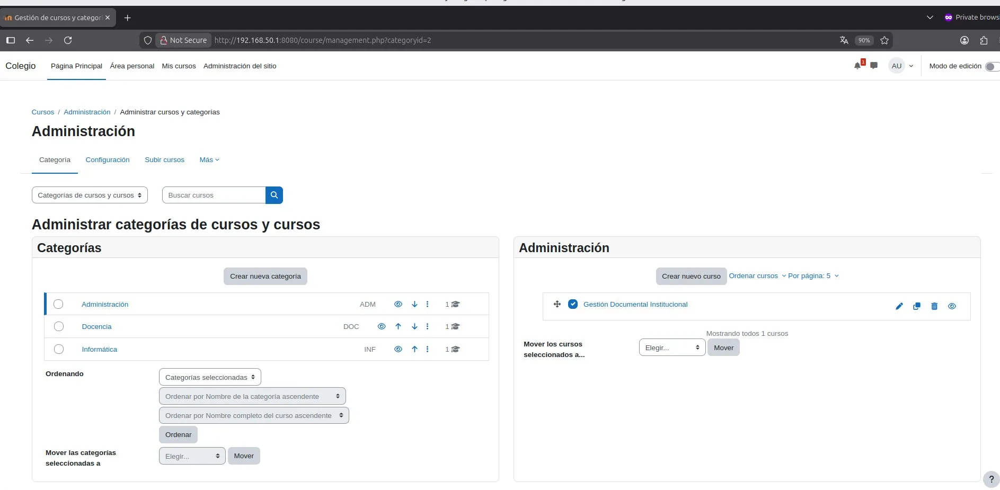
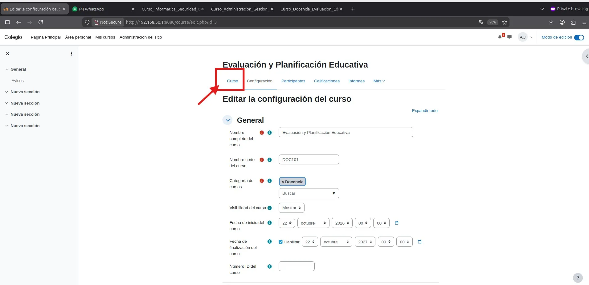

# PASO 06.03 — Crear los tres cursos

> **Naturaleza:** procedimiento reproducible derivado íntegramente de la guía compartida, con correcciones para el repositorio. **No implica que el paso esté verificado en todas las máquinas.**
>
> **Origen:** `docs/fuentes/GUIA-HISTORICA-INTEGRA.md`; capturas reales de la última bitácora cuando existen.

## Antes de ejecutar

- [ ] Identificar VM, interfaz e IP actual; no asumir la IP de otra persona.
- [ ] Inspeccionar el estado actual del servicio. Si hay datos o volúmenes existentes, respaldarlos antes de cambios.
- [ ] Registrar fecha, integrante responsable, revisor y versión vigente en la sesión de bitácora.

## Procedimiento completo y comandos originales

Dentro de cada categoría, seleccioná la opción para crear un curso nuevo.

| Categoría      | Nombre del curso                     | Nombre corto |
| -------------- | ------------------------------------ | ------------ |
| Administración | Gestión Documental Institucional     | `ADM101`     |
| Docencia       | Evaluación y Planificación Educativa | `DOC101`     |
| Informática    | Fundamentos de Seguridad Informática | `INF101`     |

Configurá los cursos como visibles para sus participantes autorizados. La restricción efectiva se hará mediante las matrículas y los permisos.

## Correcciones y precauciones aplicables

Antes de copiar comandos comprueben si es un servidor nuevo o una VM ya configurada; adaptar rutas, IP, interfaces, nombres y versiones, y guardar evidencia del resultado.

## Evidencias originales asociadas

**EV-021** — Gestión de cursos en Moodle (p. 10 de la bitácora):

**EV-022** — Edición del curso de Docencia (p. 10 de la bitácora):

## Registro de ejecución del grupo

| Campo | Completar durante la sesión |
|---|---|
| VM / fecha | _Pendiente de registrar_ |
| Quién ejecutó / quién revisó | _Pendiente_ |
| Comandos aplicados / diferencias | _Pendiente_ |
| Resultado observado | _Pendiente de comprobar_ |
| Captura nueva / prueba | _Crear EV nueva sin sobrescribir las históricas_ |
| Incidencia (si ocurre) | _Referenciar `bitacora/incidentes/INC-XXX`_ |

**Aceptación:** adjuntar captura y comando verificable; no cambiar a completado porque el procedimiento figure aquí.
