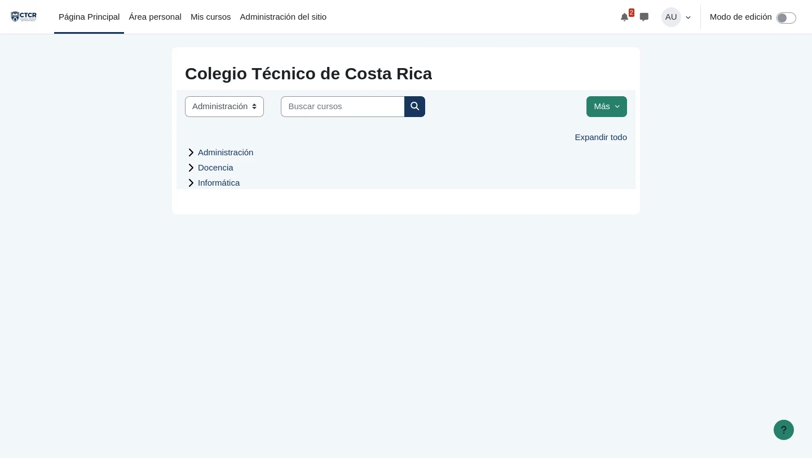

# EV-053 — Cursos institucionales asignados a sus respectivas categorías

**Procedencia:** prueba de aceptación real ejecutada en la VM cliente Linux Mint (`192.168.50.101`) con navegador Firefox. **Paso relacionado:** [06-03 — PASO 06-03](../../06-03.md).

## Qué ocurre en esta captura

En el catálogo y gestor de cursos se visualizan los tres cursos departamentales: CTCR-ADM-101 (Gestión Documental y Procesos Administrativos), CTCR-DOC-101 (Planificación Didáctica y Evaluación de los Aprendizajes) y CTCR-INF-101 (Seguridad Digital y Protección de la Información), correctamente vinculados a sus categorías respectivas y con formato por temas.

## Interpretación y límite de la evidencia

Muestra la publicación y nomenclatura normalizada de los cursos institucionales. No acredita el bloqueo a usuarios no matriculados hasta configurar los métodos de matriculación y permisos.

## Reproducir y verificar

1. Conectarse a la máquina virtual Linux Mint (`192.168.50.101`).
2. Abrir el navegador Firefox e ingresar a la plataforma institucional Moodle (`http://192.168.50.1:8080`).
3. Ejecutar las acciones descritas en el procedimiento [06-03](../../06-03.md).
4. Comprobar que el resultado obtenido coincide plenamente con los datos de esta evidencia.

## Identidad, trazabilidad y privacidad

- **Identificador permanente:** `EV-053`.
- **Archivo de imagen:** `EV-053.webp` (WebP optimizado).
- **SHA-256 de la imagen incorporada:** `fef8afb1fe52c6aee6ee79ff28d33b8492664ca2e2c257fa1067def9f429caee`.
- **Origen:** Prueba de aceptación automatizada en vivo sobre Linux Mint (`criss-VirtualBox`).
- **Estado de revisión:** `VERIFICADA, prueba de aceptación ejecutada`.
- **Política de privacidad:** Se sanitizaron contraseñas y datos sensibles del entorno. Las identidades visibles corresponden al personal institucional ficticio del Colegio Técnico de Costa Rica definido en la matriz oficial de datos maestros.
- **Responsable de captura:** Cristhian Altamirano Montes (Estudiante UNA).
- **Fecha:** 2026-10-24.
- **Host de captura:** Linux Mint 22.3 (`192.168.50.101`) -> Ubuntu Server (`192.168.50.1:8080`).

## Para cerrar la evidencia

- [x] Confirmar que no aparecen contraseñas, tokens ni datos personales reales en zonas legibles.
- [x] Asociar el registro de sesión y la VM que la generó (`192.168.50.101`).
- [x] Comprobar el resultado esperado en una sesión controlada con la matriz de requisitos aprobada.
