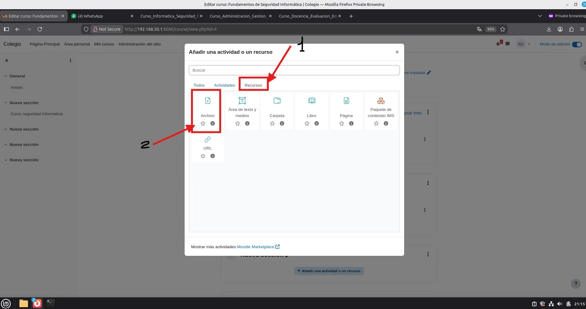
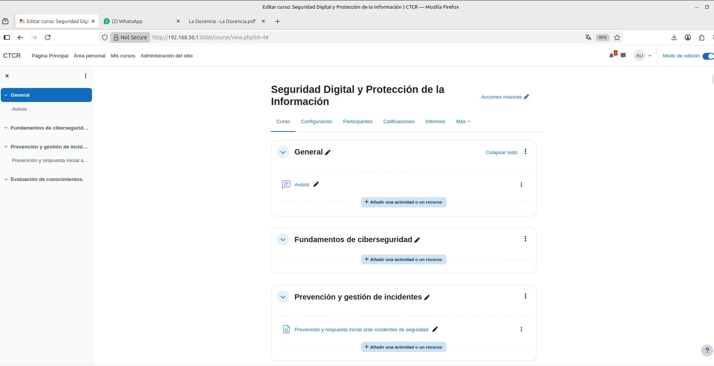
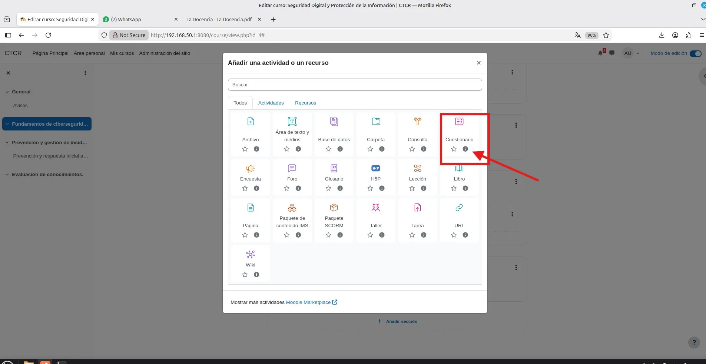

# PASO 06.04 — Agregar los recursos y actividades

> **Naturaleza:** procedimiento reproducible derivado íntegramente de la guía compartida, con correcciones para el repositorio. **No implica que el paso esté verificado en todas las máquinas.**
>
> **Origen:** `docs/fuentes/GUIA-HISTORICA-INTEGRA.md`; capturas reales de la última bitácora cuando existen.

## Antes de ejecutar

- [ ] Identificar VM, interfaz e IP actual; no asumir la IP de otra persona.
- [ ] Inspeccionar el estado actual del servicio. Si hay datos o volúmenes existentes, respaldarlos antes de cambios.
- [ ] Registrar fecha, integrante responsable, revisor y versión vigente en la sesión de bitácora.

## Procedimiento completo y comandos originales

Cada curso necesita como mínimo dos recursos y una actividad evaluable.

| Curso          | Recurso 1                               | Recurso 2                          | Actividad                                       |
| -------------- | --------------------------------------- | ---------------------------------- | ----------------------------------------------- |
| Administración | PDF sobre archivo institucional         | Guía de clasificación documental   | Cuestionario sobre clasificación de expedientes |
| Docencia       | Presentación sobre evaluación formativa | Guía sobre elaboración de rúbricas | Cuestionario sobre evaluación                   |
| Informática    | Guía de contraseñas seguras             | PDF sobre phishing                 | Cuestionario de seguridad informática           |

Para agregar contenido:

1. Entrá al curso.
2. Activá el modo de edición.
3. Seleccioná Añadir una actividad o recurso.
4. Elegí Archivo, Página u otro recurso apropiado.
5. Subí el material real que elaboraron.
6. Repetí el procedimiento y agregá un cuestionario con preguntas y calificación.

El profesor exige contenido genuino, así que no utilicen documentos vacíos ni texto genérico de relleno.

## Correcciones y precauciones aplicables

La presencia de capturas del formulario de subida no demuestra por sí sola que cada uno de los tres cursos tenga **dos recursos válidos**. Revisar el contenido real y la visibilidad con estudiantes.

## Evidencias originales asociadas

**EV-023** — Edición del curso de Informática (p. 10 de la bitácora):

**EV-024** — Selector de tipo de recurso (p. 11 de la bitácora):

**EV-025** — Carga de recurso PDF en Moodle (p. 11 de la bitácora):

**EV-026** — Secciones del curso de Informática (p. 12 de la bitácora):

**EV-027** — Selector de actividades para cuestionario (p. 12 de la bitácora):

## Registro de ejecución del grupo

| Campo | Completar durante la sesión |
|---|---|
| VM / fecha | _Pendiente de registrar_ |
| Quién ejecutó / quién revisó | _Pendiente_ |
| Comandos aplicados / diferencias | _Pendiente_ |
| Resultado observado | _Pendiente de comprobar_ |
| Captura nueva / prueba | _Crear EV nueva sin sobrescribir las históricas_ |
| Incidencia (si ocurre) | _Referenciar `bitacora/incidentes/INC-XXX`_ |

**Aceptación:** adjuntar captura y comando verificable; no cambiar a completado porque el procedimiento figure aquí.
