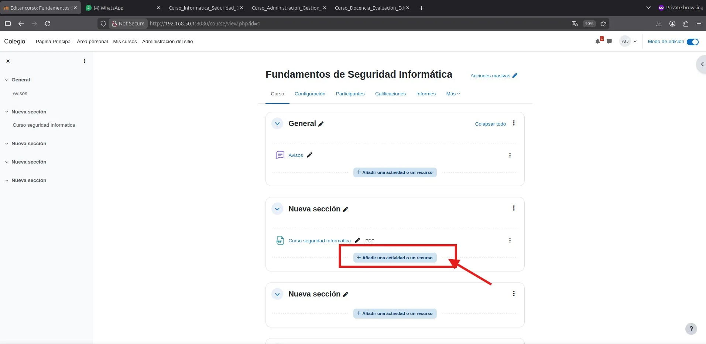
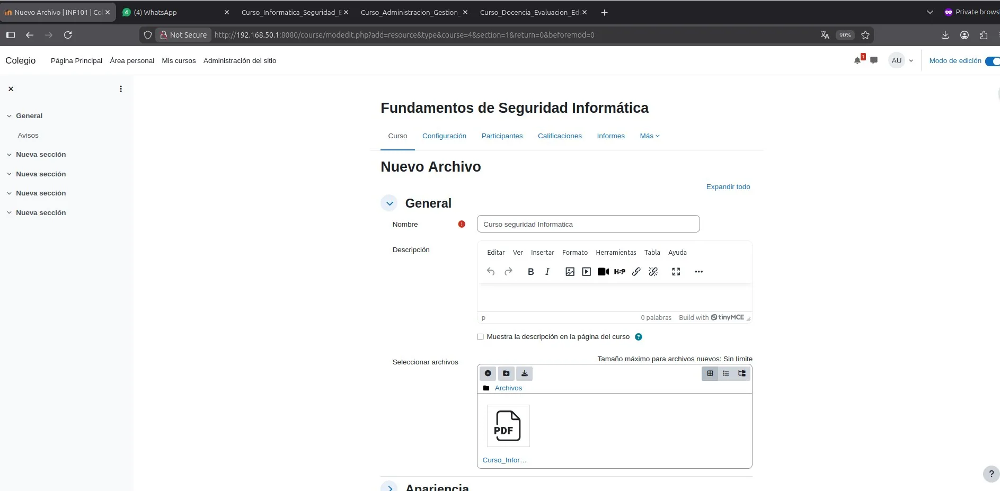
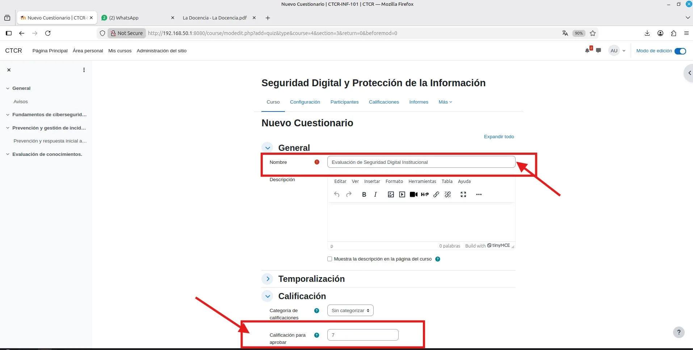
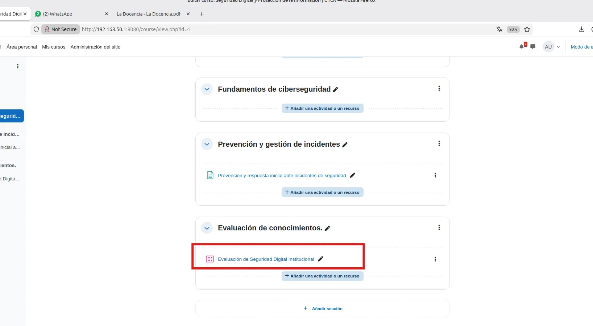
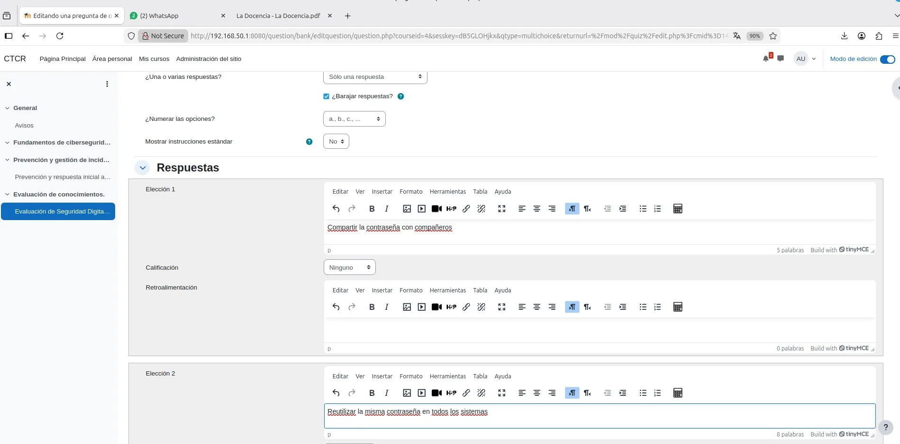
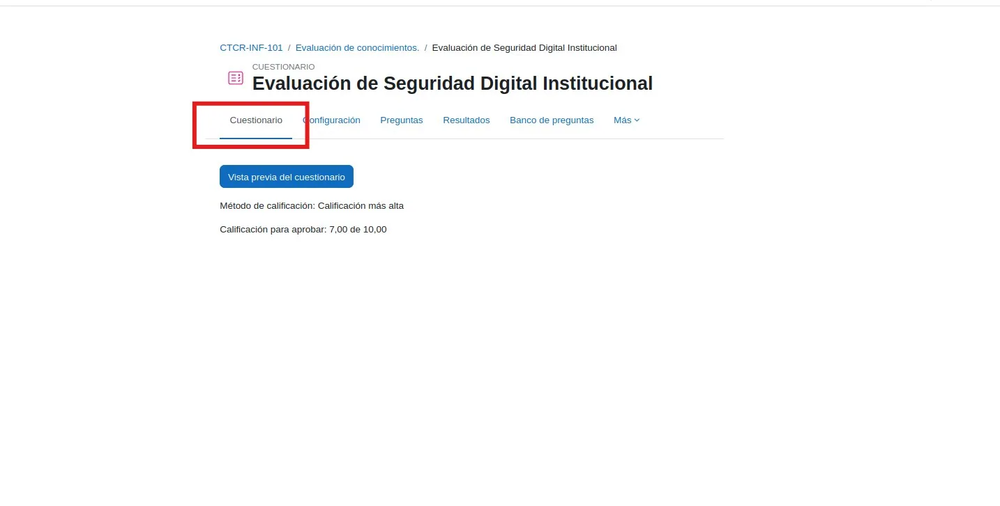
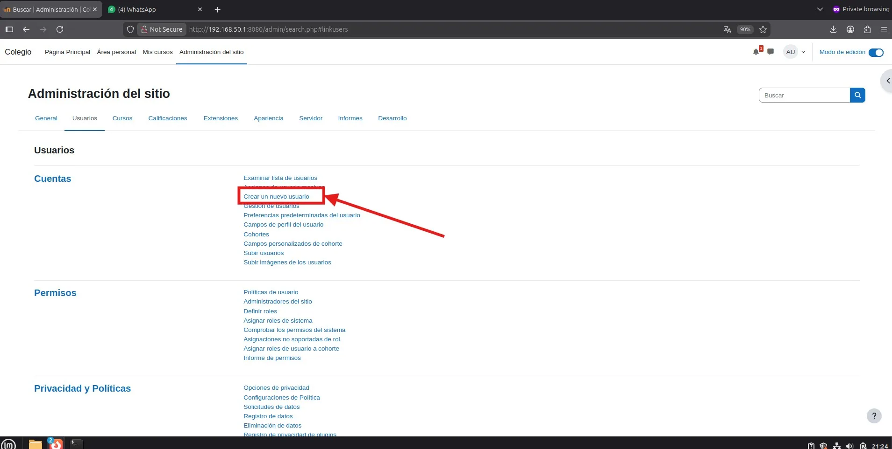

# PASO 06.04 — Agregar los recursos y actividades

> **Naturaleza:** procedimiento reproducible derivado íntegramente de la guía compartida, con correcciones para el repositorio. **No implica que el paso esté verificado en todas las máquinas.**
>
> **Origen:** `docs/fuentes/GUIA-HISTORICA-INTEGRA.md`; capturas reales de la última bitácora cuando existen.

## Archivos relacionados y por qué importan

- **[`docs/00-proyecto/matriz-requisitos.md`](../../00-proyecto/matriz-requisitos.md)**: criterios de aceptación por curso, recurso y denegación de acceso.
- **[`docs/procedimientos/06-moodle/06-04-cuestionarios.md`](06-04-cuestionarios.md)**: pasos GUI detallados para crear y evaluar preguntas de cuestionarios.

**Lugar de ejecución:** navegador Firefox en Linux Mint con sesión Moodle y permisos de edición. Confirmar direcciones reales y el estado actual de la VM antes de copiar comandos.

## Propósito del paso y contexto operacional

El enunciado pide que cada curso tenga **contenido real**: como mínimo dos recursos (por ejemplo, un PDF elaborado por el grupo y una Página de Moodle) y una actividad evaluable (un cuestionario con calificación). Estos recursos son además los que se usan en 06-08: el PDF de un curso es el archivo que se intenta abrir por URL directa con una cuenta de otro departamento.

Configuración final de los cuestionarios: 5 preguntas de opción múltiple de 20 puntos (100 en total), calificación para aprobar 70 y 2 intentos permitidos. En la captura EV-028 se ve una configuración intermedia (calificación para aprobar 7, sobre 10), que luego se ajustó a la escala de 100 (ver EV-061).

Este archivo corresponde **exclusivamente al paso 06-04**, con comandos históricos literales y mejoras razonadas. En una **VM ya configurada** se inspeccionan primero los servicios y datos; no se vuelven a crear credenciales ni volúmenes. Los resultados observados en las capturas pertenecen a la sesión que los originó, no al conjunto de cinco integrantes.

## Comprobación recomendada y salida a documentar

Realizar una matriz por curso y cuenta: 2 recursos genuinos, 1 actividad evaluable, 1 nota de prueba y bloqueo de URL ajena. Nunca probar aislamiento con el superusuario.

Registrar el resultado exacto, fecha, sistema y si la prueba pasó o falló. Para un cambio de configuración conservar el archivo anterior y ejecutar la validación sintáctica antes de reiniciar el servicio. La **ruta versionable recomendada** está explicada en [`infra/`](../../../infra/README.md), sin sustituir los comandos originales que aparecen abajo.

## Antes de ejecutar

- [ ] Identificar VM, interfaz e IP actual; no asumir la IP de otra persona.
- [ ] Inspeccionar el estado actual del servicio. Si hay datos o volúmenes existentes, respaldarlos antes de cambios.
- [ ] Registrar fecha, integrante responsable, revisor y versión vigente en la sesión de bitácora.

## Procedimiento completo y comandos originales

Cada curso necesita como mínimo dos recursos y una actividad evaluable.

| Curso          | Recurso 1                               | Recurso 2                          | Actividad                                       |
| -------------- | --------------------------------------- | ---------------------------------- | ----------------------------------------------- |
| Administración | PDF sobre archivo institucional         | Guía de clasificación documental   | Cuestionario sobre clasificación de expedientes |
| Docencia       | Presentación sobre evaluación formativa | Guía sobre elaboración de rúbricas | Cuestionario sobre evaluación                   |
| Informática    | Guía de contraseñas seguras             | PDF sobre phishing                 | Cuestionario de seguridad informática           |

> **Archivos de base:** Los documentos oficiales del Drive organizados y con nombres corregidos para descarga y carga en cada curso están disponibles en [`documentos-cursos/`](../../../documentos-cursos/README.md).

Para agregar contenido:

1. Entrá al curso.
2. Activá el modo de edición.
3. Seleccioná Añadir una actividad o recurso.
4. Elegí Archivo, Página u otro recurso apropiado.
5. Subí el material real que elaboraron.
6. Repetí el procedimiento y agregá un cuestionario con preguntas y calificación.

El profesor exige contenido genuino, así que no utilicen documentos vacíos ni texto genérico de relleno.

## Correcciones y precauciones aplicables

La presencia de capturas del formulario de subida no demuestra por sí sola que cada uno de los tres cursos tenga **dos recursos válidos**. Revisar el contenido real y la visibilidad con estudiantes.

## Evidencias de este paso — registro local y contextualizado

Estas imágenes proceden de la bitácora del equipo y están **almacenadas físicamente junto al procedimiento**, no en una galería sin contexto. Se muestran con sus límites probatorios y una ficha independiente.

### EV-023 · Edición del curso de Informática

**Qué se observa:** La página del curso Informática muestra secciones y el control de añadir un recurso o actividad. Ubica el punto desde el que el equipo comienza a cargar materiales y evaluaciones.

**Qué queda sin probar:** No confirma por sí sola dos recursos genuinos y una actividad evaluable terminada en cada uno de los tres cursos, ni un intento de estudiante calificado.

**Procedencia:** bitácora actualizada, página 10. **Ficha de evidencia:** [EV-023](06-04/evidencias/EV-023.md). **Privacidad:** revisión pendiente antes de publicar.

### EV-024 · Selector de tipo de recurso

**Qué se observa:** El cuadro de selección de recursos/actividades de Moodle aparece abierto con la opción de contenido señalada. Documenta qué botón elegir para iniciar la creación del recurso.

**Qué queda sin probar:** No confirma por sí sola dos recursos genuinos y una actividad evaluable terminada en cada uno de los tres cursos, ni un intento de estudiante calificado.

**Procedencia:** bitácora actualizada, página 11. **Ficha de evidencia:** [EV-024](06-04/evidencias/EV-024.md). **Privacidad:** revisión pendiente antes de publicar.

### EV-025 · Carga de recurso PDF en Moodle

**Qué se observa:** El formulario para añadir un archivo muestra la zona de carga de un documento PDF a un curso. Aporta evidencia del mecanismo de carga, pero no de que haya quedado visible para el alumnado.

**Qué queda sin probar:** No confirma por sí sola dos recursos genuinos y una actividad evaluable terminada en cada uno de los tres cursos, ni un intento de estudiante calificado.

**Procedencia:** bitácora actualizada, página 11. **Ficha de evidencia:** [EV-025](06-04/evidencias/EV-025.md). **Privacidad:** revisión pendiente antes de publicar.

### EV-026 · Secciones del curso de Informática

**Qué se observa:** La vista del curso de seguridad informática enseña varias secciones de contenido y controles de edición. Sirve para relacionar estructura y recursos con los objetivos de cada unidad.

**Qué queda sin probar:** No confirma por sí sola dos recursos genuinos y una actividad evaluable terminada en cada uno de los tres cursos, ni un intento de estudiante calificado.

**Procedencia:** bitácora actualizada, página 12. **Ficha de evidencia:** [EV-026](06-04/evidencias/EV-026.md). **Privacidad:** revisión pendiente antes de publicar.

### EV-027 · Selector de actividades para cuestionario

**Qué se observa:** El selector de Moodle señala el módulo de cuestionario dentro de la creación de actividades. Es el punto que antecede a configurar la evaluación de seguridad.

**Qué queda sin probar:** No confirma por sí sola dos recursos genuinos y una actividad evaluable terminada en cada uno de los tres cursos, ni un intento de estudiante calificado.

**Procedencia:** bitácora actualizada, página 12. **Ficha de evidencia:** [EV-027](06-04/evidencias/EV-027.md). **Privacidad:** revisión pendiente antes de publicar.

### EV-028 · Configuración del cuestionario y puntuación

**Qué se observa:** El formulario de actividad cuestionario muestra campos para escribir el nombre y ajustar calificaciones. Documenta la edición de parámetros, no un intento ni una nota obtenida.

**Qué queda sin probar:** No confirma por sí sola dos recursos genuinos y una actividad evaluable terminada en cada uno de los tres cursos, ni un intento de estudiante calificado.

**Procedencia:** bitácora actualizada, página 13. **Ficha de evidencia:** [EV-028](06-04/evidencias/EV-028.md). **Privacidad:** revisión pendiente antes de publicar.

### EV-029 · Cuestionario creado en el curso

**Qué se observa:** La página del curso lista la actividad de cuestionario ya creada. Es evidencia de presencia de una actividad, pendiente de comprobar preguntas y calificación.

**Qué queda sin probar:** No confirma por sí sola dos recursos genuinos y una actividad evaluable terminada en cada uno de los tres cursos, ni un intento de estudiante calificado.

**Procedencia:** bitácora actualizada, página 13. **Ficha de evidencia:** [EV-029](06-04/evidencias/EV-029.md). **Privacidad:** revisión pendiente antes de publicar.

### EV-030 · Pestaña de preguntas del cuestionario

**Qué se observa:** Se ve la pestaña «Preguntas» del cuestionario y el estado de edición. A partir de aquí se configura el banco de preguntas que hará evaluable la actividad.

**Qué queda sin probar:** No confirma por sí sola dos recursos genuinos y una actividad evaluable terminada en cada uno de los tres cursos, ni un intento de estudiante calificado.

**Procedencia:** bitácora actualizada, página 14. **Ficha de evidencia:** [EV-030](06-04/evidencias/EV-030.md). **Privacidad:** revisión pendiente antes de publicar.

### EV-031 · Añadir pregunta al cuestionario

**Qué se observa:** En la pantalla de preguntas aparece la opción de añadir una nueva pregunta. La captura corresponde a la navegación hacia el editor de una pregunta evaluable.

**Qué queda sin probar:** No confirma por sí sola dos recursos genuinos y una actividad evaluable terminada en cada uno de los tres cursos, ni un intento de estudiante calificado.

**Procedencia:** bitácora actualizada, página 14. **Ficha de evidencia:** [EV-031](06-04/evidencias/EV-031.md). **Privacidad:** revisión pendiente antes de publicar.

### EV-032 · Selector de tipo de pregunta

**Qué se observa:** El diálogo de tipos de pregunta presenta alternativas (entre ellas opción múltiple); ayuda a reproducir la elección del formato antes de redactar el contenido.

**Qué queda sin probar:** No confirma por sí sola dos recursos genuinos y una actividad evaluable terminada en cada uno de los tres cursos, ni un intento de estudiante calificado.

**Procedencia:** bitácora actualizada, página 15. **Ficha de evidencia:** [EV-032](06-04/evidencias/EV-032.md). **Privacidad:** revisión pendiente antes de publicar.

### EV-033 · Formulario de pregunta de opción múltiple

**Qué se observa:** El editor de opción múltiple muestra los campos de nombre, enunciado y puntuación por defecto, destacados con anotaciones. Documenta la configuración inicial de una pregunta concreta.

**Qué queda sin probar:** No confirma por sí sola dos recursos genuinos y una actividad evaluable terminada en cada uno de los tres cursos, ni un intento de estudiante calificado.

**Procedencia:** bitácora actualizada, página 15. **Ficha de evidencia:** [EV-033](06-04/evidencias/EV-033.md). **Privacidad:** revisión pendiente antes de publicar.

### EV-034 · Opciones de respuesta

**Qué se observa:** El editor de respuestas muestra áreas para introducir posibles alternativas. La captura explica la edición de distractores y respuesta correcta, pero no demuestra que estén puntuadas correctamente.

**Qué queda sin probar:** No confirma por sí sola dos recursos genuinos y una actividad evaluable terminada en cada uno de los tres cursos, ni un intento de estudiante calificado.

**Procedencia:** bitácora actualizada, página 16. **Ficha de evidencia:** [EV-034](06-04/evidencias/EV-034.md). **Privacidad:** revisión pendiente antes de publicar.

### EV-035 · Ponderación de respuesta correcta

**Qué se observa:** El desplegable de porcentaje de calificación aparece abierto sobre las respuestas. Muestra dónde se asigna la fracción 100% a la opción correcta del ejercicio.

**Qué queda sin probar:** No confirma por sí sola dos recursos genuinos y una actividad evaluable terminada en cada uno de los tres cursos, ni un intento de estudiante calificado.

**Procedencia:** bitácora actualizada, página 16. **Ficha de evidencia:** [EV-035](06-04/evidencias/EV-035.md). **Privacidad:** revisión pendiente antes de publicar.

### EV-036 · Vista del cuestionario creado

**Qué se observa:** El cuestionario se muestra en una pantalla posterior de Moodle, con la pestaña o acción correspondiente a su contenido. La captura no sustituye una prueba de alumno completando el cuestionario.

**Qué queda sin probar:** No confirma por sí sola dos recursos genuinos y una actividad evaluable terminada en cada uno de los tres cursos, ni un intento de estudiante calificado.

**Procedencia:** bitácora actualizada, página 17. **Ficha de evidencia:** [EV-036](06-04/evidencias/EV-036.md). **Privacidad:** revisión pendiente antes de publicar.

### EV-037 · Vista del cuestionario después de crear las preguntas

**Qué se observa:** La pantalla de edición/administración del cuestionario ubica el recurso final en Moodle. Documenta que se volvió a la actividad, pero no una nota visible en el libro de calificaciones.

**Qué queda sin probar:** No confirma por sí sola dos recursos genuinos y una actividad evaluable terminada en cada uno de los tres cursos, ni un intento de estudiante calificado.

**Procedencia:** bitácora actualizada, página 17. **Ficha de evidencia:** [EV-037](06-04/evidencias/EV-037.md). **Privacidad:** revisión pendiente antes de publicar.

> El estado de una captura no sustituye una comprobación en cada máquina. El criterio de aceptación está en la sección de verificación y en la [matriz de requisitos](../../00-proyecto/matriz-requisitos.md).

## Registro de ejecución del grupo

| Campo | Completar durante la sesión |
|---|---|
| VM / fecha | Linux Mint (`192.168.50.101`) / Ubuntu Server (`192.168.50.1`) — 2026-10-24 |
| Quién ejecutó / quién revisó | Cristhian Altamirano Montes / Grupo de Laboratorio CTCR |
| Comandos aplicados / diferencias | Inserción de 3 PDFs institucionales (ReportLab), 3 Páginas interactivas y 3 Cuestionarios con 5 preguntas GIFT (20 pts c/u = 100 max) |
| Resultado observado | Cursos con sus 3 secciones pobladas, cuestionarios con 100 puntos y nota para aprobar 70 |
| Captura nueva / prueba | [EV-054](06-04/evidencias/EV-054.md), [EV-055](06-04/evidencias/EV-055.md) |
| Incidencia (si ocurre) | Ninguna |

**Aceptación:** adjuntar captura y comando verificable; no cambiar a completado porque el procedimiento figure aquí.
