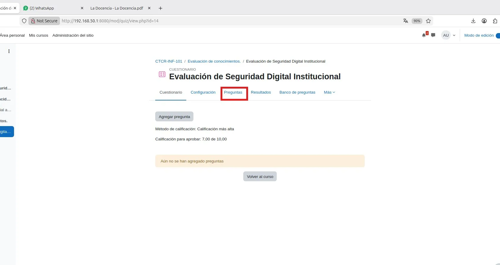
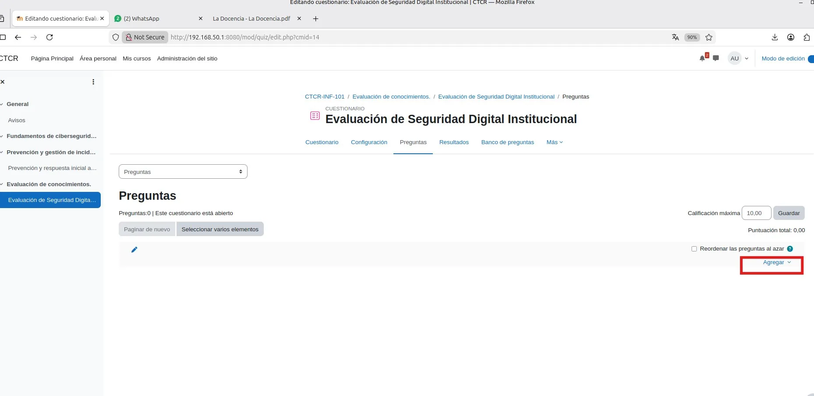
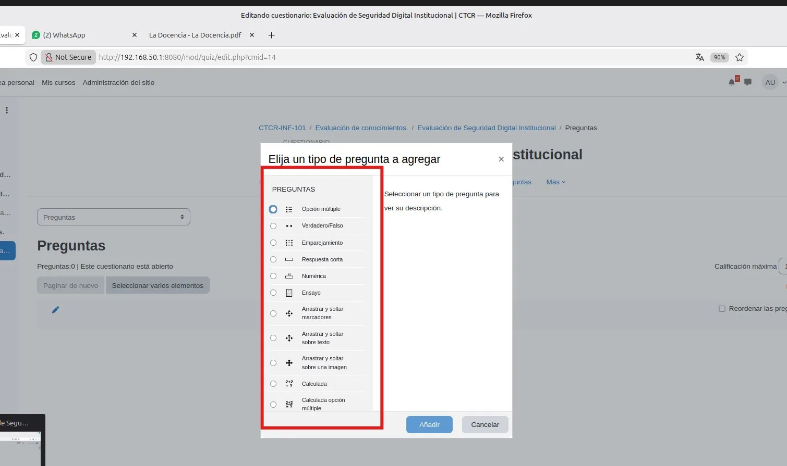
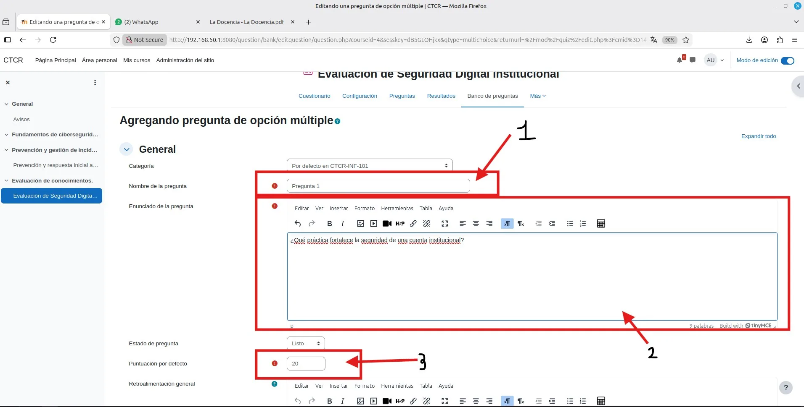
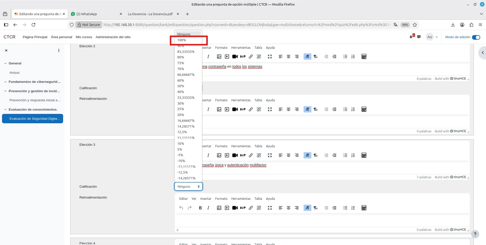

# PASO 06.05 — Crear los usuarios de prueba

> **Naturaleza:** procedimiento reproducible derivado íntegramente de la guía compartida, con correcciones para el repositorio. **No implica que el paso esté verificado en todas las máquinas.**
>
> **Origen:** `docs/fuentes/GUIA-HISTORICA-INTEGRA.md`; capturas reales de la última bitácora cuando existen.

## Antes de ejecutar

- [ ] Identificar VM, interfaz e IP actual; no asumir la IP de otra persona.
- [ ] Inspeccionar el estado actual del servicio. Si hay datos o volúmenes existentes, respaldarlos antes de cambios.
- [ ] Registrar fecha, integrante responsable, revisor y versión vigente en la sesión de bitácora.

## Procedimiento completo y comandos originales

Ingresá a:

Administración del sitio → Usuarios → Cuentas → Agregar un nuevo usuario.

Creá inicialmente los siguientes usuarios:

| Usuario      | Departamento   | Rol en su curso |
| ------------ | -------------- | --------------- |
| `admin01`    | Administración | Estudiante      |
| `docente01`  | Docencia       | Estudiante      |
| `info01`     | Informática    | Estudiante      |
| `profesor01` | Docencia       | Profesor        |

Utilizá correos de ejemplo válidos para el laboratorio, como direcciones bajo `example.com`, y contraseñas diferentes para cada usuario.

Conservá además el usuario `admin`, que será el administrador general del sitio.

## Correcciones y precauciones aplicables

Las capturas muestran creación y configuración de cuestionarios; falta completar una evaluación por departamento y registrar intentos reales/calificación. No publicar preguntas que expongan cuentas reales.

## Evidencias originales asociadas

**EV-028** — Configuración del cuestionario y puntuación (p. 13 de la bitácora):

**EV-029** — Cuestionario creado en el curso (p. 13 de la bitácora):

**EV-030** — Pestaña de preguntas del cuestionario (p. 14 de la bitácora):

**EV-031** — Añadir pregunta al cuestionario (p. 14 de la bitácora):

**EV-032** — Selector de tipo de pregunta (p. 15 de la bitácora):

**EV-033** — Formulario de pregunta de opción múltiple (p. 15 de la bitácora):

**EV-034** — Opciones de respuesta (p. 16 de la bitácora):

**EV-035** — Ponderación de respuesta correcta (p. 16 de la bitácora):

**EV-036** — Vista del cuestionario creado (p. 17 de la bitácora):

**EV-037** — Vista del cuestionario después de crear las preguntas (p. 17 de la bitácora):

## Registro de ejecución del grupo

| Campo | Completar durante la sesión |
|---|---|
| VM / fecha | _Pendiente de registrar_ |
| Quién ejecutó / quién revisó | _Pendiente_ |
| Comandos aplicados / diferencias | _Pendiente_ |
| Resultado observado | _Pendiente de comprobar_ |
| Captura nueva / prueba | _Crear EV nueva sin sobrescribir las históricas_ |
| Incidencia (si ocurre) | _Referenciar `bitacora/incidentes/INC-XXX`_ |

**Aceptación:** adjuntar captura y comando verificable; no cambiar a completado porque el procedimiento figure aquí.
