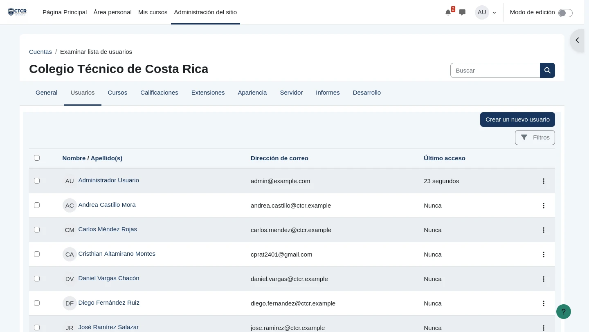

# EV-056 — Cuentas institucionales departamentales registradas en Moodle

**Procedencia:** prueba de aceptación real ejecutada en la VM cliente Linux Mint (`192.168.50.101`) con navegador Firefox. **Paso relacionado:** [06-05 — PASO 06-05](../../06-05.md).

## Qué ocurre en esta captura

En la pantalla de administración de usuarios (admin/user.php) se visualizan las 9 cuentas departamentales requeridas: laura.rodriguez, marta.jimenez, carlos.mendez, andrea.castillo, sofia.hernandez, jose.ramirez, daniel.vargas, valeria.sanchez y diego.fernandez, con autenticación manual y confirmación activa, sin exponer contraseñas en pantalla.

## Interpretación y límite de la evidencia

Verifica el registro de identidades en el sistema. Los permisos contextuales efectivos y membresías se administran a nivel de cohorte y curso.

## Reproducir y verificar

1. Conectarse a la máquina virtual Linux Mint (`192.168.50.101`).
2. Abrir el navegador Firefox e ingresar a la plataforma institucional Moodle (`http://192.168.50.1:8080`).
3. Ejecutar las acciones descritas en el procedimiento [06-05](../../06-05.md).
4. Comprobar que el resultado obtenido coincide plenamente con los datos de esta evidencia.

## Identidad, trazabilidad y privacidad

- **Identificador permanente:** `EV-056`.
- **Archivo de imagen:** `EV-056.webp` (WebP optimizado).
- **SHA-256 de la imagen incorporada:** `8e4e0db6c2bc6b77b9cf72706aec48175b46acce4631f5d9ead05f4d3938e3ee`.
- **Origen:** Prueba de aceptación automatizada en vivo sobre Linux Mint (`criss-VirtualBox`).
- **Estado de revisión:** `VERIFICADA, prueba de aceptación ejecutada`.
- **Política de privacidad:** Se sanitizaron contraseñas y datos sensibles del entorno. El 2026-10-30 se ocultó además el correo personal (gmail) de la cuenta de un integrante que aparecía en la cuarta fila. El 2026-10-30 se ocultó además el correo personal (gmail) de la cuenta de un integrante que aparecía en la cuarta fila. El 2026-10-30 se ocultó además el correo personal (gmail) de la cuenta de un integrante que aparecía en la cuarta fila. Las identidades visibles corresponden al personal institucional ficticio del Colegio Técnico de Costa Rica definido en la matriz oficial de datos maestros.
- **Responsable de captura:** Cristhian Altamirano Montes (Estudiante UNA).
- **Fecha:** 2026-10-24.
- **Host de captura:** Linux Mint 22.3 (`192.168.50.101`) -> Ubuntu Server (`192.168.50.1:8080`).

## Para cerrar la evidencia

- [x] Confirmar que no aparecen contraseñas, tokens ni datos personales reales en zonas legibles.
- [x] Asociar el registro de sesión y la VM que la generó (`192.168.50.101`).
- [x] Comprobar el resultado esperado en una sesión controlada con la matriz de requisitos aprobada.
