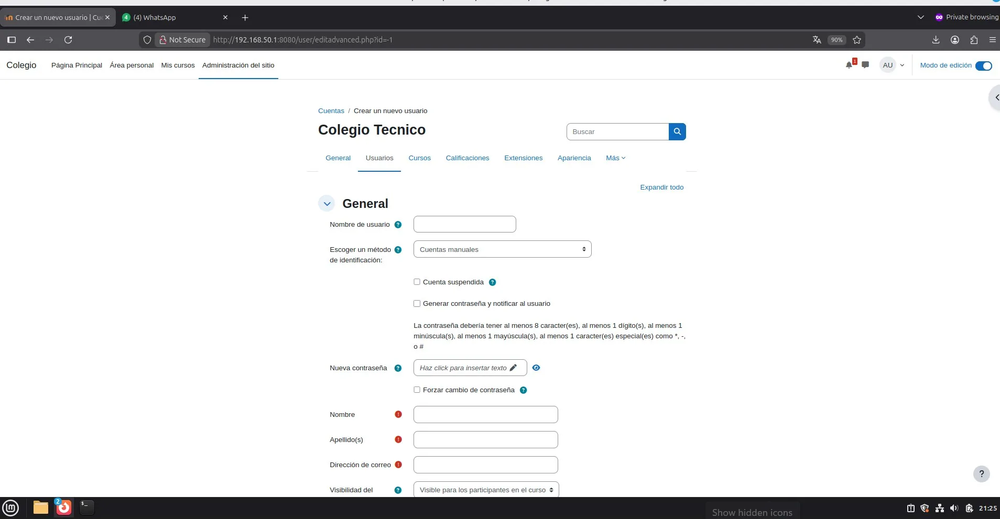
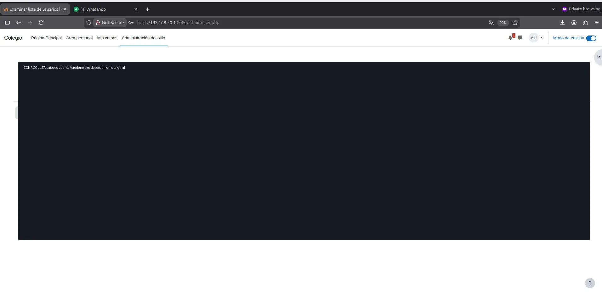
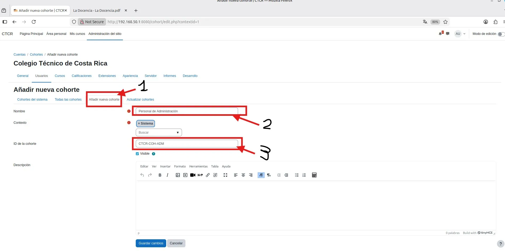
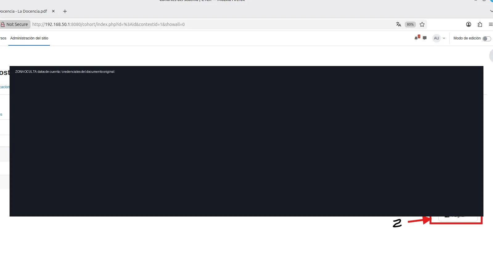

# PASO 06.06 — Crear las cohortes departamentales

> **Naturaleza:** procedimiento reproducible derivado íntegramente de la guía compartida, con correcciones para el repositorio. **No implica que el paso esté verificado en todas las máquinas.**
>
> **Origen:** `docs/fuentes/GUIA-HISTORICA-INTEGRA.md`; capturas reales de la última bitácora cuando existen.

## Antes de ejecutar

- [ ] Identificar VM, interfaz e IP actual; no asumir la IP de otra persona.
- [ ] Inspeccionar el estado actual del servicio. Si hay datos o volúmenes existentes, respaldarlos antes de cambios.
- [ ] Registrar fecha, integrante responsable, revisor y versión vigente en la sesión de bitácora.

## Procedimiento completo y comandos originales

En Moodle una cohorte es una colección de usuarios que puede utilizarse para matricular participantes en cursos.

Buscá:

Administración del sitio → Usuarios → Cuentas → Cohortes.

Creá:

- `Cohorte_Administracion`
- `Cohorte_Docencia`
- `Cohorte_Informatica`

Asigná cada usuario a su cohorte correspondiente.

## Correcciones y precauciones aplicables

La bitácora nueva sí muestra creación de usuarios y cohortes (págs. 18-21). La guía histórica diferencia creación de usuarios (6.5) de cohortes (6.6), mientras el repositorio anterior agrupaba ambos: conservar las dos referencias.

## Evidencias originales asociadas

**EV-038** — Navegación de administración a cuentas de usuario (p. 18 de la bitácora):

**EV-039** — Formulario de creación de usuario Moodle (p. 18 de la bitácora):

**EV-040** — Lista ampliada de cuentas de usuario (p. 19 de la bitácora):

**EV-041** — Navegación a cohortes (p. 19 de la bitácora):

**EV-042** — Creación de una cohorte (p. 20 de la bitácora):

**EV-043** — Lista de cohortes departamentales (p. 20 de la bitácora):

**EV-044** — Gestión de usuarios asignados a cohortes (p. 21 de la bitácora):

## Registro de ejecución del grupo

| Campo | Completar durante la sesión |
|---|---|
| VM / fecha | _Pendiente de registrar_ |
| Quién ejecutó / quién revisó | _Pendiente_ |
| Comandos aplicados / diferencias | _Pendiente_ |
| Resultado observado | _Pendiente de comprobar_ |
| Captura nueva / prueba | _Crear EV nueva sin sobrescribir las históricas_ |
| Incidencia (si ocurre) | _Referenciar `bitacora/incidentes/INC-XXX`_ |

**Aceptación:** adjuntar captura y comando verificable; no cambiar a completado porque el procedimiento figure aquí.
