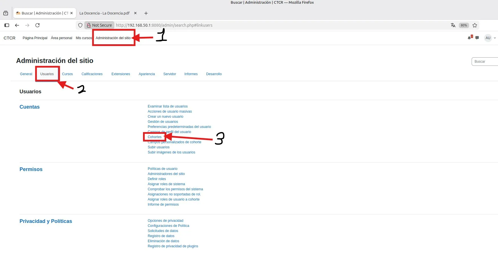

# PASO 06.06 — Crear las cohortes departamentales

> **Naturaleza:** procedimiento reproducible derivado íntegramente de la guía compartida, con correcciones para el repositorio. **No implica que el paso esté verificado en todas las máquinas.**
>
> **Origen:** `docs/fuentes/GUIA-HISTORICA-INTEGRA.md`; capturas reales de la última bitácora cuando existen.

## Archivos relacionados y por qué importan

- **[`docs/00-proyecto/matriz-requisitos.md`](../../00-proyecto/matriz-requisitos.md)**: criterios de aceptación por curso, recurso y denegación de acceso.
- **[`docs/procedimientos/06-moodle/06-04-cuestionarios.md`](06-04-cuestionarios.md)**: pasos GUI detallados para crear y evaluar preguntas de cuestionarios.

**Lugar de ejecución:** navegador Firefox en Linux Mint con sesión Moodle y permisos de edición. Confirmar direcciones reales y el estado actual de la VM antes de copiar comandos.

## Propósito del paso y contexto operacional

Modelo académico del Colegio Técnico: tres categorías, tres cursos con recursos y cuestionarios, roles y cohortes.

Este archivo corresponde **exclusivamente al paso 06-06**, con comandos históricos literales y mejoras razonadas. En una **VM ya configurada** se inspeccionan primero los servicios y datos; no se vuelven a crear credenciales ni volúmenes. Los resultados observados en las capturas pertenecen a la sesión que los originó, no al conjunto de cinco integrantes.

## Comprobación recomendada y salida a documentar

Realizar una matriz por curso y cuenta: 2 recursos genuinos, 1 actividad evaluable, 1 nota de prueba y bloqueo de URL ajena. Nunca probar aislamiento con el superusuario.

Registrar el resultado exacto, fecha, sistema y si la prueba pasó o falló. Para un cambio de configuración conservar el archivo anterior y ejecutar la validación sintáctica antes de reiniciar el servicio. La **ruta versionable recomendada** está explicada en [`infra/`](../../../infra/README.md), sin sustituir los comandos originales que aparecen abajo.

## Antes de ejecutar

- [ ] Identificar VM, interfaz e IP actual; no asumir la IP de otra persona.
- [ ] Inspeccionar el estado actual del servicio. Si hay datos o volúmenes existentes, respaldarlos antes de cambios.
- [ ] Registrar fecha, integrante responsable, revisor y versión vigente en la sesión de bitácora.

## Procedimiento completo y comandos originales

En Moodle una cohorte es una colección de usuarios que puede utilizarse para matricular participantes en cursos.

Buscá:

Administración del sitio → Usuarios → Cuentas → Cohortes.

Creá las tres cohortes de [DATOS-MAESTROS](../../00-proyecto/DATOS-MAESTROS.md) (sección 6), a nivel de sitio:

| Cohorte                    | ID             | Miembros                          |
| -------------------------- | -------------- | --------------------------------- |
| Personal de Administración | `CTCR-COH-ADM` | `marta.jimenez`, `carlos.mendez`  |
| Personal de Docencia       | `CTCR-COH-DOC` | `sofia.hernandez`, `jose.ramirez` |
| Personal de Informática    | `CTCR-COH-INF` | `valeria.sanchez`, `diego.fernandez` |

`laura.rodriguez`, `andrea.castillo` y `daniel.vargas` **no** entran en ninguna cohorte (son profesores por matrícula manual); si entraran, el cohort sync los matricularía también como estudiantes. Cada usuario va en una sola cohorte.

## Correcciones y precauciones aplicables

La bitácora nueva sí muestra creación de usuarios y cohortes (págs. 18-21). La guía histórica diferencia creación de usuarios (6.5) de cohortes (6.6), mientras el repositorio anterior agrupaba ambos: conservar las dos referencias.

## Evidencias de este paso — registro local y contextualizado

Estas imágenes proceden de la bitácora del equipo y están **almacenadas físicamente junto al procedimiento**, no en una galería sin contexto. Se muestran con sus límites probatorios y una ficha independiente.

### EV-041 · Navegación a cohortes

**Qué se observa:** La administración de usuarios muestra la ruta para acceder a cohortes. Es la transición desde gestionar cuentas individuales a agrupar participantes por departamento.

**Qué queda sin probar:** No valida la sincronización de matrícula ni aislamiento. Las cohortes no restringen el acceso por sí solas.

**Procedencia:** bitácora actualizada, página 19. **Ficha de evidencia:** [EV-041](06-06/evidencias/EV-041.md). **Privacidad:** revisión pendiente antes de publicar.

### EV-042 · Creación de una cohorte

**Qué se observa:** La pantalla «Añadir nueva cohorte» muestra campos para nombre, ID y contexto. Ayuda a reproducir la creación de una cohorte de departamento, pero no su matriculación en un curso.

**Qué queda sin probar:** No valida la sincronización de matrícula ni aislamiento. Las cohortes no restringen el acceso por sí solas.

**Procedencia:** bitácora actualizada, página 20. **Ficha de evidencia:** [EV-042](06-06/evidencias/EV-042.md). **Privacidad:** revisión pendiente antes de publicar.

### EV-043 · Lista de cohortes departamentales

**Qué se observa:** La vista de cohortes del sistema muestra la estructura de la tabla, con filas o datos sensibles ocultos. No demuestra por sí sola cuántas personas forman cada cohorte.

**Qué queda sin probar:** No valida la sincronización de matrícula ni aislamiento. Las cohortes no restringen el acceso por sí solas.

**Procedencia:** bitácora actualizada, página 20. **Ficha de evidencia:** [EV-043](06-06/evidencias/EV-043.md). **Privacidad:** revisión pendiente antes de publicar.

### EV-044 · Gestión de usuarios asignados a cohortes

**Qué se observa:** El menú contextual de una cohorte presenta la acción de asignar miembros. Es evidencia de la navegación al gestor de asignación, no prueba visual legible de todos los miembros debido a ocultación.

**Qué queda sin probar:** No valida la sincronización de matrícula ni aislamiento. Las cohortes no restringen el acceso por sí solas.

**Procedencia:** bitácora actualizada, página 21. **Ficha de evidencia:** [EV-044](06-06/evidencias/EV-044.md). **Privacidad:** revisión pendiente antes de publicar.

> El estado de una captura no sustituye una comprobación en cada máquina. El criterio de aceptación está en la sección de verificación y en la [matriz de requisitos](../../00-proyecto/matriz-requisitos.md).

## Registro de ejecución del grupo

| Campo | Completar durante la sesión |
|---|---|
| VM / fecha | Linux Mint (`192.168.50.101`) / Ubuntu Server (`192.168.50.1`) — 2026-10-24 |
| Quién ejecutó / quién revisó | Cristhian Altamirano Montes / Grupo de Laboratorio CTCR |
| Comandos aplicados / diferencias | Creación de 3 cohortes a nivel de sistema y asignación de 2 estudiantes por cohorte |
| Resultado observado | CTCR-COH-ADM (2 miembros), CTCR-COH-DOC (2 miembros), CTCR-COH-INF (2 miembros) |
| Captura nueva / prueba | [EV-057](06-06/evidencias/EV-057.md) |
| Incidencia (si ocurre) | Ninguna |

**Aceptación:** adjuntar captura y comando verificable; no cambiar a completado porque el procedimiento figure aquí.
