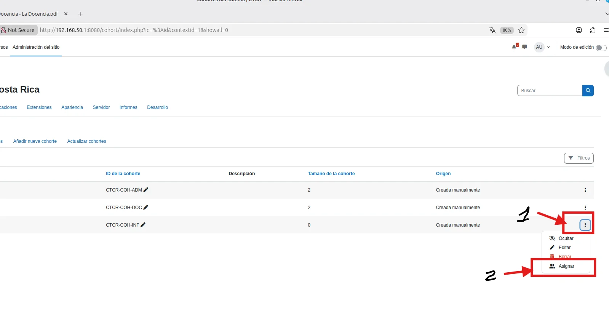

# EV-044 — Gestión de usuarios asignados a cohortes

**Procedencia:** bitácora del grupo, versión actualizada de 26 páginas, página **21**. Extracto de una captura histórica: no es una simulación ni una prueba nueva. **Paso relacionado:** [06-06 — PASO 06.06 — Crear las cohortes departamentales](../../06-06.md).

## Qué ocurre en esta captura

El menú contextual de una cohorte presenta la acción de asignar miembros. Es evidencia de la navegación al gestor de asignación, no prueba visual legible de todos los miembros debido a ocultación.

## Interpretación y límite de la evidencia

No valida la sincronización de matrícula ni aislamiento. Las cohortes no restringen el acceso por sí solas. Se conserva como **evidencia histórica parcial**, no como prueba de aceptación transversal del laboratorio ni de las cinco instalaciones.

## Reproducir y verificar

Abrir el [procedimiento 06-06](../../06-06.md), identificar la VM y ejecutar la sección de validación sin introducir contraseñas en imágenes públicas. Comparar resultado esperado con resultado real y crear una nueva evidencia si cambia la versión o configuración.

## Identidad, trazabilidad y privacidad

- **Identificador permanente:** `EV-044`.
- **Archivo de imagen:** `EV-044.webp` (WebP).
- **SHA-256 de la imagen incorporada:** `8247c18c21f7b90ffdff6390a5e01f332cb240695e8585d516845f1e2876bb41`.
- **Origen:** `Proyecto_Colegio_Técnico_con_departamentos_separados(1).docx`, página 21.
- **Estado de revisión:** `SANEADA, requiere verificación`.
- **Política de privacidad:** Revisar manualmente antes de publicar. La versión incorporada contiene ocultaciones de privacidad.
- **Responsable de captura, fecha exacta, host y revisor:** no determinados inequívocamente por esta imagen; registrar si se cuenta con esa información.

## Para cerrar la evidencia

- [ ] Confirmar que no aparecen contraseñas, tokens ni datos de terceros en zonas legibles.
- [ ] Asociar el registro de sesión y la VM que la generó.
- [ ] Comprobar el resultado esperado en una sesión controlada, si se exige prueba de aceptación.
