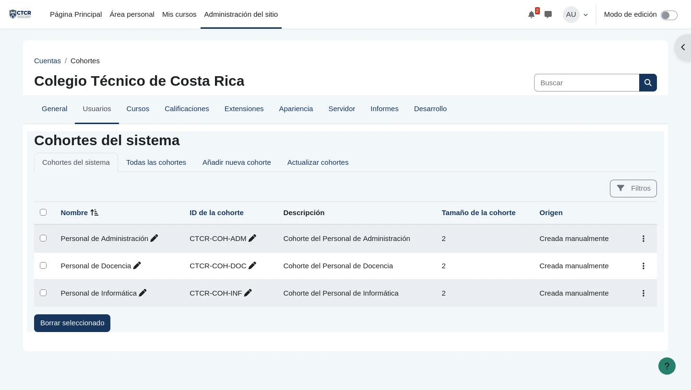

# EV-057 — Cohortes institucionales creadas a nivel de sistema

**Procedencia:** prueba de aceptación real ejecutada en la VM cliente Linux Mint (`192.168.50.101`) con navegador Firefox. **Paso relacionado:** [06-06 — PASO 06-06](../../06-06.md).

## Qué ocurre en esta captura

En la administración de cohortes (cohort/index.php) se visualizan las tres cohortes de estudiantes a nivel de sistema: Personal de Administración (CTCR-COH-ADM) con 2 integrantes, Personal de Docencia (CTCR-COH-DOC) con 2 integrantes y Personal de Informática (CTCR-COH-INF) con 2 integrantes. Los profesores permanecen fuera de las cohortes.

## Interpretación y límite de la evidencia

Comprueba la agrupación lógica de estudiantes. El aislamiento depende de que los cursos sincronicen únicamente su respectiva cohorte y deshabiliten otros métodos.

## Reproducir y verificar

1. Conectarse a la máquina virtual Linux Mint (`192.168.50.101`).
2. Abrir el navegador Firefox e ingresar a la plataforma institucional Moodle (`http://192.168.50.1:8080`).
3. Ejecutar las acciones descritas en el procedimiento [06-06](../../06-06.md).
4. Comprobar que el resultado obtenido coincide plenamente con los datos de esta evidencia.

## Identidad, trazabilidad y privacidad

- **Identificador permanente:** `EV-057`.
- **Archivo de imagen:** `EV-057.webp` (WebP optimizado).
- **SHA-256 de la imagen incorporada:** `5e618c571a4205c2bdcc37c0c384510154c72a1d384d06dcad255199a3035daf`.
- **Origen:** Prueba de aceptación automatizada en vivo sobre Linux Mint (`criss-VirtualBox`).
- **Estado de revisión:** `VERIFICADA, prueba de aceptación ejecutada`.
- **Política de privacidad:** Se sanitizaron contraseñas y datos sensibles del entorno. Las identidades visibles corresponden al personal institucional ficticio del Colegio Técnico de Costa Rica definido en la matriz oficial de datos maestros.
- **Responsable de captura:** Cristhian Altamirano Montes (Estudiante UNA).
- **Fecha:** 2026-10-24.
- **Host de captura:** Linux Mint 22.3 (`192.168.50.101`) -> Ubuntu Server (`192.168.50.1:8080`).

## Para cerrar la evidencia

- [x] Confirmar que no aparecen contraseñas, tokens ni datos personales reales en zonas legibles.
- [x] Asociar el registro de sesión y la VM que la generó (`192.168.50.101`).
- [x] Comprobar el resultado esperado en una sesión controlada con la matriz de requisitos aprobada.
