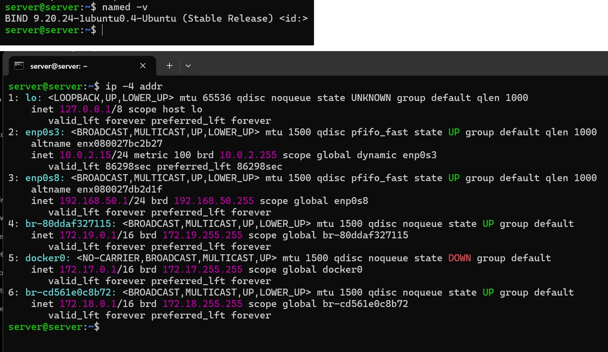
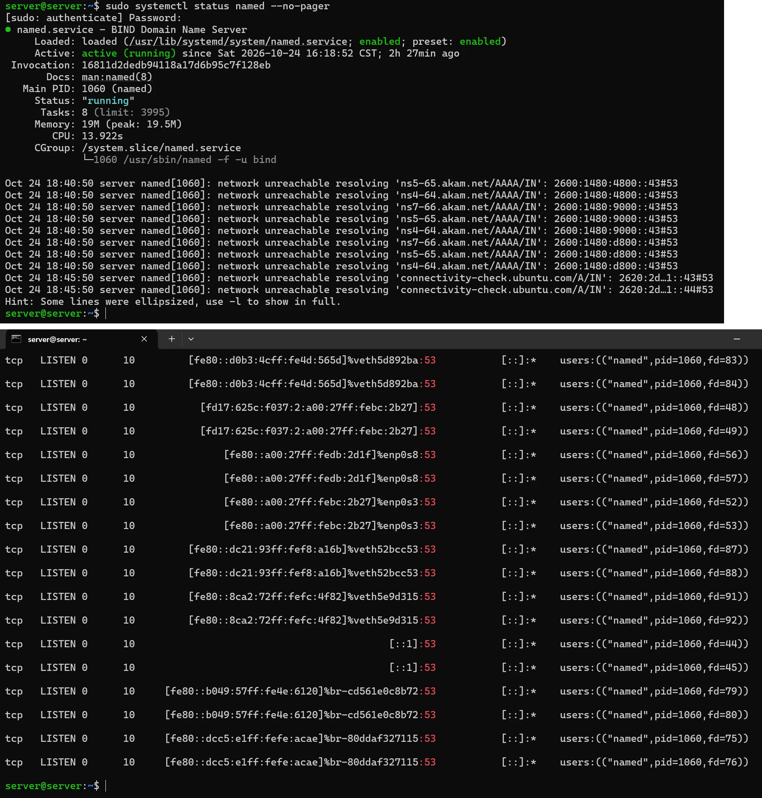

# PASO 07.01 — Instalar BIND9 en Ubuntu

> **Naturaleza:** procedimiento reproducible derivado íntegramente de la guía compartida, con correcciones para el repositorio. **No implica que el paso esté verificado en todas las máquinas.**
>
> **Origen:** `docs/fuentes/GUIA-HISTORICA-INTEGRA.md`; capturas reales de la última bitácora cuando existen.

## Archivos relacionados y por qué importan

- **[`infra/bind9/named.conf.options.fragment`](../../../infra/bind9/named.conf.options.fragment)**: interfaz/IP, reenvío y alcance de consultas DNS.
- **[`infra/bind9/named.conf.local.fragment`](../../../infra/bind9/named.conf.local.fragment)**: declaración de la zona autorizada ctcr.
- **[`infra/bind9/db.ctcr`](../../../infra/bind9/db.ctcr)**: registros NS/SOA/A que resuelven aulavirtual.ctcr.

**Lugar de ejecución:** terminal de Ubuntu Server (no la terminal del host Windows ni del contenedor, salvo cuando el comando sea `docker compose exec`). Confirmar direcciones reales y el estado actual de la VM antes de copiar comandos.

**Relación con el estado existente:** si el servicio ya está configurado, **no recrearlo por inercia**. Comparar con el archivo realmente activo; modificar solo campos necesarios, con copia, rollback y prueba posterior.

## Propósito del paso y contexto operacional

DNS autoritativo y recursión restringida BIND9: resolución del dominio `.ctcr` solamente en la red interna del laboratorio.

Este archivo corresponde **exclusivamente al paso 07-01**, con comandos históricos literales y mejoras razonadas. En una **VM ya configurada** se inspeccionan primero los servicios y datos; no se vuelven a crear credenciales ni volúmenes. Los resultados observados en las capturas pertenecen a la sesión que los originó, no al conjunto de cinco integrantes.

## Comprobación recomendada y salida a documentar

`sudo named-checkconf`, `sudo named-checkzone ctcr /etc/bind/db.ctcr`, `dig @192.168.50.1 aulavirtual.ctcr A +short` desde Mint.

Registrar el resultado exacto, fecha, sistema y si la prueba pasó o falló. Para un cambio de configuración conservar el archivo anterior y ejecutar la validación sintáctica antes de reiniciar el servicio. La **ruta versionable recomendada** está explicada en [`infra/`](../../../infra/README.md), sin sustituir los comandos originales que aparecen abajo.

## Antes de ejecutar

- [ ] Identificar VM, interfaz e IP actual; no asumir la IP de otra persona.
- [ ] Inspeccionar el estado actual del servicio. Si hay datos o volúmenes existentes, respaldarlos antes de cambios.
- [ ] Registrar fecha, integrante responsable, revisor y versión vigente en la sesión de bitácora.

## Procedimiento completo y comandos originales

```
sudo apt update
```

```
sudo apt install -y bind9 bind9-utils dnsutils
```

Comprobá:

```
named -v
```

Y verificá el estado del servicio:

```
sudo systemctl status named --no-pager
```

Ubuntu ya tiene servicios de resolución DNS propios, por lo que antes de modificar BIND comprobamos quién ocupa el puerto 53:

```
sudo ss -lntup | grep ':53 '
```

Es normal que `systemd-resolved` utilice una dirección local como `127.0.0.53`. Configuraremos BIND9 para escuchar específicamente en la IP interna `192.168.50.1`, evitando que compita por todas las interfaces.

## Correcciones y precauciones aplicables

Antes de copiar comandos comprueben si es un servidor nuevo o una VM ya configurada; adaptar rutas, IP, interfaces, nombres y versiones, y guardar evidencia del resultado.

## Evidencias de este paso — registro local y contextualizado

**Sin captura de la VM de Criss atribuible a este subpaso preparatorio.** La instalación, comprobación sintáctica de zonas y verificación del socket de BIND9 en `192.168.50.1:53` se valida de forma consolidada con la evidencia [EV-063](07-05/evidencias/EV-063.md) en el subpaso [07-05](07-05.md).

> El estado de una captura no sustituye una comprobación en cada máquina. El criterio de aceptación está en la sección de verificación y en la [matriz de requisitos](../../00-proyecto/matriz-requisitos.md).

### Ejecución del grupo en la VM `server@server`

Capturas del documento del grupo (PDF de 54 páginas) tomadas en **otra VM del grupo** (`server@server`), distinta de la VM de Criss (`criss@server`) de las evidencias anteriores. Muestran el mismo paso hecho por otras integrantes; las diferencias entre VMs están en [ADR-0004](../../decisiones/ADR-0004-servidor-unico-de-demostracion.md).

#### EV-107 · Versión de BIND9 e interfaces del servidor



**Qué se observa:** `named -v` devuelve `BIND 9.20.24-1ubuntu0.4-Ubuntu (Stable Release)`. `ip -4 addr` muestra `lo` 127.0.0.1, `enp0s3` 10.0.2.15/24 (NAT), `enp0s8` 192.168.50.1/24 (red interna), `docker0` 172.17.0.1/16 en estado DOWN y dos redes de Docker `br-…` (172.18.0.1/16 y 172.19.0.1/16).

**Qué significa y qué no prueba:** Confirma la versión instalada y que la IP donde BIND9 debe atender a Mint es la de `enp0s8`. No prueba que BIND9 escuche ahí todavía: eso cambia en 07-02. **Ficha:** [EV-107](07-01/evidencias/EV-107.md).

#### EV-108 · Estado de named y puertos 53 antes de configurar



**Qué se observa:** `systemctl status named`: `active (running)` desde el sábado 2026-10-24 16:18:52 CST y `enabled`. Los registros repiten `network unreachable resolving '…/AAAA/IN'`. `ss` muestra a `named` escuchando el puerto 53 en `::1` y en direcciones IPv6 de `enp0s3`, `enp0s8`, los puentes de Docker y varias interfaces `veth`.

**Qué significa y qué no prueba:** Es el estado **antes** de 07-02: named escucha en todas las interfaces, incluidas las de los contenedores. Por eso en 07-02 se fija `listen-on { 192.168.50.1; }` y `listen-on-v6 { none; }`. Los avisos `network unreachable` vienen de intentar resolver por IPv6 sin ruta; no son un error de la zona. **Ficha:** [EV-108](07-01/evidencias/EV-108.md).

## Registro de ejecución del grupo

| Campo | Completar durante la sesión |
|---|---|
| VM / fecha | `VM #1 (Ubuntu Server 26.04) — 2026-10-28` |
| Quién ejecutó / quién revisó | `criss / agente (verificación local)` |
| Comandos aplicados / diferencias | `named -v` (`BIND 9.20.24-1ubuntu0.4`), `sudo ss -lntup \| grep ':53 '` |
| Resultado observado | BIND9 verificado y en ejecución; puerto 53 ocupado inicialmente en loopback por `systemd-resolved` (resuelto en INC-002) |
| Captura nueva / prueba | Verificada sintaxis e instalación en [07-05](07-05.md) con `EV-063` |
| Incidencia (si ocurre) | Referenciada en [`bitacora/incidentes/INC-002-bind9-systemd-resolved-port53.md`](../../../bitacora/incidentes/INC-002-bind9-systemd-resolved-port53.md) |

**Aceptación:** adjuntar captura y comando verificable; no cambiar a completado porque el procedimiento figure aquí.
