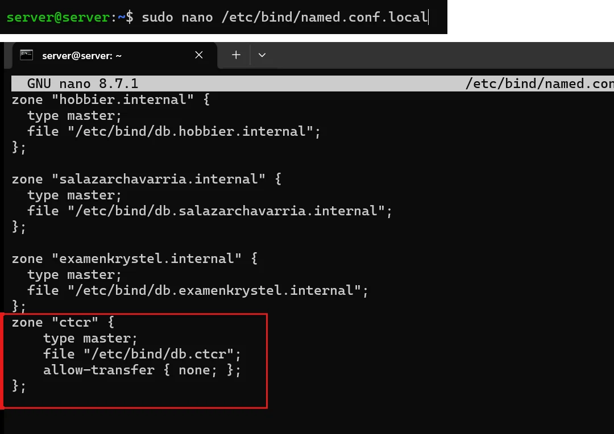

# PASO 07.03 — Registrar la zona del proyecto

> **Naturaleza:** procedimiento reproducible derivado íntegramente de la guía compartida, con correcciones para el repositorio. **No implica que el paso esté verificado en todas las máquinas.**
>
> **Origen:** `docs/fuentes/GUIA-HISTORICA-INTEGRA.md`; capturas reales de la última bitácora cuando existen.

## Archivos relacionados y por qué importan

- **[`infra/bind9/named.conf.options.fragment`](../../../infra/bind9/named.conf.options.fragment)**: interfaz/IP, reenvío y alcance de consultas DNS.
- **[`infra/bind9/named.conf.local.fragment`](../../../infra/bind9/named.conf.local.fragment)**: declaración de la zona autorizada ctcr.
- **[`infra/bind9/db.ctcr`](../../../infra/bind9/db.ctcr)**: registros NS/SOA/A que resuelven aulavirtual.ctcr.

**Lugar de ejecución:** terminal de Ubuntu Server (no la terminal del host Windows ni del contenedor, salvo cuando el comando sea `docker compose exec`). Confirmar direcciones reales y el estado actual de la VM antes de copiar comandos.

**Relación con el estado existente:** si el servicio ya está configurado, **no recrearlo por inercia**. Comparar con el archivo realmente activo; modificar solo campos necesarios, con copia, rollback y prueba posterior.

## Propósito del paso y contexto operacional

DNS autoritativo y recursión restringida BIND9: resolución del dominio `.ctcr` solamente en la red interna del laboratorio.

Este archivo corresponde **exclusivamente al paso 07-03**, con comandos históricos literales y mejoras razonadas. En una **VM ya configurada** se inspeccionan primero los servicios y datos; no se vuelven a crear credenciales ni volúmenes. Los resultados observados en las capturas pertenecen a la sesión que los originó, no al conjunto de cinco integrantes.

## Comprobación recomendada y salida a documentar

`sudo named-checkconf`, `sudo named-checkzone ctcr /etc/bind/db.ctcr`, `dig @192.168.50.1 aulavirtual.ctcr A +short` desde Mint.

Registrar el resultado exacto, fecha, sistema y si la prueba pasó o falló. Para un cambio de configuración conservar el archivo anterior y ejecutar la validación sintáctica antes de reiniciar el servicio. La **ruta versionable recomendada** está explicada en [`infra/`](../../../infra/README.md), sin sustituir los comandos originales que aparecen abajo.

## Antes de ejecutar

- [ ] Identificar VM, interfaz e IP actual; no asumir la IP de otra persona.
- [ ] Inspeccionar el estado actual del servicio. Si hay datos o volúmenes existentes, respaldarlos antes de cambios.
- [ ] Registrar fecha, integrante responsable, revisor y versión vigente en la sesión de bitácora.

## Procedimiento completo y comandos originales

Abrí:

```
sudo nano /etc/bind/named.conf.local
```

Agregá al final:

```
zone "ctcr" {
    type master;
    file "/etc/bind/db.ctcr";
    allow-transfer { none; };
};
```

## Correcciones y precauciones aplicables

Antes de copiar comandos comprueben si es un servidor nuevo o una VM ya configurada; adaptar rutas, IP, interfaces, nombres y versiones, y guardar evidencia del resultado.

## Evidencias de este paso — registro local y contextualizado

**Sin captura de la VM de Criss atribuible a este subpaso preparatorio.** La declaración de la zona `ctcr` en `named.conf.local` se comprueba mediante `named-checkconf` en [07-05](07-05.md) con la evidencia [EV-063](07-05/evidencias/EV-063.md).

> El estado de una captura no sustituye una comprobación en cada máquina. El criterio de aceptación está en la sección de verificación y en la [matriz de requisitos](../../00-proyecto/matriz-requisitos.md).

### Ejecución del grupo en la VM `server@server`

Capturas del documento del grupo (PDF de 54 páginas) tomadas en **otra VM del grupo** (`server@server`), distinta de la VM de Criss (`criss@server`) de las evidencias anteriores. Muestran el mismo paso hecho por otras integrantes; las diferencias entre VMs están en [ADR-0004](../../decisiones/ADR-0004-servidor-unico-de-demostracion.md).

#### EV-110 · Zona ctcr registrada junto a zonas de otras prácticas



**Qué se observa:** `named.conf.local` ya contenía las zonas `hobbier.internal`, `salazarchavarria.internal` y `examenkrystel.internal` de prácticas anteriores. Al final se agrega, recuadrada, `zone "ctcr" { type master; file "/etc/bind/db.ctcr"; allow-transfer { none; }; };`.

**Qué significa y qué no prueba:** La zona del proyecto quedó registrada sin tocar las de otros laboratorios. Consecuencia para la entrega: si este `named.conf.local` se entrega tal cual, el profesor verá esas tres zonas ajenas; hay que saber explicarlas (riesgo R-42). `allow-transfer { none; }` impide copiar la zona desde otro equipo. **Ficha:** [EV-110](07-03/evidencias/EV-110.md).

## Registro de ejecución del grupo

| Campo | Completar durante la sesión |
|---|---|
| VM / fecha | `VM #1 (Ubuntu Server 26.04) — 2026-10-28` |
| Quién ejecutó / quién revisó | `criss / agente (verificación local)` |
| Comandos aplicados / diferencias | Inclusión de bloque `zone "ctcr"` tipo master en `/etc/bind/named.conf.local` apuntando a `/etc/bind/db.ctcr` |
| Resultado observado | Zona ctcr registrada como autoritativa localmente sin destruir zonas previas del servidor |
| Captura nueva / prueba | Verificado sintácticamente con `named-checkconf` en [07-05](07-05.md) con `EV-063` |
| Incidencia (si ocurre) | Ninguna en el registro de la zona |

**Aceptación:** adjuntar captura y comando verificable; no cambiar a completado porque el procedimiento figure aquí.
