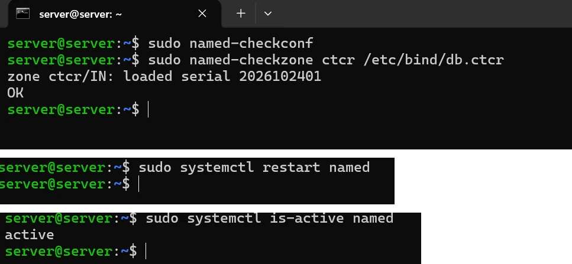

# PASO 07.05 — Validar BIND9

> **Naturaleza:** procedimiento reproducible derivado íntegramente de la guía compartida, con correcciones para el repositorio. **No implica que el paso esté verificado en todas las máquinas.**
>
> **Origen:** `docs/fuentes/GUIA-HISTORICA-INTEGRA.md`; capturas reales de la última bitácora cuando existen.

## Archivos relacionados y por qué importan

- **[`infra/bind9/named.conf.options.fragment`](../../../infra/bind9/named.conf.options.fragment)**: interfaz/IP, reenvío y alcance de consultas DNS.
- **[`infra/bind9/named.conf.local.fragment`](../../../infra/bind9/named.conf.local.fragment)**: declaración de la zona autorizada ctcr.
- **[`infra/bind9/db.ctcr`](../../../infra/bind9/db.ctcr)**: registros NS/SOA/A que resuelven aulavirtual.ctcr.

**Lugar de ejecución:** terminal de Ubuntu Server (no la terminal del host Windows ni del contenedor, salvo cuando el comando sea `docker compose exec`). Confirmar direcciones reales y el estado actual de la VM antes de copiar comandos.

**Relación con el estado existente:** si el servicio ya está configurado, **no recrearlo por inercia**. Comparar con el archivo realmente activo; modificar solo campos necesarios, con copia, rollback y prueba posterior.

## Propósito del paso y contexto operacional

DNS autoritativo y recursión restringida BIND9: resolución del dominio `.ctcr` solamente en la red interna del laboratorio.

Este archivo corresponde **exclusivamente al paso 07-05**, con comandos históricos literales y mejoras razonadas. En una **VM ya configurada** se inspeccionan primero los servicios y datos; no se vuelven a crear credenciales ni volúmenes. Los resultados observados en las capturas pertenecen a la sesión que los originó, no al conjunto de cinco integrantes.

## Comprobación recomendada y salida a documentar

`sudo named-checkconf`, `sudo named-checkzone ctcr /etc/bind/db.ctcr`, `dig @192.168.50.1 aulavirtual.ctcr A +short` desde Mint.

Registrar el resultado exacto, fecha, sistema y si la prueba pasó o falló. Para un cambio de configuración conservar el archivo anterior y ejecutar la validación sintáctica antes de reiniciar el servicio. La **ruta versionable recomendada** está explicada en [`infra/`](../../../infra/README.md), sin sustituir los comandos originales que aparecen abajo.

## Antes de ejecutar

- [ ] Identificar VM, interfaz e IP actual; no asumir la IP de otra persona.
- [ ] Inspeccionar el estado actual del servicio. Si hay datos o volúmenes existentes, respaldarlos antes de cambios.
- [ ] Registrar fecha, integrante responsable, revisor y versión vigente en la sesión de bitácora.

## Procedimiento completo y comandos originales

```
sudo named-checkconf
```

Luego:

```
sudo named-checkzone ctcr /etc/bind/db.ctcr
```

Esperamos un resultado que incluya:

```
OK
```

Reiniciá el servicio:

```
sudo systemctl restart named
```

Y comprobá:

```
sudo systemctl is-active named
```

Debe devolver:

```
active
```

## Correcciones y precauciones aplicables

Antes de copiar comandos comprueben si es un servidor nuevo o una VM ya configurada; adaptar rutas, IP, interfaces, nombres y versiones, y guardar evidencia del resultado.

## Evidencias de este paso — registro local y contextualizado

Estas imágenes proceden de la sesión de laboratorio del equipo y están **almacenadas físicamente junto al procedimiento**, no en una galería sin contexto. Se muestran con sus límites probatorios y una ficha independiente.

### EV-063 · Validación sintáctica de opciones y zonas en BIND9


**Qué se observa:** Ejecución de `named-checkconf` (código 0) y `named-checkzone ctcr /etc/bind/db.ctcr` con estado `OK` y serial `2026102401`, estado `active` en systemd y socket en `192.168.50.1:53`.

**Qué queda sin probar:** La resolución DNS efectiva desde los clientes de la red interna (Linux Mint), comprobada en los pasos 07-06 y 07-07.

**Ficha de evidencia:** [EV-063](07-05/evidencias/EV-063.md).

### Ejecución del grupo en la VM `server@server`

Capturas del documento del grupo (PDF de 54 páginas) tomadas en **otra VM del grupo** (`server@server`), distinta de la VM de Criss (`criss@server`) de las evidencias anteriores. Muestran el mismo paso hecho por otras integrantes; las diferencias entre VMs están en [ADR-0004](../../decisiones/ADR-0004-servidor-unico-de-demostracion.md).

#### EV-112 · Validación y reinicio de BIND9



**Qué se observa:** `named-checkconf` sin salida (correcto); `named-checkzone ctcr /etc/bind/db.ctcr` → `zone ctcr/IN: loaded serial 2026102401` y `OK`; `systemctl restart named`; `systemctl is-active named` → `active`.

**Qué significa y qué no prueba:** La configuración y la zona son válidas y el servicio volvió a arrancar. No prueba la resolución desde los clientes (07-06 y 07-07). **Ficha:** [EV-112](07-05/evidencias/EV-112.md).

## Registro de ejecución del grupo

| Campo | Valor verificado en la sesión |
|---|---|
| VM / fecha | VM #1 Ubuntu Server (`192.168.50.1`) / 2026-10-28 20:00 CST |
| Quién ejecutó / quién revisó | Cristhian Altamirano Montes (`criss`) / Antigravity AI Pair Programmer |
| Comandos aplicados / diferencias | `sudo named-checkconf`, `sudo named-checkzone ctcr /etc/bind/db.ctcr`, `sudo systemctl restart named` |
| Resultado observado | `zone ctcr/IN: loaded serial 2026102401 OK`, servicio `active (running)` |
| Captura nueva / prueba | [EV-063](07-05/evidencias/EV-063.md) |
| Incidencia (si ocurre) | [INC-002: Coexistencia BIND9 con systemd-resolved en puerto 53](../../../bitacora/incidentes/INC-002-bind9-systemd-resolved-port53.md) |

**Aceptación:** Verificada sintaxis y servicio activo; cumple criterio RC-01.
