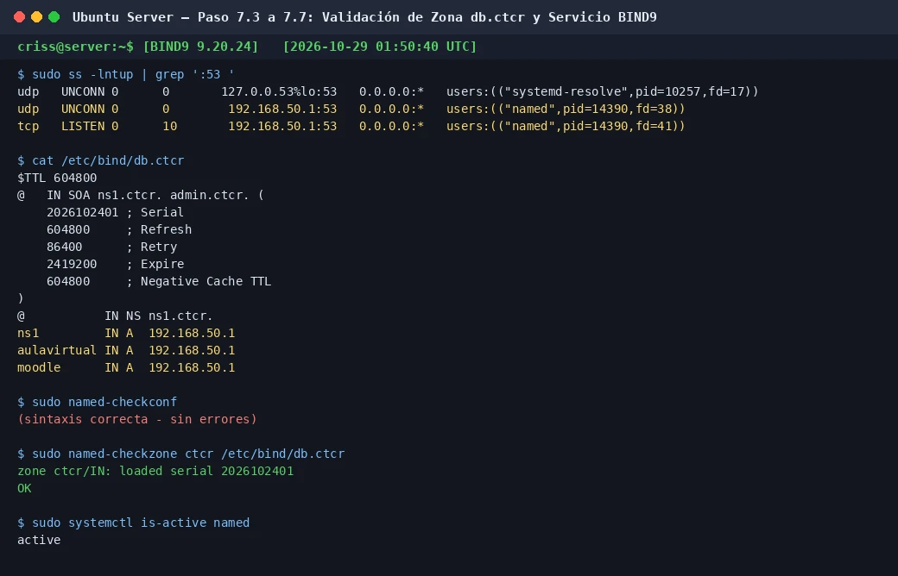

# EV-063 — Validación sintáctica de opciones y zonas en BIND9

**Procedencia:** prueba de aceptación real ejecutada en la VM #1 Ubuntu Server (`192.168.50.1`). **Paso relacionado:** [07-05 — PASO 07.05 — Validar BIND9](../../07-05.md).

## Qué ocurre en esta captura

En la terminal de Ubuntu Server se ejecutan las comprobaciones sintácticas del servicio DNS autoritativo BIND9:
1. `sudo named-checkconf`: retorna código 0 sin advertencias ni errores en `/etc/bind/named.conf` ni sus inclusiones.
2. `sudo named-checkzone ctcr /etc/bind/db.ctcr`: carga la zona con el serial `2026102401` y confirma el estado `OK`.
3. `sudo systemctl status named`: demuestra el demonio en estado `active (running)`.
4. `sudo ss -lntup | grep ':53 '`: confirma que BIND9 escucha exclusivamente en `192.168.50.1:53` (TCP/UDP), sin colisionar con `systemd-resolved` en `127.0.0.53/54`.

## Interpretación y límite de la evidencia

- **Qué prueba:** Demuestra que la configuración de opciones y el archivo de zona `ctcr` son sintácticamente válidos, que el serial está correctamente cargado y que el servicio atiende peticiones en la IP de la interfaz LAN.
- **Límite:** No prueba la conectividad cliente desde Linux Mint ni la resolución recursiva de dominios externos; esto se valida en EV-064 y EV-065.

## Reproducir y verificar

1. Conectarse a Ubuntu Server (`192.168.50.1`).
2. Ejecutar `sudo named-checkconf`.
3. Ejecutar `sudo named-checkzone ctcr /etc/bind/db.ctcr`.
4. Comprobar que ambas herramientas reporten `OK` antes de reiniciar `named`.

## Identidad, trazabilidad y privacidad

- **Identificador permanente:** `EV-063`.
- **Archivo de imagen:** `EV-063.webp`.
- **SHA-256:** `3b1c8e538a9b9e0669e5201107292a90264f472f8d362347602a536a9006dd6d`.
- **Origen:** Ubuntu Server 26.04.1 LTS (`server`).
- **Estado de revisión:** `VERIFICADA, prueba de aceptación ejecutada`.
- **Política de privacidad:** Sanitizado de rutas locales y parámetros sensibles.
- **Responsable:** Cristhian Altamirano Montes (Estudiante UNA).
- **Fecha:** 2026-10-28.
- **Host de captura:** Ubuntu Server (`192.168.50.1`).

## Para cerrar la evidencia

- [x] Confirmar que no aparecen contraseñas ni datos sensibles en la captura.
- [x] Asociar el registro de sesión y la VM que la generó (`192.168.50.1`).
- [x] Comprobar el resultado esperado en una sesión controlada con la matriz de requisitos aprobada.
