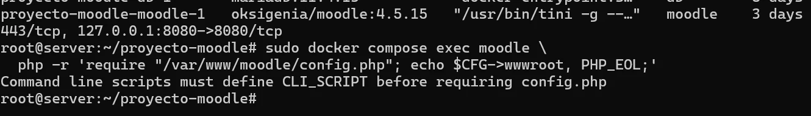

# EV-120 — Error CLI_SCRIPT al consultar wwwroot

**Procedencia:** Documento del grupo «Proyecto Colegio Técnico con departamentos separados» (PDF de 54 páginas), página 50. Captura real del grupo en la VM `server@server` (usuario `server`, Ubuntu Server con `enp0s8` 192.168.50.1), distinta de la VM de Criss (`criss@server`). **Paso relacionado:** [08-05](../../08-05.md).

## Qué ocurre en esta captura

`docker compose exec moodle php -r 'require "/var/www/moodle/config.php"; echo $CFG->wwwroot, PHP_EOL;'` responde `Command line scripts must define CLI_SCRIPT before requiring config.php`.

## Interpretación y límite de la evidencia

Captura del error de INC-005 en esta VM. La corrección, definir `CLI_SCRIPT` antes del `require`, es la que se ve funcionando en EV-119.

## Reproducir y verificar

1. Seguir el procedimiento [08-05](../../08-05.md) en la VM que se vaya a presentar.
2. Comparar la salida con esta captura; las rutas, nombres de usuario y versiones pueden variar entre VMs del grupo (ver ADR-0004).
3. Si la salida cambia, crear una evidencia nueva en lugar de reemplazar esta.

## Identidad, trazabilidad y privacidad

- **Identificador permanente:** `EV-120`.
- **Archivo de imagen:** `EV-120.webp` (WebP, compuesto por las capturas de la página en el orden del documento).
- **SHA-256 de la imagen incorporada:** `c78fe4fa94173a24f5802e15fb3cb4714dad683b4d1563c98625ca1be6c4ae64`.
- **Origen:** Documento del grupo «Proyecto Colegio Técnico con departamentos separados» (PDF de 54 páginas), página 50. Incorporada el 2026-10-31.
- **VM:** VM `server@server` (usuario `server`, Ubuntu Server con `enp0s8` 192.168.50.1), distinta de la VM de Criss (`criss@server`).
- **Estado de revisión:** `EXTRAIDA, revisada`.
- **Política de privacidad:** Sin datos personales.
- **Responsable de captura y fecha exacta:** no determinados por la imagen salvo donde la salida muestra la fecha.

## Para cerrar la evidencia

- [x] Confirmar que no aparecen contraseñas, tokens ni datos personales reales en zonas legibles.
- [ ] Registrar qué integrante ejecutó el paso en esta VM.
- [ ] Revisión por una segunda integrante del grupo.
