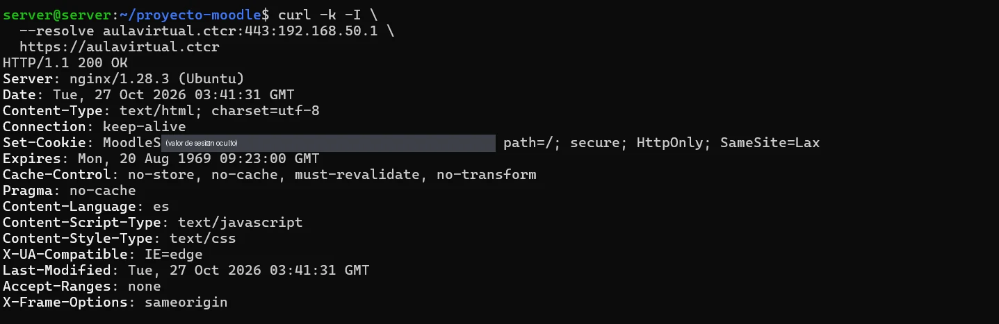

# PASO 08.06 — Probar HTTPS desde Ubuntu

> **Naturaleza:** procedimiento reproducible derivado íntegramente de la guía compartida, con correcciones para el repositorio. **No implica que el paso esté verificado en todas las máquinas.**
>
> **Origen:** `docs/fuentes/GUIA-HISTORICA-INTEGRA.md`; capturas reales de la última bitácora cuando existen.

## Archivos relacionados y por qué importan

- **[`infra/nginx/moodle.conf.example`](../../../infra/nginx/moodle.conf.example)**: VirtualHost HTTPS, redirección y proxy a localhost.
- **[`infra/compose/.env.https.example`](../../../infra/compose/.env.https.example)**: cambios requeridos en URL canónica y enlace de 8080 local; no sobrescribir claves reales.

**Lugar de ejecución:** terminal de Ubuntu Server (no la terminal del host Windows ni del contenedor, salvo cuando el comando sea `docker compose exec`). Confirmar direcciones reales y el estado actual de la VM antes de copiar comandos.

**Relación con el estado existente:** si el servicio ya está configurado, **no recrearlo por inercia**. Comparar con el archivo realmente activo; modificar solo campos necesarios, con copia, rollback y prueba posterior.

## Propósito del paso y contexto operacional

Nginx y TLS: proxy inverso local, URL canónica de Moodle y publicación controlada en 443.

Este archivo corresponde **exclusivamente al paso 08-06**, con comandos históricos literales y mejoras razonadas. En una **VM ya configurada** se inspeccionan primero los servicios y datos; no se vuelven a crear credenciales ni volúmenes. Los resultados observados en las capturas pertenecen a la sesión que los originó, no al conjunto de cinco integrantes.

## Comprobación recomendada y salida a documentar

`sudo nginx -t`, `openssl x509 -in /etc/nginx/certs/ctcr.crt -noout -subject -dates -ext subjectAltName`, `curl -kI --resolve aulavirtual.ctcr:443:192.168.50.1 https://aulavirtual.ctcr`.

Registrar el resultado exacto, fecha, sistema y si la prueba pasó o falló. Para un cambio de configuración conservar el archivo anterior y ejecutar la validación sintáctica antes de reiniciar el servicio. La **ruta versionable recomendada** está explicada en [`infra/`](../../../infra/README.md), sin sustituir los comandos originales que aparecen abajo.

## Antes de ejecutar

- [ ] Identificar VM, interfaz e IP actual; no asumir la IP de otra persona.
- [ ] Inspeccionar el estado actual del servicio. Si hay datos o volúmenes existentes, respaldarlos antes de cambios.
- [ ] Registrar fecha, integrante responsable, revisor y versión vigente en la sesión de bitácora.

## Procedimiento completo y comandos originales

```
curl -k -I https://aulavirtual.ctcr
```

La opción `-k` se utiliza únicamente para probar el certificado autofirmado del laboratorio.

Si el sistema operativo Ubuntu no está utilizando BIND9 para resolver su propio dominio, podés hacer una prueba directa sin modificar el DNS del servidor:

```
curl -k -I \
  --resolve aulavirtual.ctcr:443:192.168.50.1 \
  https://aulavirtual.ctcr
```

## Correcciones y precauciones aplicables

Antes de copiar comandos comprueben si es un servidor nuevo o una VM ya configurada; adaptar rutas, IP, interfaces, nombres y versiones, y guardar evidencia del resultado.

## Evidencias de este paso — registro local y contextualizado

### EV-068 · Docker Compose HTTPS, wwwroot Efectiva y Pruebas Curl


**Qué se observa:** Moodle enlazado localmente a `127.0.0.1:8080`, variable `MOODLE_URL=https://aulavirtual.ctcr`, verificación wwwroot y curl comprobando redirección 301 en puerto 80 y respuesta 200 OK en 443.

**Qué queda sin probar:** La experiencia de navegación visual del usuario en el navegador cliente Firefox desde Linux Mint (paso 08-07).

**Ficha de evidencia:** [EV-068](08-06/evidencias/EV-068.md).

> El estado de una captura no sustituye una comprobación en cada máquina. El criterio de aceptación está en la sección de verificación y en la [matriz de requisitos](../../00-proyecto/matriz-requisitos.md).

### Ejecución del grupo en la VM `server@server`

Capturas del documento del grupo (PDF de 54 páginas) tomadas en **otra VM del grupo** (`server@server`), distinta de la VM de Criss (`criss@server`) de las evidencias anteriores. Muestran el mismo paso hecho por otras integrantes; las diferencias entre VMs están en [ADR-0004](../../decisiones/ADR-0004-servidor-unico-de-demostracion.md).

#### EV-121 · HTTPS 200 desde Ubuntu con cookie segura



**Qué se observa:** `curl -k -I --resolve aulavirtual.ctcr:443:192.168.50.1 https://aulavirtual.ctcr` → `HTTP/1.1 200 OK`, `Server: nginx/1.28.3 (Ubuntu)`, fecha `Tue, 27 Oct 2026 03:41:31 GMT` y `Set-Cookie: MoodleSession=…; path=/; secure; HttpOnly; SameSite=Lax`.

**Qué significa y qué no prueba:** La cookie marcada `secure` confirma que Moodle sabe que está detrás de HTTPS. `--resolve` fuerza la IP: prueba Nginx y Moodle, no el DNS del propio Ubuntu (INC-013). **Ficha:** [EV-121](08-06/evidencias/EV-121.md).

## Registro de ejecución del grupo

| Campo | Completar durante la sesión |
|---|---|
| VM / fecha | `VM #1 (Ubuntu Server 26.04) — 2026-10-28` |
| Quién ejecutó / quién revisó | `criss / agente (verificación local)` |
| Comandos aplicados / diferencias | `curl -k -I --resolve aulavirtual.ctcr:443:192.168.50.1 https://aulavirtual.ctcr`, `curl -I http://192.168.50.1 -H "Host: aulavirtual.ctcr"` |
| Resultado observado | Petición HTTPS retorna `HTTP/1.1 200 OK` con cabecera `Server: nginx/1.28.3 (Ubuntu)`; petición HTTP retorna `HTTP/1.1 301 Moved Permanently` a `https://aulavirtual.ctcr/` |
| Captura nueva / prueba | `EV-068` |
| Incidencia (si ocurre) | Ninguna en la respuesta de sockets |

**Aceptación:** adjuntar captura y comando verificable; no cambiar a completado porque el procedimiento figure aquí.
