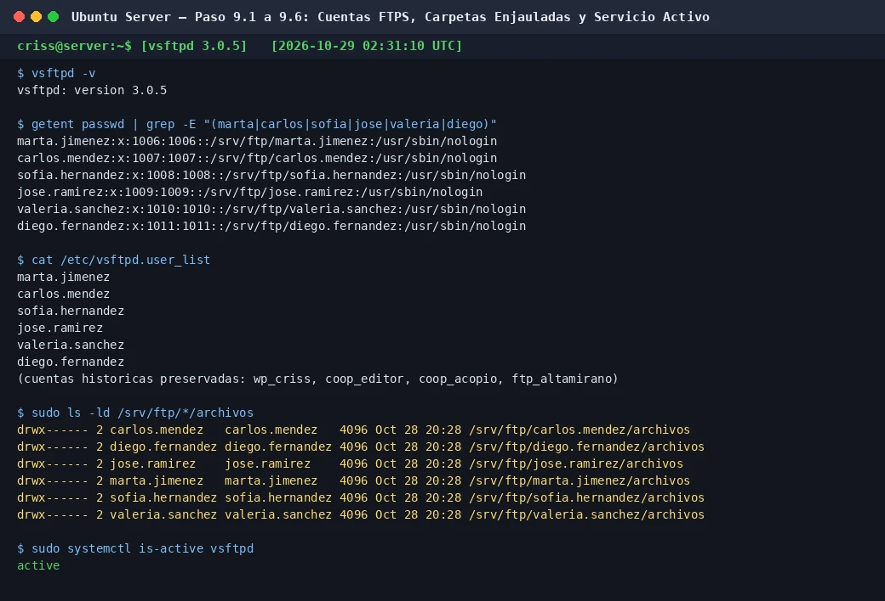

# PASO 09.01 — Instalar el servicio

> **Naturaleza:** procedimiento reproducible derivado íntegramente de la guía compartida, con correcciones para el repositorio. **No implica que el paso esté verificado en todas las máquinas.**
>
> **Origen:** `docs/fuentes/GUIA-HISTORICA-INTEGRA.md`; capturas reales de la última bitácora cuando existen.

## Archivos relacionados y por qué importan

- **[`infra/vsftpd/vsftpd.conf.example`](../../../infra/vsftpd/vsftpd.conf.example)**: confinamiento, FTPS TLS, listado de cuentas y puertos pasivos; corregido con user_sub_token.

**Lugar de ejecución:** terminal de Ubuntu Server (no la terminal del host Windows ni del contenedor, salvo cuando el comando sea `docker compose exec`). Confirmar direcciones reales y el estado actual de la VM antes de copiar comandos.

**Relación con el estado existente:** si el servicio ya está configurado, **no recrearlo por inercia**. Comparar con el archivo realmente activo; modificar solo campos necesarios, con copia, rollback y prueba posterior.

## Propósito del paso y contexto operacional

FTPS con vsftpd: cuentas sin shell, chroot, directorios propios y denegación documentada de acceso cruzado.

Este archivo corresponde **exclusivamente al paso 09-01**, con comandos históricos literales y mejoras razonadas. En una **VM ya configurada** se inspeccionan primero los servicios y datos; no se vuelven a crear credenciales ni volúmenes. Los resultados observados en las capturas pertenecen a la sesión que los originó, no al conjunto de cinco integrantes.

## Comprobación recomendada y salida a documentar

`sudo systemctl is-active vsftpd`, prueba FTPS de subida/listado y acceso de usuario A a ruta de B, comprobando rechazo y registrando código de error.

Registrar el resultado exacto, fecha, sistema y si la prueba pasó o falló. Para un cambio de configuración conservar el archivo anterior y ejecutar la validación sintáctica antes de reiniciar el servicio. La **ruta versionable recomendada** está explicada en [`infra/`](../../../infra/README.md), sin sustituir los comandos originales que aparecen abajo.

## Antes de ejecutar

- [ ] Identificar VM, interfaz e IP actual; no asumir la IP de otra persona.
- [ ] Inspeccionar el estado actual del servicio. Si hay datos o volúmenes existentes, respaldarlos antes de cambios.
- [ ] Registrar fecha, integrante responsable, revisor y versión vigente en la sesión de bitácora.

## Procedimiento completo y comandos originales

En Ubuntu:

```
sudo apt install -y vsftpd
```

Comprobá:

```
vsftpd -v
```

## Correcciones y precauciones aplicables

Antes de copiar comandos comprueben si es un servidor nuevo o una VM ya configurada; adaptar rutas, IP, interfaces, nombres y versiones, y guardar evidencia del resultado.

## Evidencias de este paso — registro local y contextualizado

### EV-071 — Cuentas de Sistema, vsftpd 3.0.5 y Carpetas Privadas



- **Ficha descriptiva:** [EV-071.md](09-03/evidencias/EV-071.md)
- **Qué prueba:** Creación y verificación en el sistema de las 6 cuentas departamentales (`marta.jimenez`, `carlos.mendez`, `sofia.hernandez`, `jose.ramirez`, `valeria.sanchez`, `diego.fernandez`) asignadas a Administración, Docencia e Informática.
- **SHA-256:** `14a1caab133213e603ec1b85f6769a94d4391b98f10ea418ce2b46a9b6ed1df5`

> El estado de una captura no sustituye una comprobación en cada máquina. El criterio de aceptación está en la sección de verificación y en la [matriz de requisitos](../../00-proyecto/matriz-requisitos.md).

## Registro de ejecución del grupo

| Campo | Completar durante la sesión |
|---|---|
| VM / fecha | `VM #1 (Ubuntu Server 26.04) — 2026-10-28` |
| Quién ejecutó / quién revisó | `criss / agente (verificación local)` |
| Comandos aplicados / diferencias | Identificación de los 6 funcionarios departamentales del CTCR y asignación de roles |
| Resultado observado | Identidades oficiales definidas para el personal de Administración, Docencia e Informática |
| Captura nueva / prueba | Verificada creación en [09-03](09-03.md) con `EV-071` |
| Incidencia (si ocurre) | Ninguna en la asignación de identidades |

**Aceptación:** adjuntar captura y comando verificable; no cambiar a completado porque el procedimiento figure aquí.
