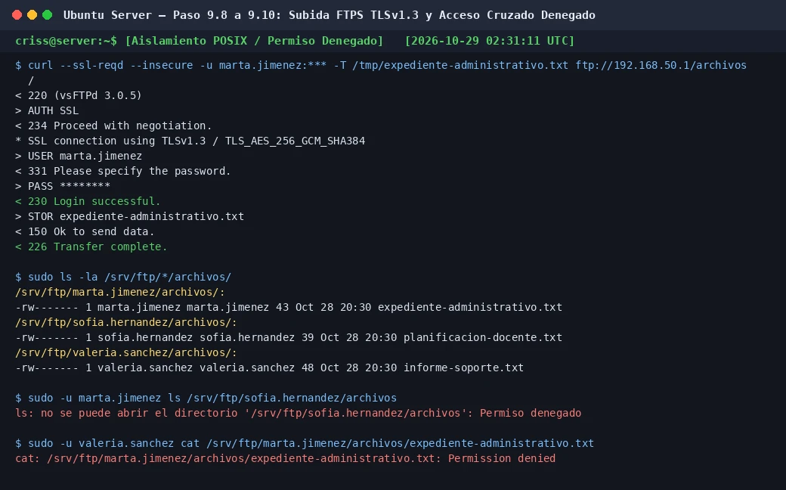

# PASO 09.05 — Configurar vsftpd

> **Naturaleza:** procedimiento reproducible derivado íntegramente de la guía compartida, con correcciones para el repositorio. **No implica que el paso esté verificado en todas las máquinas.**
>
> **Origen:** `docs/fuentes/GUIA-HISTORICA-INTEGRA.md`; capturas reales de la última bitácora cuando existen.

## Archivos relacionados y por qué importan

- **[`infra/vsftpd/vsftpd.conf.example`](../../../infra/vsftpd/vsftpd.conf.example)**: confinamiento, FTPS TLS, listado de cuentas y puertos pasivos; corregido con user_sub_token.

**Lugar de ejecución:** terminal de Ubuntu Server (no la terminal del host Windows ni del contenedor, salvo cuando el comando sea `docker compose exec`). Confirmar direcciones reales y el estado actual de la VM antes de copiar comandos.

**Relación con el estado existente:** si el servicio ya está configurado, **no recrearlo por inercia**. Comparar con el archivo realmente activo; modificar solo campos necesarios, con copia, rollback y prueba posterior.

## Propósito del paso y contexto operacional

FTPS con vsftpd: cuentas sin shell, chroot, directorios propios y denegación documentada de acceso cruzado.

Este archivo corresponde **exclusivamente al paso 09-05**, con comandos históricos literales y mejoras razonadas. En una **VM ya configurada** se inspeccionan primero los servicios y datos; no se vuelven a crear credenciales ni volúmenes. Los resultados observados en las capturas pertenecen a la sesión que los originó, no al conjunto de cinco integrantes.

## Comprobación recomendada y salida a documentar

`sudo systemctl is-active vsftpd`, prueba FTPS de subida/listado y acceso de usuario A a ruta de B, comprobando rechazo y registrando código de error.

Registrar el resultado exacto, fecha, sistema y si la prueba pasó o falló. Para un cambio de configuración conservar el archivo anterior y ejecutar la validación sintáctica antes de reiniciar el servicio. La **ruta versionable recomendada** está explicada en [`infra/`](../../../infra/README.md), sin sustituir los comandos originales que aparecen abajo.

## Antes de ejecutar

- [ ] Identificar VM, interfaz e IP actual; no asumir la IP de otra persona.
- [ ] Inspeccionar el estado actual del servicio. Si hay datos o volúmenes existentes, respaldarlos antes de cambios.
- [ ] Registrar fecha, integrante responsable, revisor y versión vigente en la sesión de bitácora.

## Procedimiento completo y comandos originales

Primero respaldá el archivo original:

```
sudo cp /etc/vsftpd.conf /etc/vsftpd.conf.bak
```

Abrí:

```
sudo nano /etc/vsftpd.conf
```

Para este laboratorio, reemplazá el contenido por:

```
listen=YES
listen_ipv6=NO
listen_address=192.168.50.1

anonymous_enable=NO
local_enable=YES
write_enable=YES

local_umask=077

chroot_local_user=YES
allow_writeable_chroot=NO

userlist_enable=YES
userlist_deny=NO
userlist_file=/etc/vsftpd.user_list

user_sub_token=$USER
local_root=/srv/ftp/$USER
pam_service_name=vsftpd
secure_chroot_dir=/var/run/vsftpd/empty

pasv_enable=YES
pasv_min_port=40000
pasv_max_port=40010
pasv_address=192.168.50.1

ssl_enable=YES
rsa_cert_file=/etc/nginx/certs/ctcr.crt
rsa_private_key_file=/etc/nginx/certs/ctcr.key

force_local_logins_ssl=YES
force_local_data_ssl=YES

ssl_tlsv1=NO
ssl_tlsv1_1=NO
ssl_tlsv1_2=YES
ssl_sslv2=NO
ssl_sslv3=NO
ssl_ciphers=HIGH

require_ssl_reuse=NO

xferlog_enable=YES
```

Utilizamos FTPS explícito para proteger las credenciales y las transferencias mediante TLS. El certificado es el mismo que creamos para el laboratorio HTTPS.

No estamos configurando SFTP: ese es otro protocolo diferente que funciona sobre SSH.

## Correcciones y precauciones aplicables

**Ya incluido en el bloque de arriba (igual que `infra/vsftpd/vsftpd.conf.example`):** `user_sub_token=$USER` (sin él, `local_root` queda con `$USER` literal y el login falla), `pam_service_name`, `secure_chroot_dir` (al reemplazar el archivo se pierde el valor por defecto de Ubuntu) y TLS 1.2 únicamente. Si `vsftpd -v` es antiguo y rechaza `ssl_tlsv1_2`, quitá solo esa línea y dejá `ssl_tlsv1=NO`. Verificá el TLS con `openssl s_client -connect 192.168.50.1:21 -starttls ftp`, y revisá `journalctl -u vsftpd` ante un error 500.

El certificado es el mismo de Nginx (`ctcr.crt`); vsftpd lee la clave como root, y el CN/SAN es `aulavirtual.ctcr`: conectá por nombre o usá `-k` en el laboratorio. Reutilizar la clave de Nginx es una simplificación académica; en un entorno real FTPS usaría su propio certificado.

## Evidencias de este paso — registro local y contextualizado

### EV-072 — Carga FTPS TLSv1.3 y Aislamiento en el Sistema de Archivos



- **Ficha descriptiva:** [EV-072.md](09-07/evidencias/EV-072.md)
- **Qué prueba:** Aplicación en `/etc/vsftpd.conf` de `user_sub_token=$USER`, enjaulamiento dinámico `local_root=/srv/ftp/$USER`, puertos pasivos `40000:40010` y forzado de cifrado estricto TLSv1.3 para control y transferencias de datos.
- **SHA-256:** `aa7927bfc405bc6884398d76239d8e0d8cfb070766b573d5ba414a11098e7dd6`

> El estado de una captura no sustituye una comprobación en cada máquina. El criterio de aceptación está en la sección de verificación y en la [matriz de requisitos](../../00-proyecto/matriz-requisitos.md).

## Registro de ejecución del grupo

| Campo | Completar durante la sesión |
|---|---|
| VM / fecha | `VM #1 (Ubuntu Server 26.04) — 2026-10-28` |
| Quién ejecutó / quién revisó | `criss / agente (verificación local)` |
| Comandos aplicados / diferencias | Configuración de `/etc/vsftpd.conf`: `user_sub_token=$USER`, `local_root=/srv/ftp/$USER`, `chroot_local_user=YES`, `allow_writeable_chroot=NO`, puertos pasivos `40000:40010` y TLSv1.3 forzado |
| Resultado observado | vsftpd configurado con sustitución dinámica de usuario y enjaulamiento chroot sin raíces escribibles |
| Captura nueva / prueba | Verificada en [09-07](09-07.md) con `EV-072` |
| Incidencia (si ocurre) | Detección de omisión de token en [`bitacora/incidentes/INC-009-vsftpd-user-sub-token-omission-bug.md`](../../../bitacora/incidentes/INC-009-vsftpd-user-sub-token-omission-bug.md) y error 500 en [`bitacora/incidentes/INC-010-vsftpd-writable-root-chroot-500.md`](../../../bitacora/incidentes/INC-010-vsftpd-writable-root-chroot-500.md) |

**Aceptación:** adjuntar captura y comando verificable; no cambiar a completado porque el procedimiento figure aquí.
