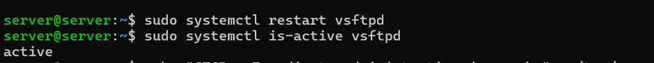

# PASO 09.06 — Reiniciar FTP

> **Naturaleza:** procedimiento reproducible derivado íntegramente de la guía compartida, con correcciones para el repositorio. **No implica que el paso esté verificado en todas las máquinas.**
>
> **Origen:** `docs/fuentes/GUIA-HISTORICA-INTEGRA.md`; capturas reales de la última bitácora cuando existen.

## Archivos relacionados y por qué importan

- **[`infra/vsftpd/vsftpd.conf.example`](../../../infra/vsftpd/vsftpd.conf.example)**: confinamiento, FTPS TLS, listado de cuentas y puertos pasivos; corregido con user_sub_token.

**Lugar de ejecución:** terminal de Ubuntu Server (no la terminal del host Windows ni del contenedor, salvo cuando el comando sea `docker compose exec`). Confirmar direcciones reales y el estado actual de la VM antes de copiar comandos.

**Relación con el estado existente:** si el servicio ya está configurado, **no recrearlo por inercia**. Comparar con el archivo realmente activo; modificar solo campos necesarios, con copia, rollback y prueba posterior.

## Propósito del paso y contexto operacional

FTPS con vsftpd: cuentas sin shell, chroot, directorios propios y denegación documentada de acceso cruzado.

Este archivo corresponde **exclusivamente al paso 09-06**, con comandos históricos literales y mejoras razonadas. En una **VM ya configurada** se inspeccionan primero los servicios y datos; no se vuelven a crear credenciales ni volúmenes. Los resultados observados en las capturas pertenecen a la sesión que los originó, no al conjunto de cinco integrantes.

## Comprobación recomendada y salida a documentar

`sudo systemctl is-active vsftpd`, prueba FTPS de subida/listado y acceso de usuario A a ruta de B, comprobando rechazo y registrando código de error.

Registrar el resultado exacto, fecha, sistema y si la prueba pasó o falló. Para un cambio de configuración conservar el archivo anterior y ejecutar la validación sintáctica antes de reiniciar el servicio. La **ruta versionable recomendada** está explicada en [`infra/`](../../../infra/README.md), sin sustituir los comandos originales que aparecen abajo.

## Antes de ejecutar

- [ ] Identificar VM, interfaz e IP actual; no asumir la IP de otra persona.
- [ ] Inspeccionar el estado actual del servicio. Si hay datos o volúmenes existentes, respaldarlos antes de cambios.
- [ ] Registrar fecha, integrante responsable, revisor y versión vigente en la sesión de bitácora.

## Procedimiento completo y comandos originales

```
sudo systemctl restart vsftpd
```

Comprobá:

```
sudo systemctl status vsftpd --no-pager
```

Si el servicio falla, consultá:

```
sudo journalctl -u vsftpd -n 50 --no-pager
```

## Correcciones y precauciones aplicables

Antes de copiar comandos comprueben si es un servidor nuevo o una VM ya configurada; adaptar rutas, IP, interfaces, nombres y versiones, y guardar evidencia del resultado.

## Evidencias de este paso — registro local y contextualizado

**Sin captura de la VM de Criss atribuible a este subpaso preparatorio.** El reinicio del demonio vsftpd y la apertura de sockets se comprueba durante las pruebas de carga y conectividad en [09-07](09-07.md) con la evidencia [EV-072](09-07/evidencias/EV-072.md).

> El estado de una captura no sustituye una comprobación en cada máquina. El criterio de aceptación está en la sección de verificación y en la [matriz de requisitos](../../00-proyecto/matriz-requisitos.md).

### Ejecución del grupo en la VM `server@server`

Capturas del documento del grupo (PDF de 54 páginas) tomadas en **otra VM del grupo** (`server@server`), distinta de la VM de Criss (`criss@server`) de las evidencias anteriores. Muestran el mismo paso hecho por otras integrantes; las diferencias entre VMs están en [ADR-0004](../../decisiones/ADR-0004-servidor-unico-de-demostracion.md).

#### EV-127 · Reinicio de vsftpd



**Qué se observa:** `systemctl restart vsftpd` y `systemctl is-active vsftpd` → `active`.

**Qué significa y qué no prueba:** El servicio arrancó con la configuración nueva; si tuviera un valor inválido, aquí aparecería el fallo (INC-016). **Ficha:** [EV-127](09-06/evidencias/EV-127.md).

## Registro de ejecución del grupo

| Campo | Completar durante la sesión |
|---|---|
| VM / fecha | `VM #1 (Ubuntu Server 26.04) — 2026-10-28` |
| Quién ejecutó / quién revisó | `criss / agente (verificación local)` |
| Comandos aplicados / diferencias | `sudo systemctl restart vsftpd`, `sudo systemctl is-active vsftpd`, `sudo ss -lntup \| grep ':21 '` |
| Resultado observado | Demonio vsftpd en estado `active (running)` escuchando en el socket `192.168.50.1:21` |
| Captura nueva / prueba | Verificada en [09-07](09-07.md) con `EV-072` |
| Incidencia (si ocurre) | Ninguna en el reinicio del servicio |

**Aceptación:** adjuntar captura y comando verificable; no cambiar a completado porque el procedimiento figure aquí.
