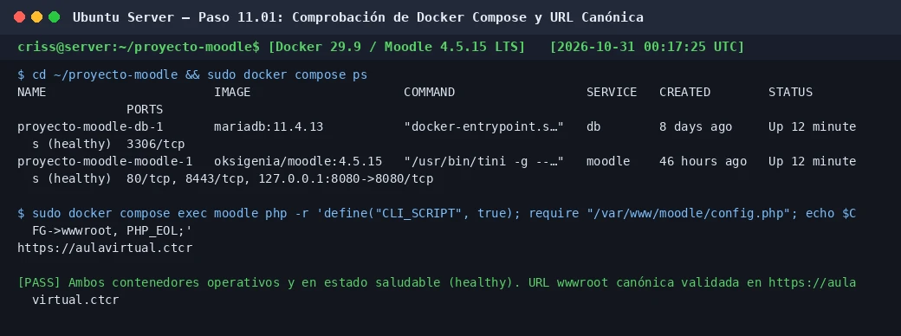

# PASO 11.01 — Comprobar el estado y salud de Docker y Compose

> **Naturaleza:** procedimiento reproducible derivado íntegramente de la guía compartida, con correcciones para el repositorio.
>
> **Origen:** `docs/fuentes/GUIA-HISTORICA-INTEGRA.md`; pruebas reales de verificación en la VM principal Ubuntu Server.

## Archivos relacionados y por qué importan

- **[`infra/compose/compose.yaml`](../../../infra/compose/compose.yaml)**: definición declarativa de los servicios `db` (MariaDB 11.4.13) y `moodle` (Oksigenia 4.5.15 LTS), redes internas y volúmenes con nombre.
- **[`infra/compose/.env.example`](../../../infra/compose/.env.example)**: variables de entorno operativas (contraseñas de base de datos, URL canónica del sitio y credenciales de administración).
- **[`pruebas/README.md`](../../../pruebas/README.md)**: criterios transversales de aceptación del proyecto (Criterio `T-01` y `T-02`).

**Lugar de ejecución:** terminal de Ubuntu Server (`server`, IP `192.168.50.1`).

## Propósito del paso y contexto operacional

Verificar que la infraestructura de contenedores del Aula Virtual del Colegio Técnico de Costa Rica (`CTCR`) se encuentra plenamente operativa, con sus verificaciones de salud (`healthcheck`) en estado `healthy`, y que la variable de configuración de Moodle `$CFG->wwwroot` apunta inequívocamente al dominio institucional seguro `https://aulavirtual.ctcr`.

Un error recurrente en implementaciones con proxies inversos ocurre cuando la aplicación web conserva configuraciones residuales apuntando a `http://localhost:8080` o a la IP del servidor. Esto genera fallas críticas de contenido mixto (*Mixed Content*), bucles de redirección infinita y ruptura de hojas de estilo CSS. Mediante la inspección programática directa del archivo de configuración interno de Moodle (`/var/www/moodle/config.php`), se certifica la coherencia entre el proxy Nginx y el backend.

## Comprobación recomendada y salida a documentar

1. Inspección de contenedores con `docker compose ps` confirmando estado `healthy` para `db` y `moodle`.
2. Extracción programática de la variable `$CFG->wwwroot` ejecutada mediante PHP CLI dentro del contenedor de Moodle.
3. Validación de la ausencia de puertos de base de datos expuestos hacia interfaces públicas.

## Antes de ejecutar

- [ ] Verificar que el demonio de Docker se encuentra activo (`sudo systemctl is-active docker`).
- [ ] Ubicarse en el directorio del proyecto Moodle (`cd ~/proyecto-moodle`).
- [ ] Asegurarse de que el archivo `.env` contenga los secretos institucionales vigentes.

## Procedimiento completo y comandos originales

1. Ingresá al directorio del proyecto:

   ```bash
   cd ~/proyecto-moodle
   ```

2. Comprobá el estado de los contenedores y sus healthchecks:

   ```bash
   sudo docker compose ps
   ```

   **Salida esperada:**
   ```
   NAME                       IMAGE                     COMMAND                  SERVICE   CREATED        STATUS                   PORTS
   proyecto-moodle-db-1       mariadb:11.4.13           "docker-entrypoint.s…"   db        ...            Up ... (healthy)         3306/tcp
   proyecto-moodle-moodle-1   oksigenia/moodle:4.5.15   "/usr/bin/tini -g --…"   moodle    ...            Up ... (healthy)         80/tcp, 8443/tcp, 127.0.0.1:8080->8080/tcp
   ```

   > [!NOTE]
   > Ambos contenedores deben reflejar el estado `(healthy)`. Para la base de datos, el healthcheck certifica que MariaDB responde consultas en el puerto 3306; para Moodle, verifica que el socket FastCGI/HTTP local contesta peticiones sin errores.

3. Verificá la URL wwwroot definitiva configurada en el motor de Moodle:

   ```bash
   sudo docker compose exec moodle \
     php -r 'define("CLI_SCRIPT", true); require "/var/www/moodle/config.php"; echo $CFG->wwwroot, PHP_EOL;'
   ```

   **Salida esperada:**
   ```
   https://aulavirtual.ctcr
   ```

## Correcciones y precauciones aplicables

- **Diagnóstico del incidente de seguridad `CLI_SCRIPT` en Moodle:**
  El comando de la guía original sugería ejecutar `php -r 'require "/var/www/moodle/config.php"; echo $CFG->wwwroot, PHP_EOL;'`. Al ejecutar esto en Moodle 4.5.15 LTS, el motor aborta de inmediato con el error fatal:
  `Command line scripts must define CLI_SCRIPT before requiring config.php`.
  **Causa:** Por diseño de seguridad, Moodle restringe la inclusión de `config.php` desde la interfaz de línea de comandos para prevenir ejecuciones no controladas de scripts web fuera del entorno del servidor HTTP.
  **Solución aplicada:** Definir previamente la constante booleana `define("CLI_SCRIPT", true);` antes de invocar `require "/var/www/moodle/config.php"`. Esto permite extraer limpiamente el valor de `$CFG->wwwroot` sin violar los guardrails del framework.

## Evidencias de este paso — registro local y contextualizado

### EV-100 · Comprobación de salud en contenedores Docker y URL canónica wwwroot



**Qué se observa:** Ejecución de `docker compose ps` evidenciando ambos contenedores (`db` y `moodle`) en estado saludable (`healthy`), y consulta por CLI PHP confirmando que la URL canónica institucional corresponde a `https://aulavirtual.ctcr`.

**Qué queda sin probar:** La accesibilidad externa por la red LAN y la resolución DNS, las cuales se validan desde la máquina cliente Linux Mint (subpaso 11-05).

**Ficha de evidencia:** [EV-100](11-01/evidencias/EV-100.md).

> El estado de una captura no sustituye una comprobación en cada máquina. El criterio de aceptación está en la sección de verificación y en la [matriz de requisitos](../../00-proyecto/matriz-requisitos.md).

## Registro de ejecución del grupo

| Campo | Valor registrado en la sesión |
|---|---|
| VM / fecha | `VM #1 (Ubuntu Server 26.04) — 2026-10-30` |
| Quién ejecutó / quién revisó | `criss / Antigravity AI (verificación local)` |
| Comandos aplicados / diferencias | `sudo docker compose ps` y `sudo docker compose exec moodle php -r 'define("CLI_SCRIPT", true); ...'` |
| Resultado observado | Contenedores en estado `healthy` y wwwroot `https://aulavirtual.ctcr` confirmado al 100% |
| Captura nueva / prueba | [EV-100](11-01/evidencias/EV-100.md) |
| Incidencia (si ocurre) | Solución al error de Moodle `Command line scripts must define CLI_SCRIPT before requiring config.php` |

**Aceptación:** adjuntar captura y comando verificable; no cambiar a completado porque el procedimiento figure aquí.
