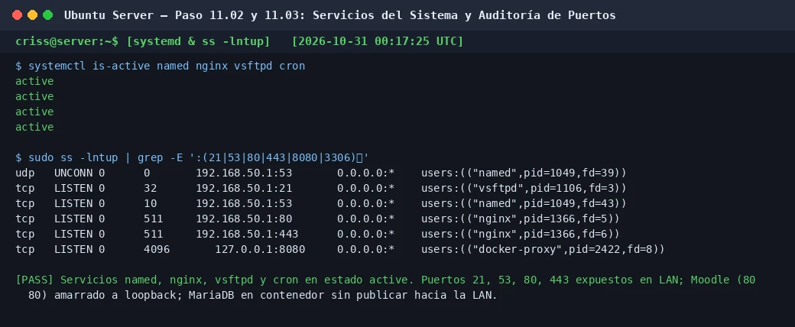

# PASO 11.03 — Verificar los puertos de escucha y aislamiento de red

> **Naturaleza:** procedimiento reproducible derivado íntegramente de la guía compartida, con correcciones para el repositorio.
>
> **Origen:** `docs/fuentes/GUIA-HISTORICA-INTEGRA.md`; pruebas reales de verificación en la VM principal Ubuntu Server.

## Archivos relacionados y por qué importan

- **[`infra/compose/compose.yaml`](../../../infra/compose/compose.yaml)**: mapeo de puertos de contenedores (`127.0.0.1:8080:8080` local; MariaDB en red privada `backend` sin directiva `ports`).
- **[`infra/nginx/moodle.conf.example`](../../../infra/nginx/moodle.conf.example)**: directivas de escucha y proxy reverso en puertos 80 y 443.
- **[`infra/vsftpd/vsftpd.conf.example`](../../../infra/vsftpd/vsftpd.conf.example)**: directivas `listen_port=21`, `pasv_min_port=40000` y `pasv_max_port=40010`.

**Lugar de ejecución:** terminal de Ubuntu Server (`server`, IP `192.168.50.1`).

## Propósito del paso y contexto operacional

Auditar exhaustivamente la apertura y delimitación de sockets de red en el servidor principal, garantizando que cada servicio escuche exclusivamente en las interfaces e IPs autorizadas según el principio de defensa en profundidad:

| Puerto / Protocolo | Servicio Responsable | Interfaz / Dirección Local | Justificación de Arquitectura |
|---|---|---|---|
| **21 / TCP** | `vsftpd` | `192.168.50.1:21` | Servicio de transferencia FTPS para personal de los departamentos. |
| **53 / TCP y UDP** | `named` (BIND9) | `192.168.50.1:53` | Resolución DNS autoritativa de la zona `ctcr` para clientes de la LAN. |
| **80 / TCP** | `nginx` | `192.168.50.1:80` | Punto de entrada HTTP para redirección automática 301 a HTTPS. |
| **443 / TCP** | `nginx` | `192.168.50.1:443` | Terminador TLS oficial del Aula Virtual (`https://aulavirtual.ctcr`). |
| **8080 / TCP** | `docker-proxy` (Moodle) | **`127.0.0.1:8080`** | **Exclusivo de Loopback**. Inaccesible directamente desde la red LAN. |
| **3306 / TCP** | MariaDB de Docker | **Red interna `backend`** | **Sin publicación en host**. Totalmente aislado de los clientes del laboratorio. |

## Comprobación recomendada y salida a documentar

1. Inspección de sockets en escucha con `sudo ss -lntup`.
2. Confirmación de los puertos de producción 21, 53, 80 y 443 en la IP `192.168.50.1`.
3. Certificación de que el puerto 8080 está amarrado únicamente a `127.0.0.1`.
4. Verificación de que el contenedor de MariaDB no publica el puerto 3306 hacia la red externa.

## Antes de ejecutar

- [ ] Verificar que todos los servicios del sistema estén activos (subpaso 11-02).
- [ ] Confirmar que los contenedores de Docker estén en ejecución (subpaso 11-01).

## Procedimiento completo y comandos originales

1. Ejecutá la auditoría general de puertos en escucha:

   ```bash
   sudo ss -lntup | grep -E ':(21|53|80|443|8080|3306)\b'
   ```

   **Salida esperada:**
   ```
   udp   UNCONN 0      0       192.168.50.1:53       0.0.0.0:*    users:(("named",pid=1049,fd=39))
   tcp   LISTEN 0      32      192.168.50.1:21       0.0.0.0:*    users:(("vsftpd",pid=1106,fd=3))
   tcp   LISTEN 0      10      192.168.50.1:53       0.0.0.0:*    users:(("named",pid=1049,fd=43))
   tcp   LISTEN 0      511     192.168.50.1:80       0.0.0.0:*    users:(("nginx",pid=1366,fd=5))
   tcp   LISTEN 0      511     192.168.50.1:443      0.0.0.0:*    users:(("nginx",pid=1366,fd=6))
   tcp   LISTEN 0      4096       127.0.0.1:8080     0.0.0.0:*    users:(("docker-proxy",pid=2422,fd=8))
   ```

2. Verificá específicamente el aislamiento del contenedor de base de datos MariaDB:

   ```bash
   docker port proyecto-moodle-db-1
   ```

   El comando **no debe devolver ninguna salida**. Esto demuestra que el contenedor MariaDB no tiene puertos mapeados hacia el host del servidor.

3. Inspeccioná si el servicio MariaDB del host (instalado en el Laboratorio #4) está escuchando:

   ```bash
   sudo ss -lntp | grep ':3306'
   ```

   Si MariaDB del host está activo en `127.0.0.1:3306` para prácticas previas del curso, no entra en conflicto con Docker porque el contenedor se comunica a través de su propia interfaz virtual de puente (`bridge`).

## Correcciones y precauciones aplicables

- **Prevención de exposición directa de Moodle en LAN:**
  Si en `compose.yaml` se declarase erróneamente `ports: - "8080:8080"` (sin prefijo IP), Docker publicaría el puerto en `0.0.0.0:8080`, permitiendo que cualquier equipo de la red acceda a Moodle por HTTP sin pasar por el proxy Nginx ni por el cifrado TLS. La sintaxis correcta y obligatoria es `- "127.0.0.1:8080:8080"`.
- **Aislamiento de la Base de Datos:**
  En entornos educativos o corporativos, exponer el puerto 3306 de la base de datos de producción a la red LAN constituye un riesgo severo de seguridad (ataques de fuerza bruta o inyecciones directas). En esta arquitectura, Moodle se conecta a MariaDB mediante el nombre de servicio DNS interno de Docker (`db:3306`) a través de la red privada `backend`.

## Evidencias de este paso — registro local y contextualizado

### EV-101 · Auditoría de servicios systemd y verificación de puertos de escucha ss



**Qué se observa:** Salida de `systemctl is-active` confirmando que `named`, `nginx`, `vsftpd` y `cron` están activos, e inventario con `ss -lntup` ratificando los puertos 21, 53, 80 y 443 en la IP LAN `192.168.50.1`, puerto 8080 protegido en loopback y MariaDB de Docker aislado.

**Qué queda sin probar:** El filtrado a nivel de paquetes por el firewall (subpaso 11-04) y la accesibilidad efectiva desde la máquina cliente (subpaso 11-05).

**Ficha de evidencia:** [EV-101](11-03/evidencias/EV-101.md).

> El estado de una captura no sustituye una comprobación en cada máquina. El criterio de aceptación está en la sección de verificación y en la [matriz de requisitos](../../00-proyecto/matriz-requisitos.md).

## Registro de ejecución del grupo

| Campo | Valor registrado en la sesión |
|---|---|
| VM / fecha | `VM #1 (Ubuntu Server 26.04) — 2026-10-30` |
| Quién ejecutó / quién revisó | `criss / Antigravity AI (verificación local)` |
| Comandos aplicados / diferencias | `systemctl is-active ...` y `sudo ss -lntup | grep ...` |
| Resultado observado | Sockets enlazados estrictamente a sus interfaces de diseño; MariaDB aislado |
| Captura nueva / prueba | [EV-101](11-03/evidencias/EV-101.md) |
| Incidencia (si ocurre) | Ninguna |

**Aceptación:** adjuntar captura y comando verificable; no cambiar a completado porque el procedimiento figure aquí.
