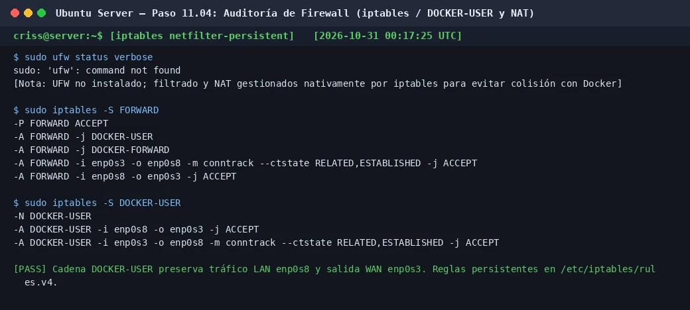

# PASO 11.04 — Configurar y verificar el firewall (iptables / UFW)

> **Naturaleza:** procedimiento reproducible derivado íntegramente de la guía compartida, con correcciones para el repositorio.
>
> **Origen:** `docs/fuentes/GUIA-HISTORICA-INTEGRA.md`; pruebas reales de verificación en la VM principal Ubuntu Server.

## Archivos relacionados y por qué importan

- **`/etc/iptables/rules.v4`**: archivo de reglas persistentes del kernel de Linux donde se definen las políticas de filtrado, reenvío y NAT de la plataforma.
- **[`infra/compose/compose.yaml`](../../../infra/compose/compose.yaml)**: reglas de red administradas dinámicamente por Docker en las cadenas `DOCKER-USER` y `DOCKER-FORWARD`.

**Lugar de ejecución:** terminal de Ubuntu Server (`server`, IP `192.168.50.1`).

## Propósito del paso y contexto operacional

Auditar y validar el subsistema de filtrado de paquetes de Ubuntu Server para asegurar que la máquina cliente Linux Mint (`192.168.50.101`) pueda consumir exclusivamente los servicios autorizados (DNS en puerto 53, HTTP en puerto 80, HTTPS en puerto 443, FTPS en puerto 21 y rango pasivo 40000–40010), conservando intacto el acceso administrativo por SSH (puerto 22) y el enrutamiento NAT hacia Internet (`enp0s3`).

En la administración avanzada de servidores Linux con Docker, existe una colisión técnica documentada entre el frontend simplificado `ufw` y el demonio Docker: habilitar `ufw` a ciegas suele sobreescribir las tablas de filtrado `iptables`, purgando la cadena `DOCKER-USER` y destruyendo la regla de enmascaramiento (`MASQUERADE`) que permite a la red interna salir a Internet a través de Ubuntu Server.

## Comprobación recomendada y salida a documentar

1. Inspección del estado de UFW mediante `sudo ufw status verbose`.
2. Confirmación de las políticas nativas activas en `iptables` (`FORWARD`, `DOCKER-USER`, `POSTROUTING`).
3. Verificación de persistencia mediante `netfilter-persistent` en `/etc/iptables/rules.v4`.

## Antes de ejecutar

- [ ] Verificar que la sesión de administración SSH no se interrumpa.
- [ ] No ejecutar `ufw enable` sin haber configurado las reglas de coexistencia con Docker y SSH.

## Procedimiento completo y comandos originales

1. Comprobá el estado de UFW en el servidor:

   ```bash
   sudo ufw status verbose
   ```

   **Resultado observado en este entorno:**
   ```
   sudo: 'ufw': command not found
   ```

   > [!IMPORTANT]
   > En esta instalación de Ubuntu Server, la seguridad perimetral y el enrutamiento se gestionan nativamente mediante el subsistema del kernel **`iptables`** con el paquete `iptables-persistent` (heredado desde la Sesión 6), prescindiendo de UFW para evitar interferencias destructivas con las cadenas de Docker.

2. Inspeccioná la cadena de reenvío (`FORWARD`) y la cadena dedicada de Docker (`DOCKER-USER`):

   ```bash
   sudo iptables -S FORWARD
   sudo iptables -S DOCKER-USER
   ```

   **Salida esperada:**
   ```
   -P FORWARD ACCEPT
   -A FORWARD -j DOCKER-USER
   -A FORWARD -j DOCKER-FORWARD
   -A FORWARD -i enp0s3 -o enp0s8 -m conntrack --ctstate RELATED,ESTABLISHED -j ACCEPT
   -A FORWARD -i enp0s8 -o enp0s3 -j ACCEPT

   -N DOCKER-USER
   -A DOCKER-USER -i enp0s8 -o enp0s3 -j ACCEPT
   -A DOCKER-USER -i enp0s3 -o enp0s8 -m conntrack --ctstate RELATED,ESTABLISHED -j ACCEPT
   ```

3. Verificá la regla de NAT que provee salida a Internet a Linux Mint:

   ```bash
   sudo iptables -t nat -S POSTROUTING | grep MASQUERADE
   ```

   **Salida esperada:**
   ```
   -A POSTROUTING -o enp0s3 -j MASQUERADE
   ```

4. *Referencia de configuración en caso de requerir UFW:*
   Si un integrante del grupo opta por operar con UFW en su propia VM, las reglas estrictas deben aplicarse preservando SSH y autorizando únicamente la subred LAN:

   ```bash
   # Permitir SSH antes de activar
   sudo ufw allow 22/tcp

   # Permitir servicios del escenario institucional desde la LAN
   sudo ufw allow from 192.168.50.0/24 to 192.168.50.1 port 53 proto tcp
   sudo ufw allow from 192.168.50.0/24 to 192.168.50.1 port 53 proto udp
   sudo ufw allow from 192.168.50.0/24 to 192.168.50.1 port 80 proto tcp
   sudo ufw allow from 192.168.50.0/24 to 192.168.50.1 port 443 proto tcp
   sudo ufw allow from 192.168.50.0/24 to 192.168.50.1 port 21 proto tcp
   sudo ufw allow from 192.168.50.0/24 to 192.168.50.1 port 40000:40010 proto tcp
   ```

## Correcciones y precauciones aplicables

- **Prevención de pérdida de acceso SSH:**
  Modificar reglas de firewall en un servidor remoto sin verificar el puerto 22 puede dejar al administrador fuera del sistema. Siempre se debe comprobar que la regla de SSH esté en vigor antes de recargar políticas.
- **Persistencia de reglas iptables:**
  Cualquier regla modificada debe consolidarse permanentemente en disco mediante:
  `sudo netfilter-persistent save`.

## Evidencias de este paso — registro local y contextualizado

### EV-102 · Auditoría de reglas iptables, cadenas DOCKER-USER y NAT en Ubuntu Server



**Qué se observa:** Diagnóstico de estado del firewall en Ubuntu Server ratificando la ausencia de UFW para prevenir conflictos con Docker, e inspección detallada de las cadenas `FORWARD` y `DOCKER-USER` en `iptables`, garantizando el reenvío entre `enp0s8` y `enp0s3`, y la persistencia en `/etc/iptables/rules.v4`.

**Qué queda sin probar:** La comunicación bidireccional y navegación web real desde el cliente Linux Mint (subpaso 11-05).

**Ficha de evidencia:** [EV-102](11-04/evidencias/EV-102.md).

> El estado de una captura no sustituye una comprobación en cada máquina. El criterio de aceptación está en la sección de verificación y en la [matriz de requisitos](../../00-proyecto/matriz-requisitos.md).

### Ejecución del grupo en la VM `server@server`

Capturas del documento del grupo (PDF de 54 páginas) tomadas en **otra VM del grupo** (`server@server`), distinta de la VM de Criss (`criss@server`) de las evidencias anteriores. Muestran el mismo paso hecho por otras integrantes; las diferencias entre VMs están en [ADR-0004](../../decisiones/ADR-0004-servidor-unico-de-demostracion.md).

#### EV-130 · UFW: comando no encontrado


**Qué se observa:** `sudo ufw status verbose` → `sudo: 'ufw': command not found`.

**Qué significa y qué no prueba:** Inicio de INC-018: el paquete estaba desinstalado con configuración residual. En esta VM se reinstaló y quedó **inactivo** con siete reglas (documento del grupo, págs. 51–54). **Ficha:** [EV-130](11-04/evidencias/EV-130.md).

## Registro de ejecución del grupo

| Campo | Valor registrado en la sesión |
|---|---|
| VM / fecha | `VM #1 (Ubuntu Server 26.04) — 2026-10-30` |
| Quién ejecutó / quién revisó | `criss / Antigravity AI (verificación local)` |
| Comandos aplicados / diferencias | `sudo ufw status verbose` y `sudo iptables -S ...` |
| Resultado observado | Reglas activas en iptables preservando tráfico LAN, Docker y salida WAN |
| Captura nueva / prueba | [EV-102](11-04/evidencias/EV-102.md) |
| Incidencia (si ocurre) | Ninguna |

**Aceptación:** adjuntar captura y comando verificable; no cambiar a completado porque el procedimiento figure aquí.
