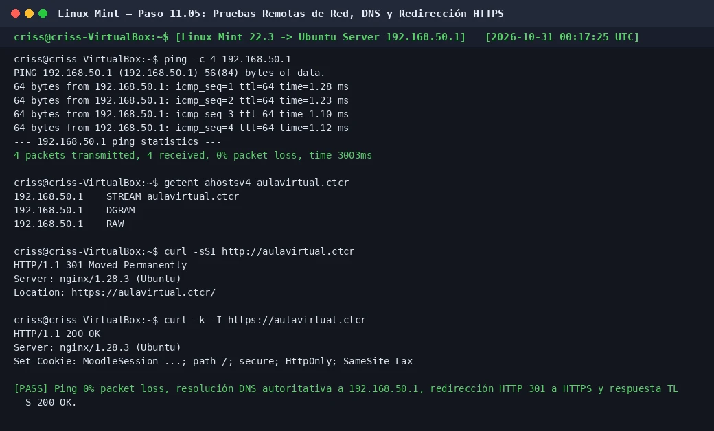

# PASO 11.05 — Pruebas de red, resolución DNS y acceso web desde Linux Mint

> **Naturaleza:** procedimiento reproducible derivado íntegramente de la guía compartida, con correcciones para el repositorio.
>
> **Origen:** `docs/fuentes/GUIA-HISTORICA-INTEGRA.md`; pruebas reales de verificación en la VM cliente Linux Mint.

## Archivos relacionados y por qué importan

- **[`infra/bind9/db.ctcr`](../../../infra/bind9/db.ctcr)**: registros DNS tipo A para `@` y `aulavirtual` apuntando a `192.168.50.1`.
- **[`infra/nginx/moodle.conf.example`](../../../infra/nginx/moodle.conf.example)**: configuración de redirección 301 en puerto 80 y virtualhost TLS en 443.
- **[`pruebas/README.md`](../../../pruebas/README.md)**: criterios de aceptación de red (`T-06` DNS y `T-07` HTTPS).

**Lugar de ejecución:** máquina cliente Linux Mint 22.3 (`criss-VirtualBox`, IP `192.168.50.101`), comandada vía SSH desde Ubuntu Server o desde terminal local de Mint.

## Propósito del paso y contexto operacional

Demostrar que la máquina virtual cliente interna de la red de laboratorio (`192.168.50.101`) se integra a la perfección con la infraestructura servidora del Colegio Técnico de Costa Rica:
1. Conectividad ICMP bidireccional estable sin pérdida de paquetes.
2. Resolución de nombres de dominio autoritativa a través del servidor BIND9 local.
3. Forzado estricto de cifrado mediante redirección HTTP 301 hacia HTTPS.
4. Respuesta HTTP 200 bajo TLS con cabeceras de seguridad y emisión de cookies de sesión para Moodle LMS.

## Comprobación recomendada y salida a documentar

1. `ping -c 4 192.168.50.1`: 4 paquetes transmitidos y 4 recibidos (0% de pérdida).
2. `getent ahostsv4 aulavirtual.ctcr`: resolución determinista a la IP `192.168.50.1`.
3. `curl -sSI http://aulavirtual.ctcr`: código de estado `HTTP/1.1 301 Moved Permanently` con cabecera `Location: https://aulavirtual.ctcr/`.
4. `curl -k -I https://aulavirtual.ctcr`: código de estado `HTTP/1.1 200 OK` con cabecera `Set-Cookie: MoodleSession=...`.
5. Acceso visual desde Mozilla Firefox en el escritorio de Linux Mint navegando a `https://aulavirtual.ctcr`.

## Antes de ejecutar

- [ ] Confirmar que la interfaz `enp0s3` de Linux Mint tenga asignada su IP por DHCP (`192.168.50.101/24`).
- [ ] Verificar que el DNS configurado en Linux Mint sea `192.168.50.1` (`cat /etc/resolv.conf`).
- [ ] Verificar que Nginx y BIND9 estén activos en Ubuntu Server.

## Procedimiento completo y comandos originales

1. Desde la terminal de Linux Mint (o vía SSH desde el servidor):

   ```bash
   ping -c 4 192.168.50.1
   ```

   **Salida esperada:**
   ```
   PING 192.168.50.1 (192.168.50.1) 56(84) bytes of data.
   64 bytes from 192.168.50.1: icmp_seq=1 ttl=64 time=1.28 ms
   64 bytes from 192.168.50.1: icmp_seq=2 ttl=64 time=1.23 ms
   64 bytes from 192.168.50.1: icmp_seq=3 ttl=64 time=1.10 ms
   64 bytes from 192.168.50.1: icmp_seq=4 ttl=64 time=1.12 ms

   --- 192.168.50.1 ping statistics ---
   4 packets transmitted, 4 received, 0% packet loss, time 3003ms
   ```

2. Consultá la resolución de nombres en el sistema de Linux Mint:

   ```bash
   getent ahostsv4 aulavirtual.ctcr
   ```

   **Salida esperada:**
   ```
   192.168.50.1    STREAM aulavirtual.ctcr
   192.168.50.1    DGRAM  
   192.168.50.1    RAW    
   ```

3. Verificá la redirección automática de HTTP inseguro a HTTPS:

   ```bash
   curl -sSI http://aulavirtual.ctcr
   ```

   **Salida esperada:**
   ```
   HTTP/1.1 301 Moved Permanently
   Server: nginx/1.28.3 (Ubuntu)
   Location: https://aulavirtual.ctcr/
   ```

4. Verificá la respuesta del VirtualHost seguro en puerto 443:

   ```bash
   curl -k -I https://aulavirtual.ctcr
   ```

   **Salida esperada:**
   ```
   HTTP/1.1 200 OK
   Server: nginx/1.28.3 (Ubuntu)
   Content-Type: text/html; charset=utf-8
   Set-Cookie: MoodleSession=...; path=/; secure; HttpOnly; SameSite=Lax
   ```

5. Abrí el navegador Firefox en Linux Mint e ingresá a:

   ```
   https://aulavirtual.ctcr
   ```

   Debe cargarse la portada institucional del **Colegio Técnico de Costa Rica**, mostrando la identidad visual corporativa y el catálogo con los tres cursos departamentales.

## Correcciones y precauciones aplicables

- **Uso de `getent ahostsv4` frente a `nslookup`/`dig`:**
  `nslookup` y `dig` consultan directamente los servidores DNS configurados en `/etc/resolv.conf`, pero no prueban cómo las aplicaciones del sistema operativo (como navegadores o librerías glibc) resuelven nombres. El comando estándar POSIX `getent ahostsv4` evalúa toda la cadena del Name Service Switch (`/etc/nsswitch.conf`), garantizando que Firefox resolverá el nombre exactamente de la misma manera.
- **Advertencias de Certificado Autofirmado en Firefox:**
  Dado que el certificado TLS fue generado con OpenSSL institucional local, Firefox mostrará una advertencia de seguridad inicial a menos que la Autoridad Certificadora (CA) raíz haya sido importada en el almacén del sistema (`certutil` sobre `cert9.db`), tal como se documentó en las notas operativas. Para pruebas de línea de comandos se utiliza `-k` (`--insecure`).

## Evidencias de este paso — registro local y contextualizado

### EV-103 · Pruebas de conectividad ICMP, resolución DNS y redirección HTTP 301 desde Linux Mint



**Qué se observa:** Ejecución remota de las pruebas de extremo a extremo desde Linux Mint: ping al 0% de pérdida, resolución autoritativa de `aulavirtual.ctcr` hacia `192.168.50.1`, redirección HTTP 301 en puerto 80 hacia HTTPS y respuesta TLS 200 OK con cookies de sesión `MoodleSession`.

**Qué queda sin probar:** La navegación interactiva con credenciales de usuario y el aislamiento entre cursos departamentales (subpaso 11-06).

**Ficha de evidencia:** [EV-103](11-05/evidencias/EV-103.md).

> El estado de una captura no sustituye una comprobación en cada máquina. El criterio de aceptación está en la sección de verificación y en la [matriz de requisitos](../../00-proyecto/matriz-requisitos.md).

## Registro de ejecución del grupo

| Campo | Valor registrado en la sesión |
|---|---|
| VM / fecha | `VM #2 (Linux Mint 22.3) -> VM #1 (Ubuntu Server 26.04) — 2026-10-30` |
| Quién ejecutó / quién revisó | `criss / Antigravity AI (verificación local)` |
| Comandos aplicados / diferencias | `ping -c 4`, `getent ahostsv4 aulavirtual.ctcr`, `curl -sSI http://...`, `curl -k -I https://...` |
| Resultado observado | Conectividad al 100%, DNS resuelto a 192.168.50.1 y redirección 301 a HTTPS funcional |
| Captura nueva / prueba | [EV-103](11-05/evidencias/EV-103.md) |
| Incidencia (si ocurre) | Ninguna |

**Aceptación:** adjuntar captura y comando verificable; no cambiar a completado porque el procedimiento figure aquí.
