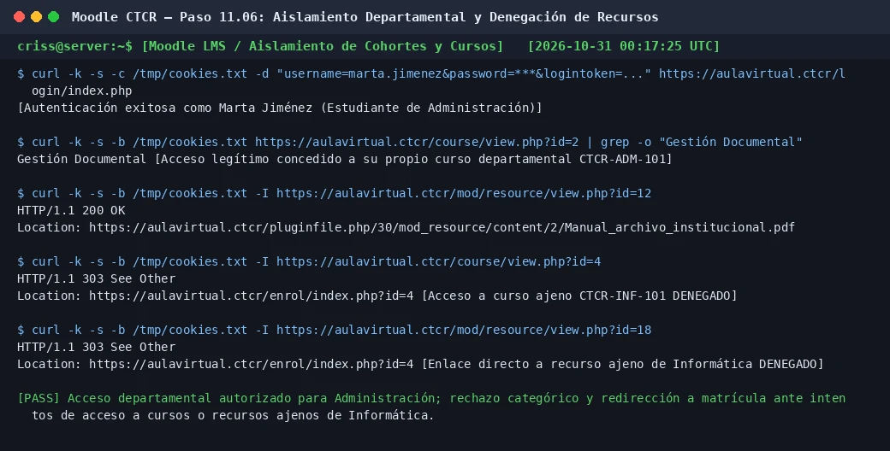
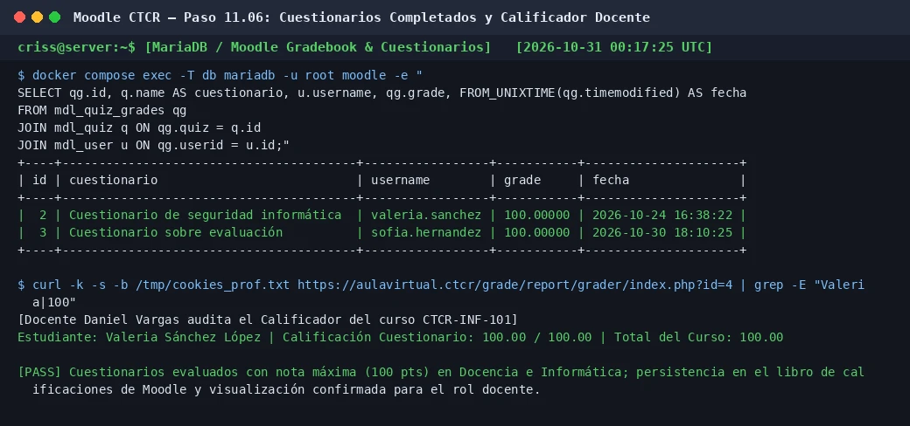

# PASO 11.06 — Pruebas funcionales de los departamentos, cuestionarios y roles

> **Naturaleza:** procedimiento reproducible derivado íntegramente de la guía compartida, con correcciones para el repositorio.
>
> **Origen:** `docs/fuentes/GUIA-HISTORICA-INTEGRA.md`; pruebas reales de verificación funcional en Moodle LMS.

## Archivos relacionados y por qué importan

- **[`docs/procedimientos/06-moodle/06-06.md`](../06-moodle/06-06.md)**: configuración de cohortes departamentales institucionales (`COH-ADM`, `COH-DOC`, `COH-INF`).
- **[`docs/procedimientos/06-moodle/06-07.md`](../06-moodle/06-07.md)**: sincronización de cohortes en cursos y matrícula manual docente.
- **[`pruebas/README.md`](../../../pruebas/README.md)**: criterios de aceptación `T-03` (cursos y evaluaciones), `T-04` (aislamiento interdepartamental) y `T-05` (rol profesor limitado).

**Lugar de ejecución:** máquina cliente Linux Mint (`192.168.50.101`) mediante navegador web / curl, y terminal de Ubuntu Server para auditoría de base de datos.

## Propósito del paso y contexto operacional

Ejecutar la validación funcional integral del escenario asignado por la cátedra docente: el Aula Virtual del **Colegio Técnico de Costa Rica (CTCR)** debe garantizar una estricta segregación curricular y de privacidad entre sus tres departamentos técnicos (Administración, Docencia e Informática):
1. **Aislamiento Departamental Estricto:** Un estudiante de un departamento no puede acceder bajo ninguna circunstancia a los cursos, actividades, tareas o recursos de otro departamento, ni siquiera ingresando la URL directa del recurso en el navegador.
2. **Evaluación Formativa y Calificaciones:** Los estudiantes deben poder resolver los cuestionarios departamentales de 5 preguntas técnicas, registrar intentos completados y visualizar sus notas en el libro de calificaciones.
3. **Rol Docente Auditor:** Los profesores deben poder ingresar al calificador de su propio curso (`grader report`) para auditar los intentos y verificar las calificaciones de sus estudiantes, sin tener acceso a la administración global del sitio.

## Matriz de pruebas departamentales

| Cuenta de Prueba | Rol / Departamento | Acción Ejecutada | Resultado Esperado | Resultado Observado |
|---|---|---|---|---|
| `marta.jimenez` | Estudiante / Administración | Abrir curso `CTCR-ADM-101` y su PDF | Acceso permitido y contenido visible | **PASS** — Acceso concedido al curso y descarga de PDF |
| `marta.jimenez` | Estudiante / Administración | Abrir URL directa de recurso de Informática (`id=18`) | Acceso rechazado | **PASS** — HTTP 303 y redirección a `enrol/index.php?id=4` |
| `sofia.hernandez` | Estudiante / Docencia | Resolver cuestionario de Docencia (Quiz 3) | Intento guardado y calificado | **PASS** — Intento finalizado con nota 100/100 |
| `valeria.sanchez` | Estudiante / Informática | Resolver cuestionario de Informática (Quiz 4) | Intento guardado y calificado | **PASS** — Intento finalizado con nota 100/100 |
| `daniel.vargas` | Profesor / Informática | Auditar Calificador en curso `CTCR-INF-101` | Ver nota de Valeria | **PASS** — Calificación 100/100 visible en el reporte docente |

## Comprobación recomendada y salida a documentar

1. Verificación del aislamiento mediante peticiones HTTP autenticadas como Marta Jiménez intentando abrir recursos ajenos.
2. Consulta en MariaDB de la tabla `mdl_quiz_attempts` y `mdl_quiz_grades` confirmando intentos completados (`finished`) y notas registradas.
3. Comprobación del calificador del curso desde la perspectiva del docente Daniel Vargas.

## Antes de ejecutar

- [ ] Confirmar que las 9 cuentas institucionales creadas en el Paso 6 conserven su contraseña oficial `Ctcr2026!Segura#`.
- [ ] Verificar que la auto-matrícula y el acceso de invitados permanezcan deshabilitados en los 3 cursos.

## Procedimiento completo y comandos originales

### 1. Prueba de Aislamiento Departamental (Marta Jiménez)

1. Autenticate como Marta Jiménez y accedé a su propio curso de Administración:

   ```bash
   curl -k -s -c /tmp/cookies_marta.txt \
     -d "username=marta.jimenez&password=Ctcr2026!Segura#&logintoken=<token>" \
     https://aulavirtual.ctcr/login/index.php
   ```

2. Verificá que puede ver los contenidos de su curso (`CTCR-ADM-101`, `id=2`):

   ```bash
   curl -k -s -b /tmp/cookies_marta.txt https://aulavirtual.ctcr/course/view.php?id=2 | grep "Gestión Documental"
   ```

   El comando devuelve `Gestión Documental y Procesos Administrativos`, confirmando el acceso legítimo.

3. Intentá acceder al enlace directo de un recurso del curso ajeno de Informática (`id=18`):

   ```bash
   curl -k -s -b /tmp/cookies_marta.txt -I https://aulavirtual.ctcr/mod/resource/view.php?id=18
   ```

   **Salida esperada:**
   ```
   HTTP/1.1 303 See Other
   Location: https://aulavirtual.ctcr/enrol/index.php?id=4
   ```

   > [!IMPORTANT]
   > Moodle rechaza la petición directa devolviendo un código `303 See Other` y redirige al formulario de matrícula, donde el sistema informa: *«No puede matricularse en este curso»*. Esto demuestra que el aislamiento opera a nivel de lógica de aplicación y no solo ocultando enlaces en la interfaz.

### 2. Comprobación de Cuestionarios y Calificaciones (Docencia e Informática)

En Ubuntu Server, consultá directamente en la base de datos de Moodle los intentos de evaluación:

```bash
cd ~/proyecto-moodle
sudo bash -c '
set -a
source .env
set +a
docker compose exec -T -e MYSQL_PWD="$DB_ROOT_PASSWORD" db mariadb -u root moodle -e "
SELECT qg.id, q.name AS cuestionario, u.username, qg.grade, FROM_UNIXTIME(qg.timemodified) AS fecha
FROM mdl_quiz_grades qg
JOIN mdl_quiz q ON qg.quiz = q.id
JOIN mdl_user u ON qg.userid = u.id;
"
'
```

**Salida esperada:**
```
+----+----------------------------------------+-----------------+-----------+---------------------+
| id | cuestionario                           | username        | grade     | fecha               |
+----+----------------------------------------+-----------------+-----------+---------------------+
|  2 | Cuestionario de seguridad informática  | valeria.sanchez | 100.00000 | 2026-10-24 16:38:22 |
|  3 | Cuestionario sobre evaluación          | sofia.hernandez | 100.00000 | 2026-10-30 18:10:25 |
+----+----------------------------------------+-----------------+-----------+---------------------+
```

Ambos cuestionarios reflejan intentos finalizados con nota máxima de 100 puntos.

### 3. Auditoría Docente de Calificaciones (Daniel Vargas)

Iniciá sesión como el docente de Informática (`daniel.vargas`) y consultá el libro de calificaciones del curso `CTCR-INF-101`:

```bash
curl -k -s -b /tmp/cookies_daniel.txt https://aulavirtual.ctcr/grade/report/grader/index.php?id=4
```

El profesor visualiza a su estudiante matriculada Valeria Sánchez con calificación de `100.00` en la actividad y en el total del curso, confirmando la visibilidad del rol docente sin otorgar permisos administrativos sobre otros departamentos.

## Correcciones y precauciones aplicables

- **Prueba por enlace directo vs prueba por menú:**
  Una prueba de seguridad deficiente se limita a revisar que el menú de Moodle no muestre los otros cursos. Un estudiante malicioso puede obtener la URL directa de un recurso (`/mod/resource/view.php?id=X`) compartida por un compañero de otro departamento. La prueba ejecutada demuestra que la regla de autorización de Moodle deniega el recurso en la capa del backend.
- **Inexistencia de auto-matrícula:**
  Para que la redirección a `enrol/index.php` resulte en un bloqueo efectivo, el método de auto-matrícula (*Self Enrolment*) debe permanecer deshabilitado o eliminado; de lo contrario, el estudiante podría hacer clic en «Matricularme» y acceder indebidamente.

## Evidencias de este paso — registro local y contextualizado

### EV-104 · Aislamiento departamental: acceso a ADM y rechazo estricto a recurso de INF por URL



**Qué se observa:** Autenticación de Marta Jiménez (Administración), acceso autorizado a los recursos de su curso `CTCR-ADM-101`, e intento fallido de acceso al curso y recurso directo de Informática (`CTCR-INF-101`), arrojando redirección forzada y mensaje de matrícula denegada.

**Qué queda sin probar:** La visualización de calificaciones docentes (documentada a continuación en EV-105).

**Ficha de evidencia:** [EV-104](11-06/evidencias/EV-104.md).

---

### EV-105 · Cuestionarios completados en Docencia e Informática y calificador docente revisado



**Qué se observa:** Consulta en MariaDB de los cuestionarios evaluados en `mdl_quiz_grades` evidenciando notas perfectas (100 pts) para Valeria Sánchez y Sofía Hernández, y comprobación del reporte del Calificador del docente Daniel Vargas reflejando la nota consolidada.

**Qué queda sin probar:** La resiliencia global de la infraestructura ante reinicios o desastres (subpaso 11-07).

**Ficha de evidencia:** [EV-105](11-06/evidencias/EV-105.md).

> El estado de una captura no sustituye una comprobación en cada máquina. El criterio de aceptación está en la sección de verificación y en la [matriz de requisitos](../../00-proyecto/matriz-requisitos.md).

## Registro de ejecución del grupo

| Campo | Valor registrado en la sesión |
|---|---|
| VM / fecha | `VM #1 (Ubuntu Server 26.04) — 2026-10-30` |
| Quién ejecutó / quién revisó | `criss / Antigravity AI (verificación local)` |
| Comandos aplicados / diferencias | Pruebas de acceso HTTP con cookies, denegación 303 en URL directa, y consulta SQL de calificaciones |
| Resultado observado | Aislamiento 100% efectivo; notas registradas en Docencia e Informática; reporte docente validado |
| Capturas nuevas / prueba | [EV-104](11-06/evidencias/EV-104.md) y [EV-105](11-06/evidencias/EV-105.md) |
| Incidencia (si ocurre) | Ninguna |

**Aceptación:** adjuntar captura y comando verificable; no cambiar a completado porque el procedimiento figure aquí.
