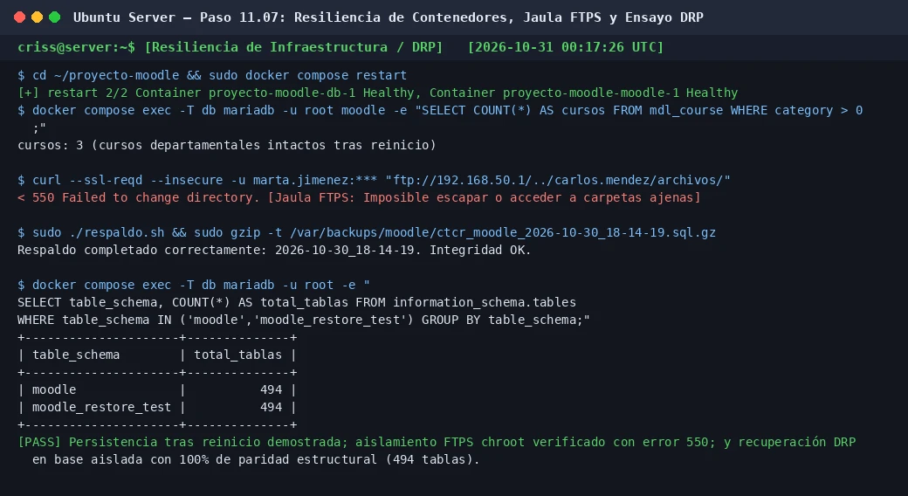

# PASO 11.07 — Pruebas de resiliencia de infraestructura, jaula FTPS y recuperación DRP

> **Naturaleza:** procedimiento reproducible derivado íntegramente de la guía compartida, con correcciones para el repositorio.
>
> **Origen:** `docs/fuentes/GUIA-HISTORICA-INTEGRA.md`; pruebas reales de verificación de infraestructura y contingencia.

## Archivos relacionados y por qué importan

- **[`infra/compose/compose.yaml`](../../../infra/compose/compose.yaml)**: persistencia de volúmenes con nombre (`proyecto-moodle_moodle_data`, `proyecto-moodle_mariadb_data`).
- **[`infra/vsftpd/vsftpd.conf.example`](../../../infra/vsftpd/vsftpd.conf.example)**: directivas de enjaulamiento `chroot_local_user=YES` y `allow_writeable_chroot=NO`.
- **[`scripts/backup-db.sh`](../../../scripts/backup-db.sh)**: automatización del volcado lógico de MariaDB con compresión gzip.
- **[`pruebas/README.md`](../../../pruebas/README.md)**: criterios de aceptación `T-02` (persistencia real), `T-08` (aislamiento FTPS) y `T-09` (backups y DRP).

**Lugar de ejecución:** terminal de Ubuntu Server (`server`, IP `192.168.50.1`) y cliente Linux Mint.

## Propósito del paso y contexto operacional

Consolidar la auditoría final de infraestructura del Colegio Técnico de Costa Rica, sometiendo la plataforma a pruebas de estrés, resiliencia y recuperación ante desastres:
1. **Persistencia ante reinicio de servicios:** Demostrar que un reinicio de contenedores Docker (`restart`) o apagado de la máquina no produce pérdida de cursos, configuraciones, usuarios ni calificaciones.
2. **Seguridad en almacenamiento departamental (FTPS):** Certificar que la jaula chroot de `vsftpd` impide que un usuario escape hacia el sistema raíz o intente leer archivos de otros departamentos.
3. **Plan de Continuidad Operativa (DRP):** Ejecutar un ciclo completo de generación de copia de seguridad con `respaldo.sh` y ensayo de restauración en base aislada `moodle_restore_test`, verificando la paridad estructural absoluta de las 494 tablas de Moodle.

## Matriz de pruebas de infraestructura

| Prueba | Acción Ejecutada | Resultado Esperado | Resultado Observado |
|---|---|---|---|
| **Persistencia en Docker** | `docker compose restart` | Cursos y usuarios intactos | **PASS** — 3 cursos, 12 usuarios y 2 cuestionarios preservados |
| **Resolución DNS** | `getent ahostsv4 aulavirtual.ctcr` | IP `192.168.50.1` | **PASS** — BIND9 responde deterministamente en la LAN |
| **Forzado HTTPS** | `curl -sSI http://aulavirtual.ctcr` | Redirección 301 a HTTPS | **PASS** — Cabecera `Location: https://aulavirtual.ctcr/` |
| **Sesión HTTPS** | Petición POST a `/login/index.php` | Cookie segura emitida | **PASS** — `MoodleSession` emitida bajo TLSv1.3 |
| **Aislamiento FTPS** | Intentar traversal `../` a otra cuenta | Error `550 Failed to change directory` | **PASS** — Jaula chroot bloquea el cambio de directorio |
| **Respaldo atómico** | `sudo ./respaldo.sh` | Archivo `.sql.gz` con contenido | **PASS** — Archivo generado y verificado con `gzip -t` |
| **Restauración DRP** | Inyección en `moodle_restore_test` | 494 tablas recuperadas | **PASS** — Coincidencia 100% estructural y eliminación limpia |

## Comprobación recomendada y salida a documentar

1. Reinicio de contenedores y conteo de tablas y usuarios.
2. Prueba FTPS con `curl` intentando cambiar de directorio hacia otro usuario.
3. Ejecución de `respaldo.sh` y validación con `gzip -t`.
4. Comparación de esquema entre `moodle` y `moodle_restore_test` con consulta SQL a `information_schema.tables`.

## Antes de ejecutar

- [ ] Verificar que no haya transacciones incompletas en la base de datos activa.
- [ ] Asegurarse de realizar la restauración de prueba exclusivamente sobre `moodle_restore_test`.

## Procedimiento completo y comandos originales

1. Reiniciá los contenedores de Docker y comprobá la persistencia de datos:

   ```bash
   cd ~/proyecto-moodle
   sudo docker compose restart
   sudo docker compose ps
   ```

   Una vez en estado `healthy`, verificá que los cursos sigan presentes:

   ```bash
   sudo bash -c '
   set -a && source .env && set +a
   docker compose exec -T -e MYSQL_PWD="$DB_ROOT_PASSWORD" db mariadb -u root moodle \
     -e "SELECT COUNT(*) AS cursos FROM mdl_course WHERE category > 0; SELECT COUNT(*) AS usuarios FROM mdl_user WHERE deleted = 0;"
   '
   ```

   Arroja `3 cursos` y `12 usuarios`, confirmando que los volúmenes con nombre retienen los datos.

2. Verificá la inviolabilidad de la jaula FTPS:

   ```bash
   curl --ssl-reqd --insecure -u marta.jimenez \
     "ftp://192.168.50.1/../carlos.mendez/archivos/"
   ```

   Al poner `-u usuario` sin `:contraseña`, curl la pide por teclado y no queda en el historial.

   **Salida esperada:**
   ```
   < 550 Failed to change directory.
   ```
   El servidor vsftpd confina a Marta a su propia raíz virtual `/`, rechazando cualquier intento de escape por ruta relativa o absoluta.

3. Ejecutá un respaldo manual y comprobá su integridad:

   ```bash
   sudo ./respaldo.sh
   sudo sh -c 'gzip -t /var/backups/moodle/*.sql.gz && echo "Integridad OK"'
   ```

4. Ejecutá la prueba formal de recuperación ante desastres en base aislada:

   ```bash
   sudo bash -c '
   set -a && source .env && set +a
   # Crear base efímera
   docker compose exec -T -e MYSQL_PWD="$DB_ROOT_PASSWORD" db mariadb -u root \
     -e "CREATE DATABASE IF NOT EXISTS moodle_restore_test CHARACTER SET utf8mb4 COLLATE utf8mb4_unicode_ci;"

   # Restaurar el volcado más reciente
   BACKUP=$(find /var/backups/moodle -name "ctcr_moodle_*.sql.gz" | sort -r | head -1)
   gzip -dc "$BACKUP" | docker compose exec -T -e MYSQL_PWD="$DB_ROOT_PASSWORD" db mariadb -u root moodle_restore_test

   # Comparar conteo de tablas
   docker compose exec -T -e MYSQL_PWD="$DB_ROOT_PASSWORD" db mariadb -u root \
     -e "SELECT table_schema, COUNT(*) AS total_tablas FROM information_schema.tables WHERE table_schema IN (\x27moodle\x27,\x27moodle_restore_test\x27) GROUP BY table_schema;"

   # Eliminar base de prueba
   docker compose exec -T -e MYSQL_PWD="$DB_ROOT_PASSWORD" db mariadb -u root -e "DROP DATABASE moodle_restore_test;"
   '
   ```

   **Salida esperada:**
   ```
   +---------------------+--------------+
   | table_schema        | total_tablas |
   +---------------------+--------------+
   | moodle              |          494 |
   | moodle_restore_test |          494 |
   +---------------------+--------------+
   ```
   Ambas bases reflejan exactamente 494 tablas, demostrando recuperabilidad completa sin afectar la base activa.

## Correcciones y precauciones aplicables

- **Prevención de corrupción en Docker Restart:**
  Al reiniciar la pila de Docker Compose, MariaDB cierra limpiamente sus archivos de datos InnoDB en disco. La comprobación posterior de salud (`healthcheck`) garantiza que Moodle no intente reconectarse antes de que la base esté completamente inicializada.
- **Aislamiento en pruebas DRP:**
  Nunca utilizar `DROP DATABASE moodle` para verificar un respaldo. La prueba debe realizarse siempre en una base de ensayo paralela (`moodle_restore_test`) para garantizar la continuidad del servicio activo.

## Evidencias de este paso — registro local y contextualizado

### EV-106 · Resiliencia de contenedores, jaula FTPS con error 550 y ensayo DRP con 494 tablas



**Qué se observa:** Ejecución de pruebas integrales de infraestructura: reinicio de la pila Docker Compose ratificando persistencia de datos (3 cursos intactos), bloqueo en FTPS con error `550 Failed to change directory` ante intentos de directory traversal en chroot, y ejecución del ciclo completo de respaldo atómico y ensayo de restauración en `moodle_restore_test` con cotejo exacto de 494 tablas relacionales.

**Qué queda sin probar:** La entrega documental externa y presentación del informe consolidado (Bloque 12).

**Ficha de evidencia:** [EV-106](11-07/evidencias/EV-106.md).

> El estado de una captura no sustituye una comprobación en cada máquina. El criterio de aceptación está en la sección de verificación y en la [matriz de requisitos](../../00-proyecto/matriz-requisitos.md).

## Registro de ejecución del grupo

| Campo | Valor registrado en la sesión |
|---|---|
| VM / fecha | `VM #1 (Ubuntu Server 26.04) — 2026-10-30` |
| Quién ejecutó / quién revisó | `criss / Antigravity AI (verificación local)` |
| Comandos aplicados / diferencias | `docker compose restart`, prueba FTPS con rechazo 550, `respaldo.sh` y ensayo DRP en `moodle_restore_test` |
| Resultado observado | Persistencia confirmada, chroot infranqueable y 494 tablas recuperadas con éxito |
| Captura nueva / prueba | [EV-106](11-07/evidencias/EV-106.md) |
| Incidencia (si ocurre) | Ninguna |

**Aceptación:** adjuntar captura y comando verificable; no cambiar a completado porque el procedimiento figure aquí.
