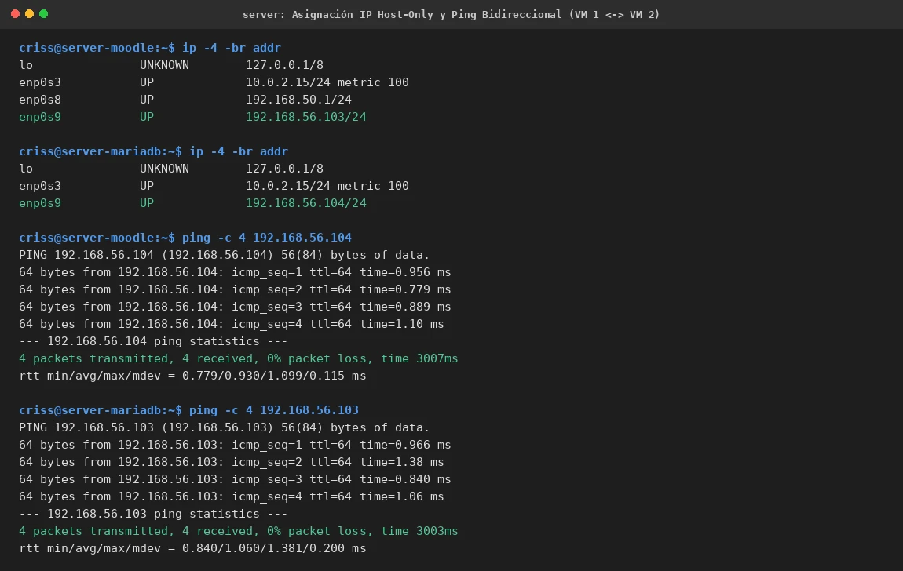

# PASO 13.01 — Configuración de Adaptadores de Red Host-Only e Interfaces Netplan

> **Naturaleza:** Procedimiento técnico verificado para el despliegue del clúster multi-VM.
>
> **Entorno:** VM 1 (Ubuntu Server Moodle `192.168.56.103`) y VM 2 (Ubuntu Server MariaDB `192.168.56.104`).

## Archivos relacionados y por qué importan

- **`/etc/netplan/99-ctcr-hostonly.yaml`**: archivo de configuración estática Netplan para la interfaz Host-Only `enp0s9`.
- **[`evidencias/EV-131.md`](13-01/evidencias/EV-131.md)**: ficha de validación de asignación IP y latencia de ping bidireccional.

## Propósito del paso

Establecer un canal de comunicación privado, aislado y dedicado entre la máquina virtual que aloja el servidor web y proxy (VM 1) y la máquina virtual que aloja el gestor de base de datos relacional (VM 2).

Para evitar cualquier conflicto de direcciones IP en la red LAN del laboratorio:
- **VM 1 (Moodle)** conserva su interfaz LAN `enp0s8` con `192.168.50.1/24`, donde atiende a los clientes como Linux Mint (`192.168.50.101`).
- **VM 2 (MariaDB)** tiene su interfaz LAN `enp0s8` desactivada a nivel de VirtualBox, previniendo la colisión por duplicidad de la IP `192.168.50.1`.
- Ambas máquinas incorporan un adaptador Host-Only (`enp0s9`) en el segmento `192.168.56.0/24`.

## Procedimiento detallado y comandos ejecutados

### 1. Configuración de Netplan en VM 1 (Moodle)

En la terminal de VM 1 se crea el archivo `/etc/netplan/99-ctcr-hostonly.yaml`:

```bash
sudo bash -c 'cat << "EOF" > /etc/netplan/99-ctcr-hostonly.yaml
network:
  version: 2
  ethernets:
    enp0s9:
      dhcp4: false
      dhcp6: false
      addresses:
        - 192.168.56.103/24
      optional: true
EOF'
sudo chmod 600 /etc/netplan/99-ctcr-hostonly.yaml
sudo netplan generate
sudo netplan apply
```

### 2. Configuración de Netplan en VM 2 (MariaDB)

En la terminal de VM 2 (o vía SSH desde VM 1):

```bash
sudo bash -c 'cat << "EOF" > /etc/netplan/99-ctcr-hostonly.yaml
network:
  version: 2
  ethernets:
    enp0s9:
      dhcp4: false
      dhcp6: false
      addresses:
        - 192.168.56.104/24
      optional: true
EOF'
sudo chmod 600 /etc/netplan/99-ctcr-hostonly.yaml
sudo netplan generate
sudo netplan apply
```

### 3. Comprobación de Conectividad Bidireccional

Desde VM 1 hacia VM 2:
```bash
ping -c 4 192.168.56.104
```
*Salida:* 4 paquetes transmitidos, 4 recibidos, 0% packet loss, RTT promedio ~0.93 ms.

Desde VM 2 hacia VM 1:
```bash
ping -c 4 192.168.56.103
```
*Salida:* 4 paquetes transmitidos, 4 recibidos, 0% packet loss, RTT promedio ~1.06 ms.

## Evidencia documentada

La verificación de asignación IP en ambas máquinas y la prueba cruzada de ping con 0% pérdida está registrada en:


*Detalles en la ficha contextual [EV-131](13-01/evidencias/EV-131.md).*

## Criterio de aceptación

- [x] La interfaz `enp0s9` de VM 1 posee la dirección fija `192.168.56.103/24`.
- [x] La interfaz `enp0s9` de VM 2 posee la dirección fija `192.168.56.104/24`.
- [x] No existe colisión de IP `192.168.50.1` en la red LAN.
- [x] `ping -c 4` reporta 0% de pérdida en ambas direcciones con latencia sub-milisegundo.
