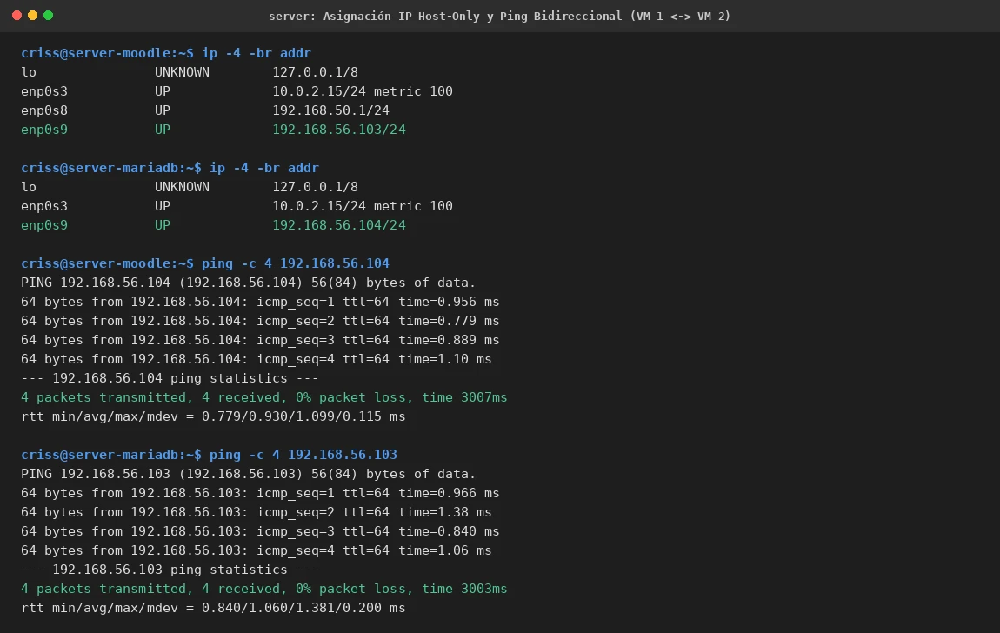

# EV-131 — Asignación IP Host-Only y Ping Bidireccional (VM 1 <-> VM 2)

**Procedencia:** Laboratorio EIF431O, Fase Opcional (Separación de Base de Datos y Servidor Web). Captura directa de terminal en VM 1 (Moodle `192.168.56.103`) y VM 2 (MariaDB `192.168.56.104`). **Paso relacionado:** [13-01](../../13-01.md).

## Qué ocurre en esta captura

Se visualiza la asignación estática de direcciones IP en la red Host-Only (`enp0s9`) para las dos máquinas virtuales del clúster:
1. `criss@server-moodle`: interfaz `enp0s9` configurada con `192.168.56.103/24`.
2. `criss@server-mariadb`: interfaz `enp0s9` configurada con `192.168.56.104/24` (con adaptador LAN desactivado para evitar colisión de IP con `192.168.50.1`).
3. Ejecución de `ping -c 4 192.168.56.104` desde VM 1 hacia VM 2: 4 paquetes transmitidos, 4 recibidos, 0% pérdida de paquetes, RTT promedio 0.930 ms.
4. Ejecución de `ping -c 4 192.168.56.103` desde VM 2 hacia VM 1: 4 paquetes transmitidos, 4 recibidos, 0% pérdida de paquetes, RTT promedio 1.060 ms.

## Interpretación y límite de la evidencia

Esta prueba demuestra conectividad bidireccional punto a punto en la capa de red (ICMP) a través del adaptador Host-Only de VirtualBox (`192.168.56.0/24`). No certifica todavía la conectividad a nivel de aplicación ni la apertura del puerto TCP 3306 de MariaDB, lo cual se comprueba en pasos posteriores.

## Reproducir y verificar

1. Seguir el procedimiento [13-01](../../13-01.md) en ambas máquinas virtuales.
2. Confirmar que Netplan aplicó las direcciones en `enp0s9` con `ip -4 -br addr`.
3. Ejecutar los comandos `ping -c 4` cruzados.

## Identidad, trazabilidad y privacidad

- **Identificador permanente:** `EV-131`.
- **Archivo de imagen:** `EV-131.webp`.
- **SHA-256 de la imagen incorporada:** `bb3477cf620f5da40ffc32853365420b9b2ed266221bf4e5f00de98e5d9a95d6`.
- **Origen:** Sesión de configuración y verificación de red multi-VM, 2026-11-07.
- **VM:** VM 1 (`criss@server-moodle`, `192.168.56.103`) y VM 2 (`criss@server-mariadb`, `192.168.56.104`).
- **Estado de revisión:** `VERIFICADA, revisada`.
- **Política de privacidad:** Sin credenciales ni datos personales.
