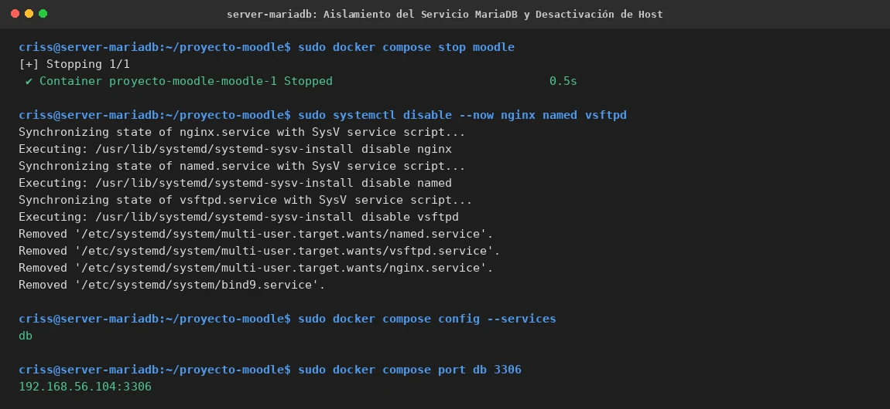
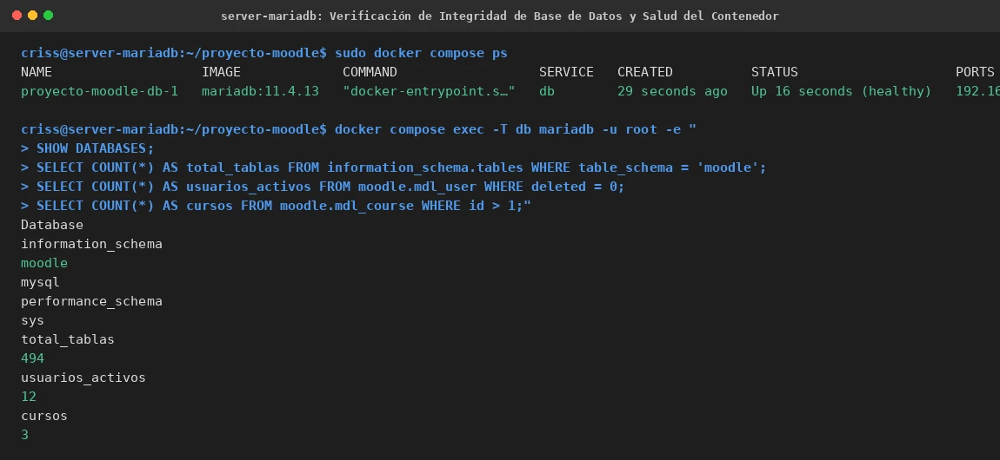

# PASO 13.02 — Preparación y Aislamiento de MariaDB en VM 2

> **Naturaleza:** Procedimiento técnico de aislamiento de servicios y verificación de datos en el Data Tier.
>
> **Entorno:** VM 2 (Ubuntu Server MariaDB `192.168.56.104`).

## Archivos relacionados y por qué importan

- **`/home/criss/proyecto-moodle/compose.yaml`**: definición de servicios Compose en VM 2, restringida al servicio `db` con puerto publicado exclusivo en la interfaz privada.
- **`/home/criss/proyecto-moodle/compose.antes-red.yaml`**: copia de seguridad del Compose original monolítico previa a la separación.
- **[`evidencias/EV-132.md`](13-02/evidencias/EV-132.md)**: ficha de aislamiento de Compose y deshabilitación de servicios no requeridos.
- **[`evidencias/EV-133.md`](13-02/evidencias/EV-133.md)**: ficha de auditoría de integridad de bases, tablas, cursos y usuarios.

## Propósito del paso

Transformar la máquina VM 2 en un servidor de base de datos dedicado y seguro para Moodle:
1. Desactivar el contenedor web de Moodle y los servicios de red de aplicación (`nginx`, `named`, `vsftpd`) en VM 2 para liberar CPU, memoria y superficie de ataque.
2. Modificar el archivo `compose.yaml` para publicar el puerto `3306` **únicamente** en la IP privada Host-Only `192.168.56.104:3306:3306`.
3. Levantar el servicio `db` enlazándolo a su volumen existente `mariadb_data` y comprobar que no se haya producido ninguna alteración ni pérdida de tablas o registros.

## Procedimiento detallado y comandos ejecutados

### 1. Detención de Moodle y Desactivación de Servicios en VM 2

En VM 2:
```bash
cd /home/criss/proyecto-moodle
sudo docker compose stop moodle
sudo systemctl disable --now nginx named vsftpd
```
*Cron se conserva activo* ya que en esta máquina se programará el respaldo SQL nocturno.

### 2. Modificación de Docker Compose en VM 2

Se resguarda la configuración original:
```bash
sudo cp -p compose.yaml compose.antes-red.yaml
```

Se edita `compose.yaml` para conservar íntegramente la configuración de `db` (imagen `mariadb:11.4.13`, variables de entorno, volumen persistente `mariadb_data`, healthcheck) y agregar la publicación de puerto restringida a la red Host-Only, eliminando la definición del servicio `moodle`:

```yaml
services:
  db:
    image: mariadb:11.4.13
    restart: unless-stopped

    ports:
      - "192.168.56.104:3306:3306"

    environment:
      MARIADB_ROOT_PASSWORD: ${DB_ROOT_PASSWORD}
      MARIADB_DATABASE: moodle
      MARIADB_USER: moodle
      MARIADB_PASSWORD: ${DB_PASSWORD}

    volumes:
      - mariadb_data:/var/lib/mysql

    healthcheck:
      test: ["CMD", "healthcheck.sh", "--connect", "--innodb_initialized"]
      interval: 10s
      timeout: 5s
      retries: 15

volumes:
  mariadb_data:
```

Comprobación de sintaxis y servicios:
```bash
sudo docker compose config -q
sudo docker compose config --services
```
*Resultado:* Únicamente `db`.

### 3. Puesta en Marcha y Verificación de Puerto

```bash
sudo docker compose up -d --no-deps db
sudo docker compose ps
sudo docker compose port db 3306
```
*Resultado observado:*
```
192.168.56.104:3306
```

### 4. Auditoría de Integridad de la Base de Datos

Se valida la consistencia relacional ejecutando consultas SQL dentro del contenedor:
```bash
docker compose exec -T db mariadb -u root -e "
SHOW DATABASES;
SELECT COUNT(*) AS total_tablas FROM information_schema.tables WHERE table_schema = 'moodle';
SELECT COUNT(*) AS usuarios_activos FROM moodle.mdl_user WHERE deleted = 0;
SELECT COUNT(*) AS cursos FROM moodle.mdl_course WHERE id > 1;
"
```
*Resultados:*
- Esquemas: `information_schema`, `moodle`, `mysql`, `performance_schema`, `sys`.
- Tablas en `moodle`: **494 tablas**.
- Usuarios activos: **12 usuarios**.
- Cursos departamentales: **3 cursos** (`CTCR-ADM-101`, `CTCR-DOC-101`, `CTCR-INF-101`).

## Evidencias documentadas

- **Aislamiento y mapeo de puerto:** [EV-132](13-02/evidencias/EV-132.md)
  

- **Integridad y salud de MariaDB:** [EV-133](13-02/evidencias/EV-133.md)
  

## Criterio de aceptación

- [x] El contenedor Moodle está detenido en VM 2.
- [x] `nginx`, `named` y `vsftpd` están deshabilitados e inactivos en VM 2.
- [x] El puerto `3306` se expone estrictamente en `192.168.56.104:3306`.
- [x] El contenedor `proyecto-moodle-db-1` alcanza el estado `healthy`.
- [x] Se conservan intactas las 494 tablas, 12 usuarios y 3 cursos.
