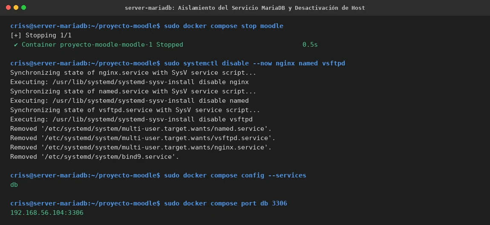

# EV-132 — Aislamiento del Servicio MariaDB y Desactivación de Host

**Procedencia:** Laboratorio EIF431O, Fase Opcional. Captura en VM 2 (MariaDB `192.168.56.104`). **Paso relacionado:** [13-02](../../13-02.md).

## Qué ocurre en esta captura

En VM 2 (`criss@server-mariadb`):
1. Detención del contenedor Moodle mediante `sudo docker compose stop moodle`.
2. Deshabilitación y detención de servicios de host no requeridos en la máquina de base de datos: `sudo systemctl disable --now nginx named vsftpd`.
3. Comprobación del servicio restante en Compose: `sudo docker compose config --services` muestra exclusivamente `db`.
4. Verificación de publicación de puerto: `sudo docker compose port db 3306` confirma el enlace estricto a `192.168.56.104:3306`.

## Interpretación y límite de la evidencia

Acredita que en VM 2 el rol de base de datos quedó aislado, liberando recursos al no ejecutar Moodle, Nginx, BIND9 ni vsftpd. El puerto 3306 está expuesto únicamente hacia la red privada Host-Only (`192.168.56.104`) y no hacia interfaces públicas. No certifica por sí sola la integridad de las tablas dentro del motor, lo que se analiza en EV-133.

## Reproducir y verificar

1. Seguir el procedimiento [13-02](../../13-02.md) en VM 2.
2. Comprobar que solo `db` aparece en `docker compose config --services`.
3. Verificar el mapeo con `docker compose port db 3306`.

## Identidad, trazabilidad y privacidad

- **Identificador permanente:** `EV-132`.
- **Archivo de imagen:** `EV-132.webp`.
- **SHA-256 de la imagen incorporada:** `f47dfa398e3073f8bf1a51c9e9d506aa95c51cfff6654fece355e845f1c703a0`.
- **Origen:** Sesión de aislamiento de servicios en VM 2, 2026-11-07.
- **VM:** VM 2 (`criss@server-mariadb`, `192.168.56.104`).
- **Estado de revisión:** `VERIFICADA, revisada`.
- **Política de privacidad:** Sin credenciales ni datos personales.
