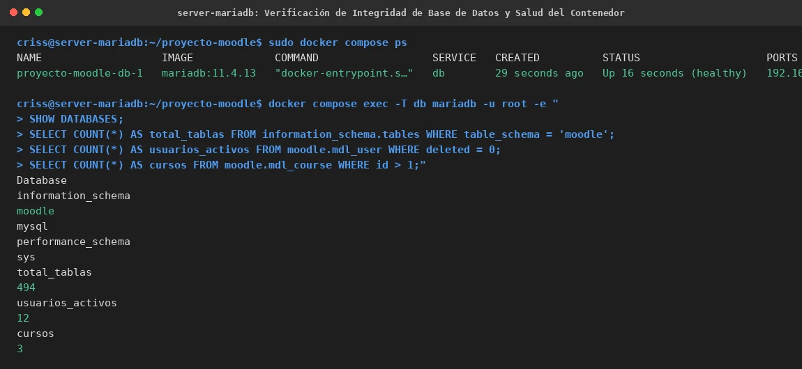

# EV-133 — Verificación de Integridad de Base de Datos y Salud del Contenedor

**Procedencia:** Laboratorio EIF431O, Fase Opcional. Captura en VM 2 (MariaDB `192.168.56.104`). **Paso relacionado:** [13-02](../../13-02.md).

## Qué ocurre en esta captura

En VM 2 (`criss@server-mariadb`):
1. Verificación del contenedor `proyecto-moodle-db-1` en estado `healthy` con puerto publicado `192.168.56.104:3306->3306/tcp`.
2. Ejecución de consultas SQL administrativas sobre el contenedor:
   - `SHOW DATABASES;`: confirmación de bases `information_schema`, `moodle`, `mysql`, `performance_schema`, `sys`.
   - Conteo de tablas en esquema `moodle`: **494 tablas**, coincidente 100% con la línea base preexistente.
   - Conteo de usuarios activos (`deleted = 0`): **12 usuarios**.
   - Conteo de cursos departamentales (`id > 1`): **3 cursos** (`CTCR-ADM-101`, `CTCR-DOC-101`, `CTCR-INF-101`).

## Interpretación y límite de la evidencia

Demuestra que la recreación del contenedor de MariaDB en VM 2 preservó de forma íntegra el volumen persistente `mariadb_data` sin pérdida ni alteración de datos. No garantiza aún que el contenedor Moodle en VM 1 pueda conectarse remotamente a través de la red Host-Only, lo cual se valida en EV-134.

## Reproducir y verificar

1. Seguir el procedimiento [13-02](../../13-02.md) en VM 2.
2. Ejecutar las consultas SQL de comprobación mediante `docker compose exec -T db mariadb`.

## Identidad, trazabilidad y privacidad

- **Identificador permanente:** `EV-133`.
- **Archivo de imagen:** `EV-133.webp`.
- **SHA-256 de la imagen incorporada:** `97e5bda1bfb1f55bfe6ab51220c9fe07e18cbfb8b9c831879721a60250079474`.
- **Origen:** Auditoría de integridad de base de datos en VM 2, 2026-11-07.
- **VM:** VM 2 (`criss@server-mariadb`, `192.168.56.104`).
- **Estado de revisión:** `VERIFICADA, revisada`.
- **Política de privacidad:** Contraseña inyectada de forma no interactiva sin exposición de credenciales.
